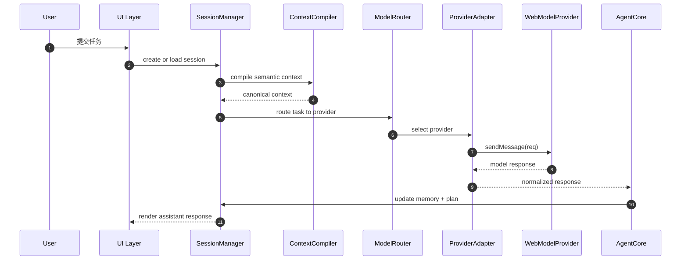
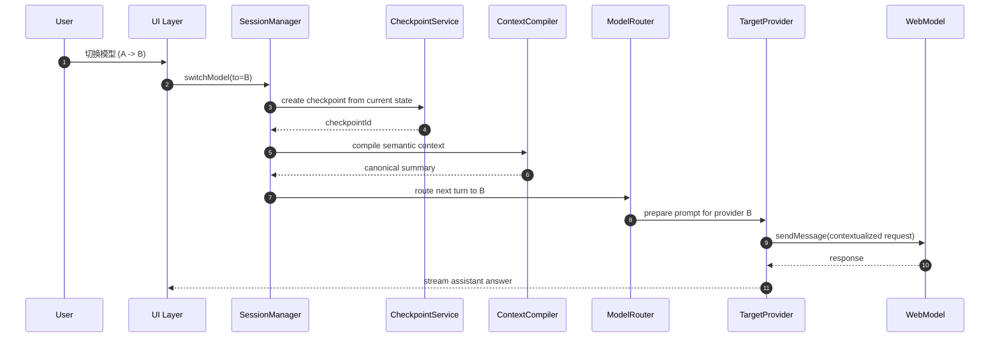
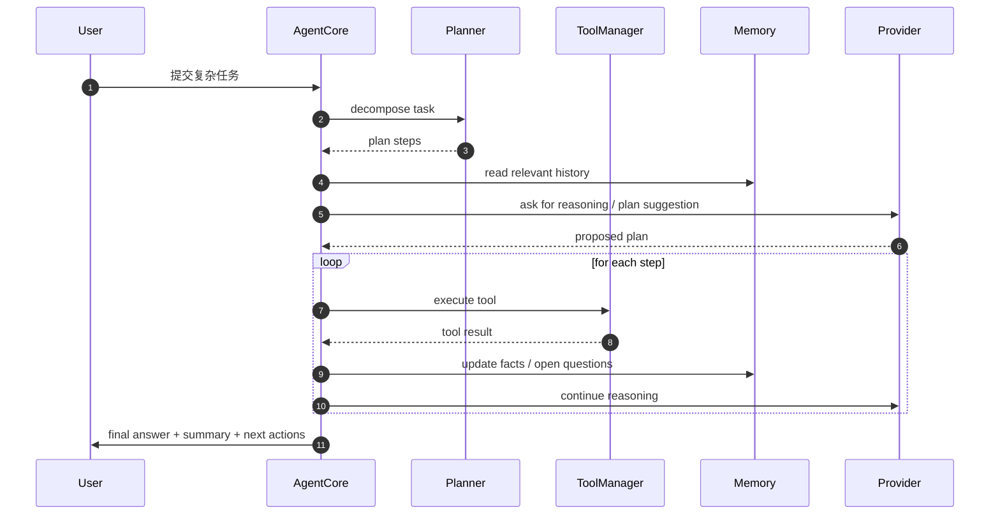
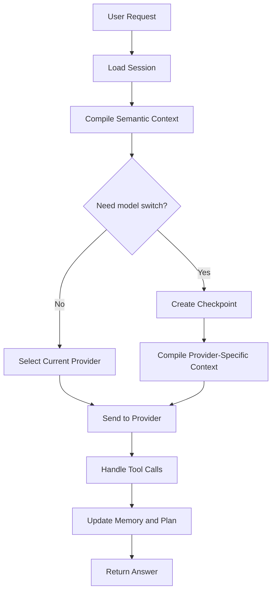
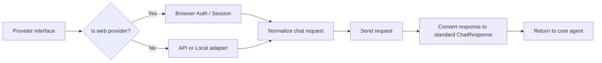
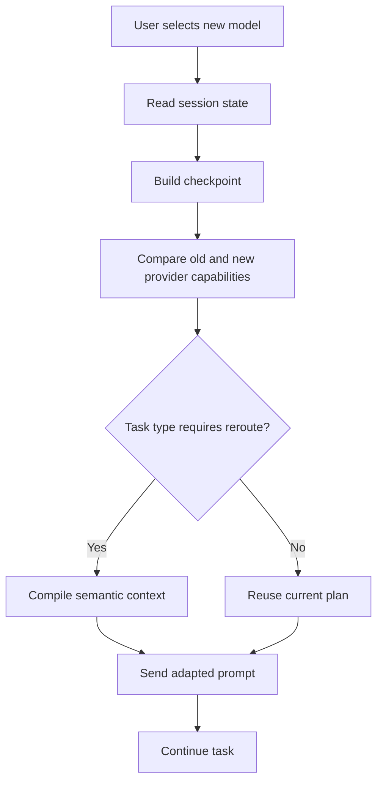

# DeepSeek ChatHub 详细代码设计规范（detail_design.md）

## 1. 文档目的

本文档在 `deepseek-chathub-design.md` 的基础上，给出一个以 DeepSeek Harness 为底座、参考 ChatHub 多模型接入思路的详细代码设计规范。

目标是：

- 以最小改动方式接入 DeepSeek Harness
- 支持多个免费网页模型（DeepSeek、Doubao、ChatGPT、Gemini 等）
- 在同一会话中切换模型时不丢失任务上下文、规划线索和思考过程
- 保持扩展性和低耦合，避免大规模重构
- 兼容 DeepSeek Harness 的插件化架构与工具调用流程

本设计重点落在“最小改动接口、最小改动接入层、扩展性的 model adapter 体系、会话连续性和多模型切换策略”上。

---

## 2. 总体设计目标

### 2.1 业务目标

实现一个“free-web-model AI agent”，具备如下能力：

- 统一入口：一个 Agent/Chat 会话承载多个模型
- 多模型自由切换：A 模型 -> B 模型，仍保留任务目标、计划、事实与推理状态
- 免费能力：以浏览器已登录的网页账号访问模型，避免付费 API token
- 复杂任务支持：支持代码分析、项目理解、调试、方案制定、执行验证
- 扩展性：增加新模型/新提供商无需重写主循环

### 2.2 技术目标

- 不对 DeepSeek Harness 主体架构做大改
- 只扩展 provider、session、memory、route、adapter 层
- 强制“统一语义上下文”与“模型适配输出”分离
- 保持主流程稳定：agent loop / tool loop / session manager 层几乎不改

---

## 3. 设计原则

### 3.1 最小改动原则

保持以下层次尽量不动：

- `dsh` core agent loop
- session state lifecycle
- tool registry
- capability orchestration

新增能力尽量通过：

- provider registry
- adapter layer
- middleware
- context compiler
- memory checkpoint

### 3.2 适配器优先原则

所有模型接入都必须实现统一接口，而不是侵入核心逻辑。核心逻辑永远依赖抽象接口：

```ts
interface IModelProvider {
  readonly id: string
  readonly kind: 'web' | 'api' | 'local'
  readonly name: string
  readonly capabilities: ModelCapabilities
  init(): Promise<void>
  isReady(): Promise<boolean>
  sendMessage(req: ChatRequest): Promise<ChatResponse>
  streamMessage(req: ChatRequest): AsyncIterable<ChatStreamChunk>
  switchSession?(sessionKey: string): Promise<void>
  close(): Promise<void>
}
```

### 3.3 语义上下文优先原则

区别于“直接丢 raw history 给新模型”，要求建立统一的“语义上下文对象”：

```ts
interface SemanticContext {
  objective: string
  plan: PlanStep[]
  facts: string[]
  openQuestions: string[]
  decisions: string[]
  workingMemory: string[]
  modelSwitchHistory: ModelSwitchRecord[]
  lastToolResults: ToolResultSummary[]
}
```

在模型切换时，由 `ContextCompiler` 生成目标模型可消费的 prompt，而不是最终用户看到的原始聊天记录。

---

## 4. 系统边界与模块划分

### 4.1 模块清单

```text
packages/
  core/
    session/
    agent/
    memory/
    planner/
  llm/
    provider/
    web/
    router/
  providers/
    deepseek-web/
    chatgpt-web/
    gemini-web/
    doubao-web/
    browser-auth/
  tool/
    repo/
    shell/
    browser/
    web-fetch/
  ui/
    chat/
    model-switch/
    session-state/
  plugins/
    context-compiler/
    model-switch-checkpoint/
    free-web-provider-registry/
```

### 4.2 核心模块说明

#### A. `session/`
负责会话与状态管理：

- 会话生命周期
- 当前目标
- 当前 provider
- message history
- model switch checkpoints

#### B. `agent/`
负责统一的 agent loop：

- think
- plan
- tool call
- reflect
- verify

#### C. `memory/`
负责长短记忆管理：

- short-term working memory
- long-term session memory
- cross-session profile memory

#### D. `planner/`
负责复杂任务拆解与重写。

#### E. `provider/`
定义模型 provider 抽象与 registry。

#### F. `web/`
负责 browser-based model integration，包含登录、会话池、健康检查。

#### G. `router/`
负责 route 选择：在什么任务上用什么模型。

#### H. `ui/`
前端界面层：模型切换器、任务视图、上下文概要。

---

## 5. 最小改动接入方案

### 5.1 接入思路

最小改动实现方式不是在 DeepSeek Harness 中直接假设“我只支持网页模型”，而是通过一个 Provider Adaptor 层做扩展：

- 不改 DeepSeek Harness 核心 agent loop
- 不改 session 事件总线接口
- 只新增 provider registry、web provider 实现、context compiler、model switch checkpoint

### 5.2 接入方式分层

```text
DeepSeek Harness Core
      ↓
      IModelProvider (standard interface)
      ↓
  WebModelProviderAdapter
      ├─ DeepSeekWebProvider
      ├─ DoubaoWebProvider
      ├─ ChatGPTWebProvider
      ├─ GeminiWebProvider
      └─ others...
```

### 5.3 最小改动的实现原则

- 核心 agent 对 provider 只认 `IModelProvider`
- 模型接入代码无需改动 `SessionManager` 结构
- 只增加 `providerId`、`providerMeta`、`checkpointId` 等字段即可
- 对已有 agent loop 只增加一个 `route` step，即“在请求前选择 provider”

---

## 6. 接口设计规范

## 6.1 Provider 抽象接口

```ts
export type ModelKind = 'web' | 'api' | 'local'

export interface ModelCapabilities {
  reasoning: boolean
  coding: boolean
  vision: boolean
  webAccess: boolean
  streaming: boolean
}

export interface ChatRequest {
  sessionId: string
  providerId: string
  messages: ChatMessage[]
  systemPrompt?: string
  taskContext?: SemanticContext
  metadata?: Record<string, unknown>
}

export interface ChatMessage {
  role: 'user' | 'assistant' | 'system' | 'tool'
  content: string
  name?: string
  timestamp?: number
  toolCallId?: string
}

export interface ChatResponse {
  providerId: string
  sessionId: string
  content: string
  usage?: {
    promptTokens?: number
    completionTokens?: number
    totalTokens?: number
  }
  finishReason?: 'stop' | 'length' | 'tool_calls' | 'error'
  metadata?: Record<string, unknown>
}

export interface ChatStreamChunk {
  index: number
  delta?: string
  content?: string
  finishReason?: string
  metadata?: Record<string, unknown>
}

export interface IModelProvider {
  readonly id: string
  readonly kind: ModelKind
  readonly name: string
  readonly capabilities: ModelCapabilities

  init(): Promise<void>
  isReady(): Promise<boolean>
  sendMessage(req: ChatRequest): Promise<ChatResponse>
  streamMessage(req: ChatRequest): AsyncIterable<ChatStreamChunk>
  switchSession?(sessionKey: string): Promise<void>
  close(): Promise<void>
}
```

### 6.2 Provider registry 接口

```ts
export interface IProviderRegistry {
  register(provider: IModelProvider): void
  get(providerId: string): IModelProvider | undefined
  list(): string[]
  getByKind(kind: ModelKind): IModelProvider[]
}
```

### 6.3 Session 接口扩展

```ts
export interface SessionRecord {
  id: string
  title: string
  createdAt: number
  updatedAt: number
  currentProvider: string
  providerHistory: string[]
  goal: string
  plan: PlanStep[]
  memory: MemoryEntry[]
  context: SemanticContext
  checkpoints: SessionCheckpoint[]
}
```

### 6.4 切换 checkpoint 接口

```ts
export interface SessionCheckpoint {
  id: string
  createdAt: number
  provider: string
  objective: string
  summary: string
  plan: PlanStep[]
  facts: string[]
  openQuestions: string[]
  memoryHighlights: string[]
  modelSwitchReason?: string
}
```

---

## 7. 统一流程规范

## 7.1 主流程：一次用户请求

```text
User Ask
  ↓
SessionRouter
  ↓
ContextCompiler
  ↓
ModelRouter
  ↓
ProviderAdapter.sendMessage
  ↓
ToolLoop / AgentLoop
  ↓
MemoryUpdate
  ↓
Checkpoint Commit
  ↓
Response Return
```

### 7.2 核心步骤说明

#### Step 1. `SessionRouter`

- 确定当前 session
- 读取当前 provider
- 读取上下文和记忆
- 判断是否需要进行 provider 切换

#### Step 2. `ContextCompiler`

- 抽取语义上下文
- 生成 canonical context
- 摘要行程：目标、事实、计划、未解决问题

#### Step 3. `ModelRouter`

- 决定 provider
- 根据任务类型进行路由：
  - coding -> reasoning provider
  - research -> web-capable provider
  - quick answer -> current provider

#### Step 4. `ProviderAdapter`

- 适配不同 provider 的 API / Web 交互方式
- 把统一 `ChatRequest` 转成目标 provider 格式

#### Step 5. `ToolLoop`

- optional tool calling
- code reading, search, shell, repo analysis

#### Step 6. `MemoryUpdate`

- 存储新事实和计划状态
- 更新长期记忆

#### Step 7. `Checkpoint Commit`

- 对重要节点生成 checkpoint
- 包含 plan/facts/open questions

---

## 8. 模型切换流程规范

## 8.1 切换流程

```text
User click model switch
  ↓
SessionManager: currentProvider = nextProvider
  ↓
ContextCompiler.compileSemanticContext(current session)
  ↓
CheckpointBuilder.generateCheckpoint()
  ↓
ProviderAdapter.preparePromptFor(nextProvider)
  ↓
Agent continues with same objective
```

### 8.2 关键规则

- 模型切换不清空 session
- 仅切换 current provider
- 若任务未完成，保留任务状态
- 生成新的 checkpoint，保留上下文摘要
- 切换前必须写入 `modelSwitchHistory`

### 8.3 交换上下文策略

#### 方案 A：完整任务摘要

用于短切换：

- objective
- plan
- open questions
- key facts
- last tool results

#### 方案 B：压缩版本

用于 token 受限场景：

- 任务目标
- 当前计划
- 最新事实
- 关键障碍
- 需要下一步行动

#### 方案 C：高细节版本

用于复杂代码分析：

- 仓库目标
- 关键文件路径
- 已尝试方案
- 当前失败点
- 需要由新模型继续的具体动作

---

## 9. 报文规范

## 9.1 ChatRequest 报文

```json
{
  "sessionId": "sess_001",
  "providerId": "deepseek-web",
  "messages": [
    { "role": "user", "content": "请分析这个仓库的根因" },
    { "role": "assistant", "content": "我先看目录和关键文件" }
  ],
  "systemPrompt": "你是一个项目分析型 agent",
  "taskContext": {
    "objective": "修复 build error",
    "plan": [
      { "id": "p1", "title": "定位报错", "status": "running" }
    ],
    "facts": ["project uses pnpm"],
    "openQuestions": ["build error is in frontend?"],
    "workingMemory": ["重点文件路径已定位"],
    "modelSwitchHistory": [
      { "from": "chatgpt-web", "to": "deepseek-web", "reason": "需要更强代码分析" }
    ]
  },
  "metadata": {
    "userId": "u_001",
    "taskType": "debug"
  }
}
```

### 9.2 ChatResponse 报文

```json
{
  "providerId": "deepseek-web",
  "sessionId": "sess_001",
  "content": "我已经定位到问题：配置文件中的路径拼接错误。下一步我会修正并验证。",
  "usage": {
    "promptTokens": 1200,
    "completionTokens": 320,
    "totalTokens": 1520
  },
  "finishReason": "stop",
  "metadata": {
    "thinkingSummary": "root cause identified",
    "planUpdated": true
  }
}
```

### 9.3 ModelSwitchRequest 报文

```json
{
  "sessionId": "sess_001",
  "fromProvider": "deepseek-web",
  "toProvider": "gemini-web",
  "reason": "需要更强的长文本和代码复述能力",
  "checkpointId": "cp_20261031_001",
  "contextSummary": {
    "objective": "修复 build error",
    "plan": ["定位报错", "修正路径", "验证测试"],
    "facts": ["当前错误集中在 build 阶段"],
    "openQuestions": ["是否还有第二个错误点"],
    "memoryHighlights": ["使用 pnpm 管理依赖"]
  }
}
```

### 9.4 Provider 适配层内部报文

```json
{
  "provider": "deepseek-web",
  "messageType": "chat",
  "payload": {
    "conversation": [
      { "role": "user", "content": "..." }
    ],
    "system": "...",
    "meta": {
      "origin": "semantic-context"
    }
  }
}
```

---

## 10. 序列图设计

## 10.1 普通单模型交互序列图



## 10.2 模型切换并保留上下文序列图



## 10.3 Agent 长任务执行序列图



---

## 11. 流程图设计

## 11.1 总体流程图



## 11.2 Provider 接入流程图



## 11.3 模型切换诊断流程图



---

## 12. 代码层设计规范

## 12.1 接口层规范

所有 provider 必须实现以下接口：

```ts
export interface IModelProvider {
  readonly id: string
  readonly name: string
  readonly kind: 'web' | 'api' | 'local'
  readonly capabilities: ModelCapabilities

  init(): Promise<void>
  isReady(): Promise<boolean>
  sendMessage(req: ChatRequest): Promise<ChatResponse>
  streamMessage(req: ChatRequest): AsyncIterable<ChatStreamChunk>
  switchSession?(sessionKey: string): Promise<void>
  close(): Promise<void>
}
```

### 约束要求

- 不能在 provider 里直接访问 session store
- 不能直接改主 agent loop 的状态
- 不能破坏 `ChatRequest`/`ChatResponse` 统一格式
- 必须通过 adapter 层返回标准化响应

## 12.2 Registry 设计

```ts
export class ProviderRegistry implements IProviderRegistry {
  private providers = new Map<string, IModelProvider>()

  register(provider: IModelProvider): void {
    this.providers.set(provider.id, provider)
  }

  get(providerId: string): IModelProvider | undefined {
    return this.providers.get(providerId)
  }

  list(): string[] {
    return [...this.providers.keys()]
  }
}
```

### 设计要求

- provider 按 `id` 注册
- 单例模式最好
- 必须支持动态注册/卸载
- 支持 provider health check

## 12.3 ContextCompiler 设计

```ts
export interface IContextCompiler {
  compile(session: SessionRecord, providerId: string): SemanticContext
  createPrompt(context: SemanticContext, providerId: string): string
}
```

### 职责

- 从 session 提取当前任务状态
- 生成统一的 semantic context
- 将 generic context 转成 provider-specific prompt 模板

### 关键约束

- 保持 provider 无关
- 不能把 provider 实现塞进 core logic

---

## 13. 模型适配器设计

## 13.1 web provider 设计模板

```ts
export abstract class AbstractWebModelProvider implements IModelProvider {
  abstract readonly id: string
  abstract readonly name: string
  abstract readonly kind: 'web'
  abstract readonly capabilities: ModelCapabilities

  protected sessionHandle?: unknown

  async init(): Promise<void> {
    // auth / browser connection / session bootstrap
  }

  async isReady(): Promise<boolean> {
    return !!this.sessionHandle
  }

  async sendMessage(req: ChatRequest): Promise<ChatResponse> {
    const payload = this.normalizeRequest(req)
    const raw = await this.doSend(payload)
    return this.normalizeResponse(raw, req.sessionId, this.id)
  }

  abstract normalizeRequest(req: ChatRequest): unknown
  abstract doSend(payload: unknown): Promise<unknown>
  abstract normalizeResponse(raw: unknown, sessionId: string, providerId: string): ChatResponse

  async close(): Promise<void> {
    // cleanup session
  }
}
```

### 13.2 每个 provider 的最小实现

每个 provider 都需要实现：

- `id`
- `name`
- `kind`
- `capabilities`
- `normalizeRequest`
- `doSend`
- `normalizeResponse`
- `switchSession`（可选）

### 13.3 适配层最小范式

```ts
export const providerAdapters = {
  'deepseek-web': DeepSeekWebProvider,
  'doubao-web': DoubaoWebProvider,
  'chatgpt-web': ChatGPTWebProvider,
  'gemini-web': GeminiWebProvider,
}
```

This allows a new model to be added by implementing one adapter and registering it.

---

## 14. 状态管理规范

### 14.1 Session 状态

```ts
export interface SessionRuntimeState {
  sessionId: string
  currentProvider: string
  activeGoal: string
  status: 'idle' | 'thinking' | 'tool-running' | 'waiting' | 'done'
  latestCheckpointId?: string
  lastError?: string
}
```

### 14.2 切换时的状态更新

- `currentProvider` 更新
- `providerHistory.push` 更新
- checkpoint 写入
- `status` 置为 `thinking`
- 保留 `activeGoal`

### 14.3 Abort / retry 语义

- 若 provider current call fails，则根据 `fallbackPolicy` 选择 fallback provider
- 若 fallback 触发，必须保留 checkpoint
- 本次失败应记录在 `session memory` 中

---

## 15. 安全与权限规范

### 15.1 登录安全

- 所有 web auth tokens / cookies 仅保存在用户本地或受控浏览器环境中
- 不把免费网页模型账号直接托管到后端存储
- 若采用嵌入浏览器，则必须隔离 provider session

### 15.2 访问控制

- 需要支持用户手动管理 provider 连接状态
- 支持 revoke / disconnect / reconnect
- default: per session provider access only

### 15.3 安全面要求

- 不在日志中明文输出 cookies / access tokens
- 所有 provider 相关错误进行结构化脱敏

---

## 16. 测试案例设计

## 16.1 测试目标

1. 验证 provider 接入的兼容性
2. 验证模型切换不会丢失上下文
3. 验证长任务下 planning 和 memory 正常工作
4. 验证错误 fallback 机制
5. 验证 UI/Session 接口稳定

## 16.2 单元测试

### UT-01: 正常 provider 注册

**输入：** `deepseek-web` provider

**预期：** registry 能正常注册，`list()` 可见 provider id

### UT-02: provider 接口实现 completeness

**输入：** 各 provider class

**预期：** 所有 provider 具备 `init()`, `sendMessage()`, `normalizeResponse()` 等关键方法

### UT-03: ContextCompiler 生成 semantic context

**输入：** 一个存在计划、事实、问题的 session

**预期：** 输出结构中包含：objective / plan / facts / openQuestions / memoryHighlights

### UT-04: model switch checkpoint generation

**输入：** 当前任务处于 `running` 状态，切换到另一个 provider

**预期：** 生成 checkpoint 带有 `plan`, `facts`, `openQuestions`

### UT-05: fallback decision

**输入：** 当前 provider 不可用，fallback provider 存在

**预期：** 自动路由到备用 provider

## 16.3 集成测试

### IT-01: DeepSeek -> Gemini model switch

**步骤：**

1. 发起任务
2. 使用 DeepSeek provider
3. 切换到 Gemini
4. 继续同一任务

**预期：**

- 任务目标保留
- 计划保留
- 已完成事实保留
- 不需要重新提出整段需求

### IT-02: DeepSeek -> Doubao -> ChatGPT

**预期：**

- provider history 记录完整
- context compiler 可根据 provider 生成不同 prompt 风格
- session 目标保持一致

### IT-03: 多轮复杂任务测试

**输入：** 复杂 project debug / repo analysis

**预期：**

- planner 生成子任务
- memory 存储 facts
- tool outputs 被使用在下一轮 reasoning 中

## 16.4 E2E 测试

### E2E-01: 用户切换模型后依然继续任务

**场景：** 用户发起 “修复 repo build issue”，先用 DeepSeek，再切到 ChatGPT

**预期：**

- UI 仍显示同一 session
- 任务标题不变
- context summary 保持一致
- 不重置任务

### E2E-02: 提供商连接失败

**场景：** DeepSeek web session expired

**预期：**

- app 提示 reconnect
- 自动 fallback 或手动切换 provider
- current task not lost

### E2E-03: 长任务记忆保留

**场景：** 处理一个大型项目的修复需求，跨多个模型和多轮对话

**预期：**

- memory 中保留事实和计划
- agent 能继续前一个步骤
- 不重走已有调查过程

---

## 17. 公共错误与处理规范

### 17.1 Provider 不可用

**现象：** `isReady() === false`

**处理：**

- 标记 provider health failed
- 记录到 session memory
- 若 fallback available，则转到 fallback
- 否则显示 user message: “当前模型连接不可用，请重新登录或切换模型”

### 17.2 长文本超出 provider 限制

**处理：**

- 使用 summary + selected context
- 调整 `ContextCompiler` 级别
- 对长任务进行 plan compaction

### 17.3 Context loss

**处理：**

- 强制 checkpoint before switch
- 不允许直接清空 session
- 每次切换时生成 `semantic context` snapshot

---

## 18. 最小可行版本设计（MVP）

为了减少实现风险，建议 MVP 仅包含：

### MVP-1

- 1 个 DeepSeek Harness agent session
- 1 个 `IModelProvider` adapter contract
- 2 个 provider 实现：`deepseek-web`, `chatgpt-web`
- 1 个 `ContextCompiler`
- 1 个 checkpoint service
- 1 个 model switch UI

### MVP-2

- add `gemini-web` and `doubao-web`
- add fallback behavior
- add `memory summaries`

### MVP-3

- add planner and repo tools
- add full multi-provider router
- add persistent session store

---

## 19. 推荐命名规范

为了保证工程一致性，建议以下命名规范：

- provider id: `deepseek-web`, `chatgpt-web`, `gemini-web`, `doubao-web`
- session id: `sess_yyyyMMdd_xxx`
- checkpoint id: `cp_yyyyMMdd_xxx`
- route class: `ModelRouter`
- compiler class: `ContextCompiler`
- registry: `ProviderRegistry`
- memory service: `SessionMemoryService`

---

## 20. 总结

本设计以 DeepSeek Harness 为底座，把 ChatHub 的“多模型统一聊天”和“切换模型不丢上下文”的核心能力抽象为：

- provider adapter
- canonical context compiler
- model switch checkpoint
- session memory and planner

这样可以在“最小改动”的前提下，完成：

- 免费网页模型接入
- 模型切换不丢思路
- 长任务规划支持
- 大型项目处理能力
- 多模型扩展性支持

最终目标是让 DeepSeek Harness 具备“真正的多模型免费 AI Agent”特性，而不是仅仅成为一个聊天入口。

---

## 21. 附录：推荐工程目录（最简可行）

```text
src/
  core/
    agent/
    session/
    planner/
    memory/
  llm/
    provider/
    registry/
    router/
  providers/
    deepseek-web/
    chatgpt-web/
    gemini-web/
    doubao-web/
  context/
    compiler/
    checkpoint/
  ui/
    chat/
    model-switch/
  types/
    chat.ts
    context.ts
    provider.ts
    session.ts
```

以上目录足够支撑 MVP，且保持与 DeepSeek Harness 现有架构方向一致。

---

## 22. 建议实施顺序

1. 完成 `IModelProvider` 抽象与 `ProviderRegistry`
2. 实现 `DeepSeekWebProvider` 与 `ChatGPTWebProvider`
3. 建立 `ContextCompiler` 与 `SessionCheckpoint`
4. 实现 model switch flow
5. 接着加入 `GeminiWebProvider` 与 `DoubaoWebProvider`
6. 最后扩展 `Planner` 和 `Memory` 处理长任务

这样可以确保最小实现风险，尽快落地可用版本。

---

本设计文档适合作为后续代码开发、接口评审和测试设计的基础，后续可进一步拆分成：

- `provider-interface.ts`
- `session-state.ts`
- `context-compiler.ts`
- `model-router.ts`
- `provider-registry.ts`
- `checkpoint.ts`
- `tests/*.spec.ts`

作为真实开发落地的代码文件。
