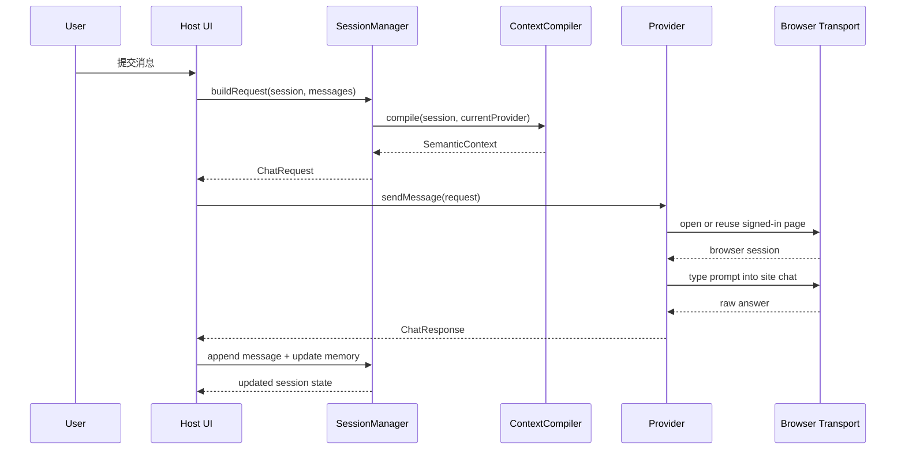
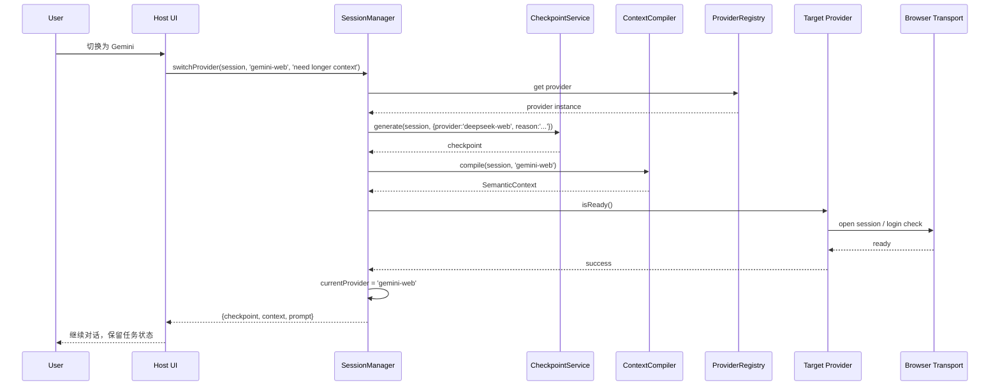
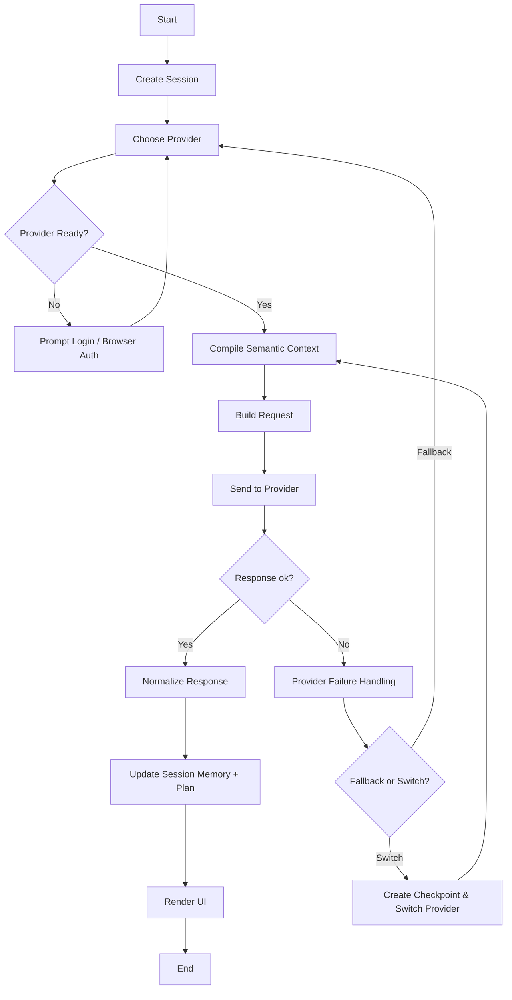

# Detail Design: DeepSeek Harness + ChatHub-inspired Multi-Model Agent

## 1. 背景与目标

本设计目标是在不大改现有 DeepSeek Harness 代码结构的前提下，构建一个“可切换多模型、可保持上下文、无需付费 API token、支持 agent 工作流”的 AI 助手。

设计要求：
1. 可接入网页端 AI 模型，例如：
   - https://chat.deepseek.com/
   - https://www.doubao.com/chat
   - https://chatgpt.com/
   - https://gemini.google.com/app
   - 以及其他 browser-authenticated model portals
2. 允许在同一会话中从模型 A 切换到模型 B，不丢失任务上下文与思考线索
3. 不需要调用官方 API key / token
4. 尽量保持原有 DeepSeek Harness 代码结构稳定，增量扩展
5. 扩展性强，后续可加入更多 web provider、memory backend、tool chain

## 2. 设计原则

### 2.1 以 agent runtime 为核心，不做单纯聊天壳
系统不是“ChatHub UI clone”，而是：
- DeepSeek Harness 负责 agent loop、session 管理、memory、planner、tool calling
- ChatHub 负责统一多模型 UX 和 provider router
- browser-backed provider 负责接入站内已登录的模型网站

### 2.2 Canonical Context 优先于 raw transcript
不能简单把上一个模型的 chat history 直接喂给下一个模型。需要维护统一的“任务语义状态”：
- objective
- plan
- facts
- decisions
- open questions
- working memory
- model switch history
- tool results

### 2.3 最小改动原则
不要直接改动大面积的原有 DeepSeek Harness runtime，而是在其外围增加：
- provider registry
- provider adapter abstraction
- session checkpoint
- context compiler
- model router
- browser transport seam

### 2.4 扩展性优先
后续添加 provider 时，只需实现一组标准接口，不需要改核心 runtime。

## 3. 总体架构

```text
┌─────────────────────────────────────────────────────────────┐
│                        UI / Host Layer                      │
│ - model selector                                           │
│ - session list / chat panels                               │
│ - task plan view                                           │
│ - provider login status                                     │
└───────────────────────────────┬─────────────────────────────┘
                                │
                                v
┌─────────────────────────────────────────────────────────────┐
│               DeepSeek Harness Runtime Core                 │
│ - SessionManager                                           │
│ - AgentLoop / Planner                                      │
│ - Memory / ContextCompiler                                  │
│ - ToolRegistry                                             │
│ - CheckpointService                                        │
│ - ModelRouter                                              │
└───────────────────────────────┬─────────────────────────────┘
                                │
            ┌───────────────────┼────────────────────┐
            │                   │                    │
            v                   v                    v
┌──────────────────┐  ┌──────────────────┐  ┌──────────────────┐
│ Web Providers   │  │ Local/API        │  │ Tooling/Plugins  │
│ - DeepSeek Web  │  │ Providers       │  │ - repo tools     │
│ - Doubao Web    │  │ - OpenAI API    │  │ - shell          │
│ - ChatGPT Web   │  │ - qwen API      │  │ - browser        │
│ - Gemini Web    │  │ - custom API    │  │ - git            │
│ - Claude Web    │  │ ...             │  │ - memory store   │
└──────────────────┘  └──────────────────┘  └──────────────────┘
```

## 4. 模块设计与总体实现结论

### 4.1 目录结构建议

```text
packages/
  experimental/
    chathub/
      src/
        types.ts
        errors.ts
        ids.ts
        provider-registry.ts
        session-memory.ts
        context-compiler.ts
        checkpoint.ts
        session-manager.ts
        model-router.ts
        providers/
          web-provider.ts
          deepseek-web.ts
          chatgpt-web.ts
          gemini-web.ts
          doubao-web.ts
          adapters.ts
```

### 4.2 设计目标分层
- `types.ts`：统一抽象类型
- `provider-registry.ts`：provider 注册/查询/健康检查
- `web-provider.ts`：浏览器 web provider 抽象基类
- `context-compiler.ts`：canonical context -> prompt
- `checkpoint.ts`：switch 前快照
- `session-manager.ts`：session 生命周期 + provider 切换
- `model-router.ts`：根据任务类型选择 provider
- `session-memory.ts`：plan / memory / fact 提炼
- `providers/*.ts`：真实 website adapter

### 4.3 模块职责

#### 4.3.1 Runtime core
DeepSeek Harness 是主脑，承担：
- agent loop
- task planning
- session lifecycle
- memory/reasoning state management
- tool orchestration
- long-running project work

#### 4.3.2 ChatHub-like UX layer
负责统一体验：
- model selector
- provider switching
- chat session
- provider health / auth state
- multi-model conversation aliasing

#### 4.3.3 Browser provider adapters
负责真实站点接入：
- DeepSeek Chat
- Doubao Chat
- ChatGPT Web
- Gemini Web
- 其他 browser-authenticated web portals

这些 provider 不负责业务 session 语义，仅负责：
- 登录态检查
- prompt render
- 发送/接收消息
- stream/delta adaptation
- site-specific failures

### 4.4 总体实现结论

最终建议的实现思路是：

- 保持 deepseek-harness 作为核心 agent runtime
- 增强 ChatHub-style provider routing 与 model switching UX
- 为 browser model providers 设计统一抽象层
- 通过 semantic context + checkpoint + memory 实现跨模型思维连续性
- 只在最小范围内扩展，以减少代码改动和维护成本

这个方案满足：
- 免费访问 web LLM
- model switch 不丢上下文
- no paid API token
- low churn / extensible
- suitable for complex coding/agent tasks

也就是说，如果目标是“复杂任务 AI Agent + 多模型切换 + 无 API 费用 + 扩展性 + 最少侵入现有架构”，那么正确的路线不是“简单 fork ChatHub”，而是：

“DeepSeek Harness 为脑，ChatHub 为 UX，browser-backed providers 为接入层，canonical session context 为连续性层。”

这正是符合当前 deepseek-harness 的扩展模式，也最符合你提出的 4 条核心需求：
1. 可访问网页模型
2. 切换模型不丢思考线索
3. 无需付费 token
4. 最小代码改动且可扩展

## 5. 最小改动接口规范

下面是“最小改动”版本的接口层，尽量保持与当前 deepseek-harness 的 experimental chathub 结构一致，并兼容后续扩展。

### 5.1 通用 provider 抽象

```ts
export type ModelKind = 'web' | 'api' | 'local'

export interface ModelCapabilities {
  reasoning: boolean
  coding: boolean
  vision: boolean
  webAccess: boolean
  streaming: boolean
}

export type ChatRole = 'user' | 'assistant' | 'system' | 'tool'

export interface ChatMessage {
  role: ChatRole
  content: string
  name?: string
  timestamp?: number
  toolCallId?: string
}

export interface ChatRequest {
  sessionId: string
  providerId: string
  messages: ChatMessage[]
  systemPrompt?: string
  taskContext?: SemanticContext
  metadata?: Record<string, unknown>
}

export interface ChatUsage {
  promptTokens?: number
  completionTokens?: number
  totalTokens?: number
}

export type ChatFinishReason = 'stop' | 'length' | 'tool_calls' | 'error'

export interface ChatResponse {
  providerId: string
  sessionId: string
  content: string
  usage?: ChatUsage
  finishReason?: ChatFinishReason
  metadata?: Record<string, unknown>
}

export interface ChatStreamChunk {
  index: number
  delta?: string
  content?: string
  finishReason?: string
  metadata?: Record<string, unknown>
}

export interface IModelProvider {
  readonly id: string
  readonly kind: ModelKind
  readonly name: string
  readonly capabilities: ModelCapabilities

  init(): Promise<void>
  isReady(): Promise<boolean>
  sendMessage(request: ChatRequest): Promise<ChatResponse>
  streamMessage(request: ChatRequest): AsyncIterable<ChatStreamChunk>
  switchSession?(sessionKey: string): Promise<void>
  close(): Promise<void>
}

export interface IProviderRegistry {
  register(provider: IModelProvider): void
  get(providerId: string): IModelProvider | undefined
  list(): string[]
  getByKind(kind: ModelKind): IModelProvider[]
}
```

### 5.2 Browser provider seam

```ts
export interface WebChatTransportSession {
  send(payload: WebChatPayload): Promise<WebChatRawResponse>
  stream?: (payload: WebChatPayload) => AsyncIterable<string>
  close(): Promise<void>
}

export interface WebChatTransport {
  open(providerId: string, sessionKey?: string): Promise<WebChatTransportSession | undefined>
}

export abstract class WebModelProvider implements IModelProvider {
  abstract readonly id: string
  abstract readonly name: string
  readonly kind: ModelKind = 'web'
  abstract readonly capabilities: ModelCapabilities
  protected abstract readonly promptStyle: WebPromptStyle

  protected readonly transport: WebChatTransport
  constructor(transport: WebChatTransport) {
    this.transport = transport
  }

  abstract init(): Promise<void>
  abstract isReady(): Promise<boolean>
  abstract sendMessage(request: ChatRequest): Promise<ChatResponse>
  abstract streamMessage(request: ChatRequest): AsyncIterable<ChatStreamChunk>
  abstract close(): Promise<void>
}
```

### 5.3 Semantic Context

```ts
export interface PlanStep {
  id: string
  title: string
  status: 'pending' | 'running' | 'done' | 'blocked'
  parentId?: string
  summary: string
  evidence: string[]
}

export interface ModelSwitchRecord {
  from: string
  to: string
  timestamp: number
  checkpointId: string
  reason: string
}

export interface ToolResultSummary {
  toolCallId: string
  name: string
  summary: string
  createdAt: number
}

export interface SemanticContext {
  objective: string
  plan: PlanStep[]
  facts: string[]
  openQuestions: string[]
  decisions: string[]
  workingMemory: string[]
  modelSwitchHistory: ModelSwitchRecord[]
  lastToolResults: ToolResultSummary[]
}
```

### 5.4 Session 与 Checkpoint

```ts
export interface SessionCheckpoint {
  id: string
  createdAt: number
  provider: string
  objective: string
  summary: string
  plan: PlanStep[]
  facts: string[]
  openQuestions: string[]
  memoryHighlights: string[]
  modelSwitchReason?: string
}

export interface ChatSessionRecord {
  id: string
  title: string
  createdAt: number
  updatedAt: number
  currentProvider: string
  providerHistory: string[]
  goal: string
  plan: PlanStep[]
  memory: MemoryEntry[]
  context: SemanticContext
  checkpoints: SessionCheckpoint[]
}
```

### 5.5 Provider 接口最小实现要求

每个 provider 仅需要实现：
- `id`
- `name`
- `capabilities`
- `promptStyle`
- `init` / `isReady`
- `sendMessage`
- `streamMessage`
- `switchSession`（可选）
- `close`

不需要重写 session runtime。

## 6. 模型接入规范

### 6.1 设计目标
不同模型以统一入口注册，外部通过 `providerId` 选择。

```ts
const registry = new ProviderRegistry()
registry.register(new DeepSeekWebProvider(transport))
registry.register(new ChatGptWebProvider(transport))
registry.register(new GeminiWebProvider(transport))
registry.register(new DoubaoWebProvider(transport))
```

### 6.2 接入新模型的最小步骤
新增 web provider 时，只需：

1. 继承 `WebModelProvider`
2. 实现：
   - `id`
   - `name`
   - `capabilities`
   - `promptStyle`
3. 通过 registry 进行注册
4. 如果有特殊站点登录/会话行为，实现在 transport 层，不污染 runtime
5. 通过 `ContextCompiler` 提供 provider-specific prompt stylesheet

示例：

```ts
export class DoubaoWebProvider extends WebModelProvider {
  readonly id = 'doubao-web'
  readonly name = 'Doubao'
  readonly capabilities = {
    reasoning: true,
    coding: true,
    vision: false,
    webAccess: true,
    streaming: true,
  }
  protected readonly promptStyle = { heading: 'Task and constraints' }
}
```

### 6.3 Provider 能力映射（推荐）
```ts
type ProviderProfile = {
  id: string
  kind: 'web' | 'api'
  reasoning: boolean
  coding: boolean
  vision: boolean
  webAccess: boolean
  preferredTask: 'general' | 'coding' | 'research' | 'reasoning'
}
```

用于 router 决策。

## 7. 运行流程规范

### 7.1 创建 session
```ts
const session = manager.create({
  title: '修复构建错误',
  goal: '定位并修复 npm build 失败问题',
  provider: 'deepseek-web',
})
```

### 7.2 发送用户消息
```ts
const request = manager.buildRequest(session, {
  messages: [
    { role: 'user', content: '请检查仓库中的 build error，并给出修复方案' }
  ],
})
const response = await provider.sendMessage(request)
```

### 7.3 模型切换前保存 checkpoint
```ts
const switchOutcome = await manager.switchProvider(
  session,
  'chatgpt-web',
  '需要更长上下文的重构分析'
)
```

#### 切换时执行顺序
1. 验证 target provider 已注册
2. 验证 target provider ready
3. 生成 checkpoint
4. 编译 canonical context for target provider
5. 拼装 prompt
6. 更新 session.currentProvider
7. 记录 switch history
8. 返回 checkpoint + prompt

### 7.4 不丢失上下文的关键要求
切换模型时，不要直接将上一轮 raw messages 复制给新 model，而是：
- 产出 canonical objective
- 保留 plan steps
- 保存 facts / blockers / decisions
- 生成 memoryHighlights
- 将这些内容转换为新 provider 的 prompt 结构

## 8. 报文规范

### 8.1 内部请求报文
客户端/host -> runtime

```json
{
  "sessionId": "sess_001",
  "providerId": "deepseek-web",
  "messages": [
    { "role": "user", "content": "请分析该 repo 的构建失败原因" }
  ],
  "systemPrompt": "你是代码助手。优先修复真实根因，并保持任务计划。",
  "taskContext": {
    "objective": "修复构建失败",
    "plan": [
      { "id": "p1", "title": "定位失败点", "status": "running", "summary": "检查 CI 报错", "evidence": ["build log"] }
    ],
    "facts": ["项目使用 pnpm", "build 失败在 webpack 配置上"],
    "openQuestions": ["是否需要改与 Node 版本相关的配置"],
    "decisions": ["优先修复最小范围，并验证构建"],
    "workingMemory": ["当前怀疑是 Node 版本不兼容"],
    "modelSwitchHistory": [],
    "lastToolResults": []
  },
  "metadata": {
    "taskType": "coding",
    "source": "ui"
  }
}
```

### 8.2 provider 返回报文（标准化）
```json
{
  "providerId": "deepseek-web",
  "sessionId": "sess_001",
  "content": "我已定位到根因：Node 版本和 webpack 配置不兼容。",
  "usage": {
    "promptTokens": 1024,
    "completionTokens": 420,
    "totalTokens": 1444
  },
  "finishReason": "stop",
  "metadata": {
    "providerModel": "deepseek-v3",
    "siteSessionKey": "chat-abc"
  }
}
```

### 8.3 Browser transport payload
因为真正访问 web site 的格式需要站点定制，因此保留了一个 provider-specific transport layer：

```json
{
  "providerId": "deepseek-web",
  "system": "Task context ...",
  "messages": [
    { "role": "user", "content": "请分析该 repo 的构建失败原因" }
  ],
  "prompt": "# Task context for deepseek-web\n## Objective\n...\n\nConversation:\nuser: 请分析...",
  "meta": {
    "origin": "semantic-context"
  }
}
```

### 8.4 Checkpoint 报文
```json
{
  "id": "cp_20261031_0001",
  "createdAt": 1761900000000,
  "provider": "deepseek-web",
  "objective": "修复构建失败",
  "summary": "修复构建失败 (2/4 plan steps done, 5 facts, 1 open question)",
  "plan": [],
  "facts": ["项目使用 pnpm", "build 失败在 webpack 配置上"],
  "openQuestions": ["是否需要改与 Node 版本相关的配置"],
  "memoryHighlights": [
    "项目使用 pnpm",
    "当前怀疑是 Node 版本兼容问题"
  ],
  "modelSwitchReason": "需要更长上下文的重构分析"
}
```

## 9. 流程规范

### 9.1 正常对话流程
```text
user input
   ↓
SessionManager.buildRequest()
   ↓
ContextCompiler.compile()
   ↓
provider.sendMessage()
   ↓
normalize response
   ↓
append to session memory
   ↓
update plan and facts
   ↓
UI render
```

### 9.2 模型切换流程
```text
user click "switch to ChatGPT"
   ↓
SessionManager.switchProvider()
   ↓
generate checkpoint
   ↓
compile semantic context for ChatGPT
   ↓
create prompt (provider-specific render)
   ↓
update currentProvider
   ↓
continue session
```

### 9.3 失败恢复流程
```text
provider not ready
   ↓
probeProvider()
   ↓
if needs-auth => user login page
   ↓
if expired => refresh session
   ↓
if other error => retry with fallback provider
```

## 10. 时序图

### 10.1 单轮请求时序图


### 10.2 模型切换时序图


## 11. 流程图



## 12. 关键状态机

```text
SessionStatus:
- idle
- thinking
- tool-running
- waiting
- done

ProviderStatus:
- not-started
- ready
- needs-auth
- expired
- failed
```

### 状态变换建议
- idle -> thinking: 用户提交消息
- thinking -> tool-running: 触发工具/代码操作
- tool-running -> waiting: 等工具返回
- waiting -> thinking: 继续执行
- thinking -> done: 任务完成
- ready -> needs-auth: site login expired
- needs-auth -> ready: 用户重新登录

## 13. Memory / Context 设计规范

### 13.1 设计要求
Memory 分为三层：
1. short-term working memory
2. session memory
3. cross-session memory

### 13.2 数据格式
```ts
type MemoryEntryType = 'fact' | 'preference' | 'plan' | 'lesson'

interface MemoryEntry {
  id: string
  type: MemoryEntryType
  content: string
  source: string
  importance: number
  createdAt: number
}
```

### 13.3 保留原则
切换模型时，需要保留：
- objective
- active plan
- current facts
- known constraints
- open blockers
- recent tool outputs
- previous model decisions

### 13.4 不保留原则
不要在 checkpoint 中冗余保存：
- 全量 raw transcript
- 无用的历史噪声
- provider-specific 原始页面 HTML
- cookies / tokens / session secret

## 14. 最小实现方案（推荐落地顺序）

### Phase 1：最小可运行版本
- provider registry
- web provider abstraction
- DeepSeek Web adapter
- session manager
- checkpoint service
- context compiler
- basic model switch logic

### Phase 2：多模型支持
- ChatGPT Web
- Doubao Web
- Gemini Web
- router by task type

### Phase 3：规划增强
- planner
- long-running task decomposition
- cross-session memory
- persistent checkpoint store

### Phase 4：生产能力
- login health checks
- session persistence
- provider fallback
- retry policy
- observability

## 15. 测试案例设计

### 15.1 单元测试

#### TC-01 splitRequestMessages: reject tool messages
```ts
it('rejects tool messages in browser prompts', () => {
  const req = {
    sessionId: 's1',
    providerId: 'deepseek-web',
    messages: [
      { role: 'tool', content: 'ls -la', toolCallId: 't1' }
    ]
  }
  expect(() => splitRequestMessages(req as any)).toThrow()
})
```

#### TC-02 splitRequestMessages: allow system + user
```ts
it('keeps system prompt and user messages', () => {
  const req = { ... }
  const out = splitRequestMessages(req)
  expect(out.system).toContain('system text')
  expect(out.messages).toHaveLength(1)
})
```

#### TC-03 switchProvider writes checkpoint
```ts
it('creates checkpoint before switching provider', async () => {
  const manager = new SessionManager({ ... })
  const session = manager.create({...})
  const outcome = await manager.switchProvider(session, 'chatgpt-web', 'review')
  expect(outcome.checkpoint.id).toBeDefined()
  expect(session.currentProvider).toBe('chatgpt-web')
})
```

#### TC-04 context compiler preserves task semantics
```ts
it('includes objective, facts, plan, and blockers in compiled context', () => {
  const compiler = new ContextCompiler()
  const context = compiler.compile(session, 'deepseek-web')
  expect(context.objective).toBe(session.goal)
  expect(context.plan.length).toBeGreaterThan(0)
  expect(context.openQuestions.length).toBeGreaterThanOrEqual(0)
})
```

#### TC-05 registry replacement
```ts
it('replaces a provider under same id', () => {
  const registry = new ProviderRegistry()
  registry.register(providerA)
  registry.register(providerB)
  expect(registry.get('deepseek-web')).toBe(providerB)
})
```

### 15.2 集成测试

#### IT-01 normal turn with web provider
- 模拟 browser transport
- 发送一条 user message
- 验证 normalized response 返回

#### IT-02 model switch preserves semantic context
- 在 DeepSeek 上执行一轮
- 切到 ChatGPT
- 验证 prompt 中包含 objective, plan, facts, blockers

#### IT-03 provider not ready
- transport.open returns undefined
- provider.isReady false
- SessionManager.switchProvider 抛 provider-not-ready

#### IT-04 fallback strategy
- 主 provider 失败
- router 选择 backup provider
- session continues without reset

### 15.3 E2E 测试建议
- 登录一个真实网站 provider
- 进入 session
- 发一轮 coding prompt
- switch to another provider
- verify the new provider still sees task summary and plan
- verify no API token is required
- verify user can continue the same task

### 15.4 真实站点验证（Real-Browser Validation）

本节记录使用 owner-local Playwright transport（`packages/experimental/chathub/scripts/real-browser/`）对真实站点进行端到端验证的方法与结论。该 harness 不随包发布，仅用于在合并前验证 browser adapter 与站点真实行为的契约。

#### 15.4.1 验证方法

- **持久化 profile + storage state**：`playwright-transport.mts` 通过 `launchPersistentContext` 使用系统 Chrome（`channel: 'chrome'`）写入 `.real-browser-profile/`；`login` 命令将 cookies + localStorage 保存到 `storage-state.json`，后续 `send`/`stream` 复用同一会话。
- **CDP 模式**（`CHATHUB_CDP=1`）：直接 `spawn` Chrome 并 `connectOverCDP`，绕开 Playwright 的 launch 标志（如 `--remote-debugging-pipe`）。CDP 连接的默认 tab 上 `waitForSelector` / `locator` / `addInitScript` 会挂起，因此所有 DOM 交互改用 `page.evaluate` 轮询，输入使用真实 `page.mouse.click` + `page.keyboard.type`。
- **反检测**：`antiDetectionScript` 覆盖 `navigator.webdriver`、`languages`、`hardwareConcurrency`、`platform`、`window.chrome`、Permissions API、WebGL vendor/renderer；可选 `CHATHUB_STEALTH=1` 加载 `playwright-extra` + `puppeteer-extra-plugin-stealth`（需 owner 自行 `npm install` 到 `/tmp/node_modules`）。

#### 15.4.2 DeepSeek Web（deepseek-web）

- **health / send / stream**：全部通过。真实模型返回文本完整，流式 delta 按增量产出。
- **真实 bug 修复**：验证中发现 `WebProvider.streamMessage` 将 `session.stream` 解构为独立函数调用导致 `this` 丢失，已改为 `session.stream(payload)`。回归测试见 `web-provider.spec.ts`。
- **跨 provider 切换（switch-self）**：以 DeepSeek 同时注册为 `deepseek-web` 与 `deepseek-web-2`，完成完整 SessionManager 切换流程：checkpoint 写入、timeline 追加、compiled semantic context 注入次级 provider 的新页面；次级 provider（无共享历史）成功回忆起种子 token `harbor-88364`，证明上下文交接有效。

#### 15.4.3 豆包 Web（doubao-web）— 反爬绕过验证

豆包（ByteDance）的反自动化检测强度高于 DeepSeek，验证覆盖以下绕过路径：

| 手段 | 结果 |
|---|---|
| 仅 `--disable-blink-features=AutomationControlled` + JS 指纹伪造 | 提交后跳转 `?from_logout=1`，页面关闭 |
| + `puppeteer-extra-plugin-stealth` | 仍触发 `from_logout` |
| + CDP 模式（手动 spawn Chrome，无 Playwright launch 标志） | 偶发成功（URL 变为 `/chat/local_<id>`），多数仍触发 `from_logout` 或页面 reload |
| + 真实鼠标点击 + `keyboard.type`（非 `textContent` 注入） | 提交成功率提升，但仍不稳定 |

**结论**：当前技术栈无法稳定绕过豆包反爬。当检测触发时，transport 通过 `runWithSessionGuard` 将 `Target page closed` / `Execution context was destroyed` 统一映射为 `session expired`，`DoubaoWebProvider.failureRules` 将 `from_logout|logout|session expired` 归类为 `auth-required`，不向错误字段泄漏任何站点原文。这是符合设计契约的退化行为——用户需要重新登录。

#### 15.4.4 运行命令

```sh
# 登录（headed，手动完成站点登录）
node_modules/.bin/tsx packages/experimental/chathub/scripts/real-browser/validate.mts login <provider>

# 发送 / 流式 / 健康检查
node_modules/.bin/tsx packages/experimental/chathub/scripts/real-browser/validate.mts send <provider> '<prompt>'
node_modules/.bin/tsx packages/experimental/chathub/scripts/real-browser/validate.mts stream <provider> '<prompt>'
node_modules/.bin/tsx packages/experimental/chathub/scripts/real-browser/validate.mts health <provider>

# 豆包：使用 CDP + 真实键鼠（owner 需先在 /tmp 安装 playwright-extra 等）
CHATHUB_CDP=1 node_modules/.bin/tsx ... validate.mts send doubao-web 'hi'
```

环境变量：`CHATHUB_HEADLESS=1`（无头）、`CHATHUB_CDP=1`（CDP 模式）、`CHATHUB_STEALTH=1`（stealth 插件）、`CHATHUB_LOGIN_WAIT_MS`（登录等待超时）。

## 16. 非功能要求

### 16.1 安全
- 不把 browser cookies / tokens 写入 session storage
- 不让 provider 代码访问 host secrets
- 账号登录由 host 的 browser automation 处理

### 16.2 可维护性
- provider 接口必须稳定
- new provider 添加不影响 runtime logic
- session data serialization should be provider-neutral

### 16.3 兼容性
- 支持 future addition of local/api providers
- 允许 model-specific prompt adaptation regardless of underlying provider kind

## 17. 总体实现结论

最终建议的实现思路：

- 保持 deepseek-harness 作为核心 agent runtime
- 增强 ChatHub-style provider routing 与 model switching UX
- 为 browser model providers 设计统一抽象层
- 通过 semantic context + checkpoint + memory 实现跨模型思维连续性
- 只在最小范围内扩展，以减少代码改动和维护成本

该方案满足：
- 免费访问 web LLM
- model switch 不丢上下文
- no paid API token
- low churn / extensible
- suitable for complex coding/agent tasks

## 18. 最后一句话

如果目标是“复杂任务 AI Agent + 多模型切换 + 无 API 费用 + 扩展性 + 最少侵入现有架构”，那么正确的路线不是“简单 fork ChatHub”，而是：

“DeepSeek Harness 为脑，ChatHub 为 UX，browser-backed providers 为接入层，canonical session context 为连续性层。”

这正是符合当前 deepseek-harness 的扩展模式，也最符合你提出的 4 条核心需求：
1. 可访问网页模型
2. 切换模型不丢思考线索
3. 无需付费 token
4. 最小代码改动且可扩展
