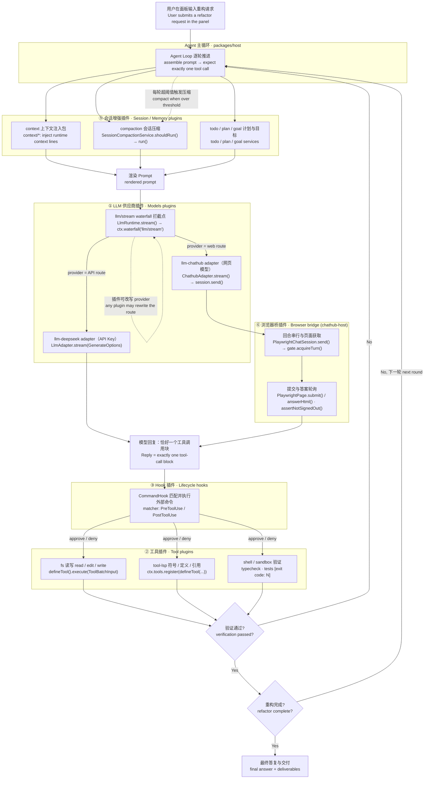
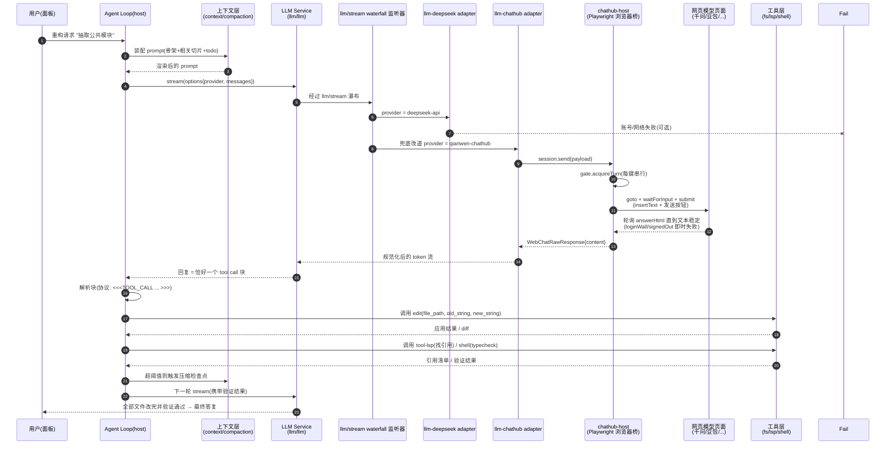

# DeepSeek Harness 插件扩展全景 —— 复杂项目重构中的调用链条

> 本文描述 deepseek-harness 中所有可扩展的插件类型、每种类型的注册 API 与方法调用点，
> 并以"重构一个复杂项目"为主线，用流程图与时序图画出完整调用链。
> 基于仓库 `packages/` 实际代码结构整理（2026-11-05）。

---

## 1. 插件扩展面总览

Harness 基于 cordis 容器（`ctx`）组织插件，每个插件是一个挂载函数，通过 `ctx` 上的
服务句柄注册能力。可扩展点共七类：

| # | 插件类型 | 代表包 | 注册 API | 在链条中的角色 |
|---|---|---|---|---|
| 1 | **LLM 供应商插件** | `llm/llm-deepseek`、`llm/llm-pi-ai`、`llm/llm-retry`、`experimental/llm-chathub` | `ctx.llm.registerAdapter(routes, adapter)` | 把一个模型（API 或网页）接入为合法模型路由 |
| 2 | **工具插件** | `lsp/tool-lsp`、`workflow/tool-workflow`、`shell/*` | `ctx.tools.register(defineTool({...}))` | 给 agent loop 增加可调用的工具 |
| 3 | **Hook 插件** | `experimental/hook-protocol`、`hooks-claude-code`、`hooks-codex` | matcher + command（配置驱动） | 会话生命周期事件上执行外部命令（PreToolUse / PostToolUse / UserPromptSubmit 等） |
| 4 | **Workflow 插件** | `workflow/workflow`、`workflow/workflow-ptc`、`workflow/tool-workflow` | workflow 定义 + `ctx.tools.register` | 把多步任务编排成固定流水线 |
| 5 | **会话增强插件** | `compaction`、`context`、`todo`、`goal`、`plan`、`session/*` | 服务挂载 + 事件监听（如 `agent/request-error`） | 上下文装配、压缩、计划/目标管理 |
| 6 | **浏览器桥插件** | `experimental/chathub` + `chathub-host` + `client-ui-chathub` | LLM adapter + cordis patch | 把网页聊天（DeepSeek/千问/豆包/GLM/ChatGPT/Gemini）桥接为模型路由 |
| 7 | **UI / 客户端插件** | `client-ui-*`、`extensions/*`（cordis 系列） | 客户端 bundle 注册 | 面板 UI 扩展，不参与服务端调用链 |

LLM 调用本身跑在 **`llm/stream` waterfall** 上（`packages/llm/llm/src/index.ts:1178`）：
每次模型调用都会先经过这条可拦截的瀑布链，任何插件都能监听、观察乃至改写请求——
这是"替换/改道模型路由"的官方位置，不需要也不应该用 hook 去做。

### 1.1 与 Plugin Hub 官方分类的对照

[DSH Plugin Hub](https://dsh-plugin.org) 的左侧分类（UI Experience / Sessions & Msg /
Memory & Context / Tools / Agents / Workflow / Integrations / Models / Dev / Knowledge / Fun）
是**面向用户的市场分类**——按"这个插件帮你做什么"划分；上表是**面向开发者的技术分类**——
按"插件向 `ctx` 注册什么能力"划分。两套是同一批插件的两个切面，对应关系如下：

| Plugin Hub 分类 | 技术分类（本文） | 对应仓库包 |
|---|---|---|
| Models | ① LLM 供应商插件 | `packages/llm/*`、`experimental/llm-chathub` |
| Tools | ② 工具插件 | `packages/core/tools`、`packages/lsp/tool-lsp`、`packages/workflow/tool-workflow`、`subagent/tool-subagent` |
| Agents | （agent 生态：子代理与团队） | `packages/subagent/*`（acp/claude-code/codex/fork/spawn + tool-subagent）、`experimental/agent-team`、`packages/ptc-runtime` |
| Memory & Context | ⑤ 会话增强插件 | `packages/compaction/*`、`packages/context/*`、`packages/spill/*`、`packages/session/*`、`packages/todo`、`packages/goal`、`packages/plan` |
| Workflow | ④ Workflow 插件 | `packages/workflow/*` |
| Integrations | ⑥ 浏览器桥 + 外部集成 | `experimental/chathub*`、`packages/browser-use`、`packages/mcp`、`packages/ssh`、`packages/terminal`、`packages/computer-use` |
| Sessions & Msg | ⑤ 会话增强（会话与消息） | `packages/session`、`session-query`、`packages/acp` |
| UI Experience | ⑦ UI / 客户端插件 | `client-ui-*`、`packages/web` |
| Knowledge | 会话增强（知识/资料） | `packages/attachment`、`packages/document`、`packages/skill` |
| Dev / Fun | 开发者工具与娱乐件 | `packages/telemetry`、`packages/test-support` 等 |

> **agent 插件与 memory 插件没有单独出现在第 1 节表格里的原因**：本文第 1 节按
> "注册 API"切面归类——agent 生态的插件（subagent/agent-team）注册的仍是工具
> （`tool-subagent`）与团队服务，memory 类插件（compaction/context/spill）注册的
> 仍是会话服务，所以它们散落在 ② 和 ⑤ 里。上表把市场分类映射回来即可对齐。

### 1.2 各类插件的接口与代码入口

所有链接相对本文件（`chatDeepDoc/`），`#L行号` 在 GitHub 上可直接跳转。

**Models —— LLM 供应商插件**

| 接口 | 代码 |
|---|---|
| `LlmAdapter`（抽象基类，子类实现模型调用） | [`packages/llm/llm/src/index.ts#L208`](../packages/llm/llm/src/index.ts#L208) |
| `LlmRuntime.registerAdapter(providers, adapter)` | [`packages/llm/llm/src/index.ts#L401`](../packages/llm/llm/src/index.ts#L401) |
| `llm/stream` waterfall（官方拦截点） | [`packages/llm/llm/src/index.ts#L1178`](../packages/llm/llm/src/index.ts#L1178) |
| chathub 网页 adapter（purpose 断言/压缩轮） | [`packages/experimental/llm-chathub/src/adapter.ts`](../packages/experimental/llm-chathub/src/adapter.ts) |
| 请求错误监听（`ctx.on('agent/request-error')`） | [`packages/llm/llm-retry/src/index.ts#L240`](../packages/llm/llm-retry/src/index.ts#L240) |

**Tools —— 工具插件**

| 接口 | 代码 |
|---|---|
| `defineTool(schema)` | [`packages/core/tools/src/schema.ts#L555`](../packages/core/tools/src/schema.ts#L555) |
| `ctx.tools.register(...)` 使用示例 | [`packages/lsp/tool-lsp/src/index.ts#L108`](../packages/lsp/tool-lsp/src/index.ts#L108) |
| `ToolDefinition` / 执行契约 | [`packages/core/tools/src/contracts.ts`](../packages/core/tools/src/contracts.ts) |
| Pre/Post 工具决策（`PreToolDecision`/`PostToolDecision`） | [`packages/core/tools/src/schema.ts`](../packages/core/tools/src/schema.ts) |

**Agents —— 子代理与团队**

| 接口 | 代码 |
|---|---|
| subagent 工具（`tool-subagent`） | [`packages/subagent/tool-subagent`](../packages/subagent/tool-subagent/src/index.ts) |
| 子代理协议（acp / claude-code / codex / in-process） | [`packages/subagent/subagent-acp`](../packages/subagent/subagent-acp/src/index.ts) |
| agent-team 的 `Context` 服务扩展（TeamRoster/TaskBoard） | [`packages/experimental/agent-team/src/index.ts#L37`](../packages/experimental/agent-team/src/index.ts#L37) |
| 团队名册 / 任务板 / 任务图 | [`roster.ts`](../packages/experimental/agent-team/src/roster.ts) · [`task-board.ts`](../packages/experimental/agent-team/src/task-board.ts) · [`task-graph.ts`](../packages/experimental/agent-team/src/task-graph.ts) |

**Memory & Context —— 会话增强插件**

| 接口 | 代码 |
|---|---|
| 压缩插件族（basic / image-offload / tool-result-pruner） | [`packages/compaction/compaction-basic`](../packages/compaction/compaction-basic/src/index.ts) |
| chathub 会话自动压缩（七段检查点协议） | [`packages/experimental/chathub/src/session-compaction.ts`](../packages/experimental/chathub/src/session-compaction.ts) |
| 上下文注入插件族（agent-instructions / file-reference / time-context 等） | [`packages/context/agent-instructions`](../packages/context/agent-instructions/src/index.ts) |
| 溢出转存（spill / spill-policy） | [`packages/spill/spill-policy`](../packages/spill/spill-policy/src/index.ts) |
| 会话持久化 | [`packages/session/session-persistence-jsonl`](../packages/session/session-persistence-jsonl/src/index.ts) |

**Hooks —— 生命周期命令钩子**

| 接口 | 代码 |
|---|---|
| `CommandHook` / `MatcherGroup` / `HookOutput` 协议 | [`packages/experimental/hook-protocol/src/types.ts#L56`](../packages/experimental/hook-protocol/src/types.ts#L56) |
| claude-code 方言的 hook 配置与事件 | [`packages/experimental/hooks-claude-code/src/config.ts`](../packages/experimental/hooks-claude-code/src/config.ts) |
| 事件编解码 / 执行器 | [`packages/experimental/hook-protocol/src/runner.ts`](../packages/experimental/hook-protocol/src/runner.ts) |

**Workflow —— 流水线编排**

| 接口 | 代码 |
|---|---|
| workflow 工具注册 | [`packages/workflow/tool-workflow/src/index.ts#L331`](../packages/workflow/tool-workflow/src/index.ts#L331) |
| workflow 引擎 / PTC 运行时 | [`packages/workflow/workflow`](../packages/workflow/workflow/src/index.ts) · [`packages/workflow/workflow-ptc`](../packages/workflow/workflow-ptc/src/index.ts) |

**Integrations —— 浏览器桥与外部集成**

| 接口 | 代码 |
|---|---|
| 站点驱动配置 `SiteDriverConfig`（input/answer/submitButton/loginWall…） | [`packages/experimental/chathub-host/src/types.ts#L31`](../packages/experimental/chathub-host/src/types.ts#L31) |
| 浏览器运行时（profile 锁 / CDP / 托管启动） | [`packages/experimental/chathub-host/src/runtime.ts#L112`](../packages/experimental/chathub-host/src/runtime.ts#L112) |
| 页面操作（提交/回读/答案轮询） | [`packages/experimental/chathub-host/src/page.ts#L14`](../packages/experimental/chathub-host/src/page.ts#L14) |
| MCP / SSH / 终端 / 浏览器使用 | [`mcp-client`](../packages/mcp/mcp-client/src/index.ts) · [`fs-ssh`](../packages/ssh/fs-ssh/src/index.ts) · [`terminal`](../packages/terminal/terminal/src/index.ts) · [`browser-use`](../packages/browser-use/browser-use/src/index.ts) |

---

## 5. 复杂项目重构：宏观调用链（流程图，按技术分类）

按第 1 节的七类技术分类组织；每个节点标注「中文说明 + 英文插件名与被调用方法」。
Organized by the seven technical categories from section 1; every node carries a
Chinese description plus the English plugin name and the method invoked on it.

---

## 6. 一轮工具调用的详细时序（时序图）

以"API Key 主模型 + chathub 网页模型兜底 + LSP 辅助重构"为例，画出一轮完整交互：

关键方法对应关系（时序图中每一步的代码入口）：

| 时序步骤 | 方法 / 入口 | 位置 |
|---|---|---|
| 模型调用 | `LlmRuntime.stream(options)` → `streamWithRegistration` | `packages/llm/llm/src/index.ts:1170` |
| waterfall 拦截 | `this.ctx.waterfall(this, 'llm/stream', options, fallback)` | `packages/llm/llm/src/index.ts:1178` |
| 适配器注册 | `ctx.llm.registerAdapter([...routes], adapter)` | `experimental/llm-chathub/src/index.ts:146` |
| 网页轮次 | `PlaywrightChatSession.send/stream` → `streamUntilComplete` | `experimental/chathub-host/src/session.ts` |
| 提交与回读 | `PlaywrightPage.submit` → `submitPrompt`(按钮/按键) | `experimental/chathub-host/src/page.ts` |
| 游客墙识别 | `assertNotSignedOut` 检查 `loginWall` | `experimental/chathub-host/src/session.ts` |
| 工具注册 | `ctx.tools.register(defineTool({...}))` | `packages/lsp/tool-lsp/src/index.ts:108` |
| 钩子事件 | matcher + command（PreToolUse/PostToolUse/UserPromptSubmit…） | `experimental/hooks-claude-code/src/config.ts` |
| 请求错误监听 | `ctx.on('agent/request-error', ...)` | `packages/llm/llm-retry/src/index.ts:240` |

---

## 7. 各插件类型的职责边界（重构场景）

### 7.1 应该放在 agent 端（工具/会话插件）

- **代码骨架与依赖分析**：`tool-lsp` 已提供符号/定义/引用；大型重构可新增
  `tool-code-skeleton` 之类的工具插件（照抄 `tool-lsp` 的 `defineTool` 写法），
  让模型按需拉取目录骨架、导出符号、依赖图。
- **上下文切片与压缩**：`compaction` 的七段检查点协议负责把长会话压进 web 模型的
  小窗口（~32k）；切片选择（只送相关文件）属于 prompt 装配层。
- **验证与调度**：typecheck/test 由 shell/sandbox 工具执行，重试顺序由 agent loop 决策。

### 7.2 应该放在模型端（LLM 插件只管接入）

- 判断"改哪个文件、怎么改、为什么验证失败"——模型端唯一的能力是推理文本；
  它看不见文件系统，一切结构信息必须由 agent 端编进 prompt。

### 7.3 何时用 workflow 插件

- 步骤固定、不依赖模型自行决定流程时（分析 → 计划 → 逐文件改 → 验证 → 报告），
  用 `workflow/workflow-ptc` 定义流水线；每一步内部仍然是上面的 agent loop 链条。

### 7.4 何时用 hook 插件

- 需要在工具调用前后执行**外部命令**（审计、门禁、自动格式化）时；
  hook 不是网络拦截器，不要用它替换模型路由。

---

## 8. 推荐组合（结合本仓库三条基本准则）

1. **不动主流程**：复用现有 `llm-chathub` 桥与 `tool-lsp`，不修改任何既有插件。
2. **只新增插件**：
   - 新增 `tool-code-skeleton`（工具插件，agent 端）：`defineTool` 暴露
     `skeleton(path)` / `deps(path)` 两个查询；
   - 可选：新增一个 llm 插件在 `llm/stream` waterfall 上做 API→web 的兜底改道；
   - 可选：新增 workflow 模板串"分析→改→验证"。
3. **自己页面测试**：新增工具通过面板实测一轮真实重构任务后再交付。

> 约束提醒：web 模型通道适合"小切片、单工具调用"的任务；大型重构的主力
> 仍是 API 模型，web-model 作为配额补充与备用通道。
