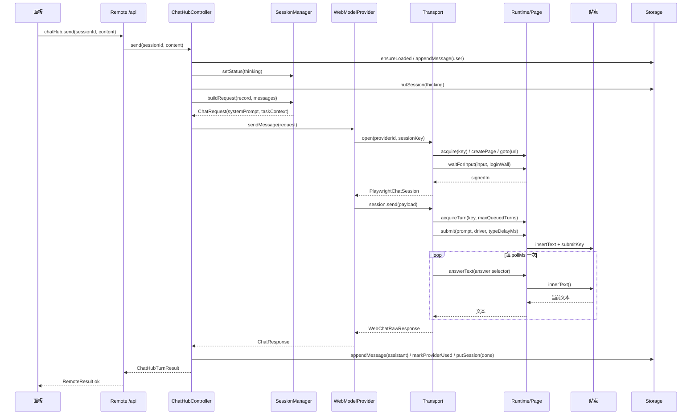
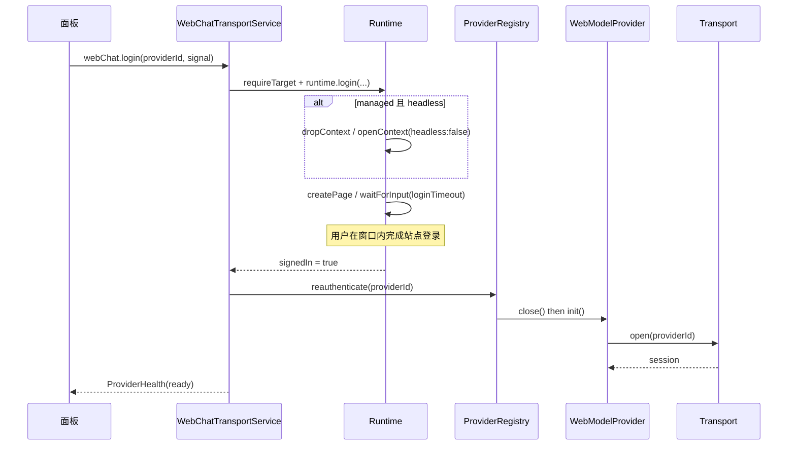
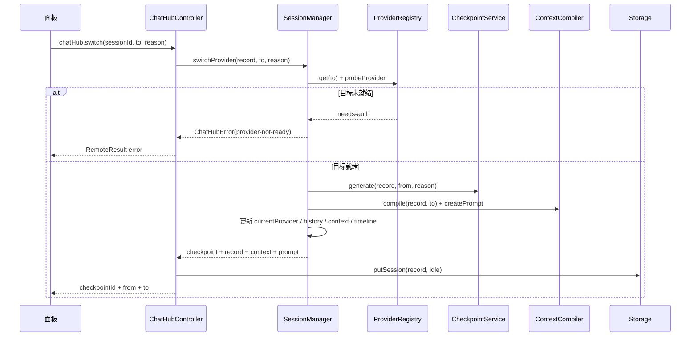
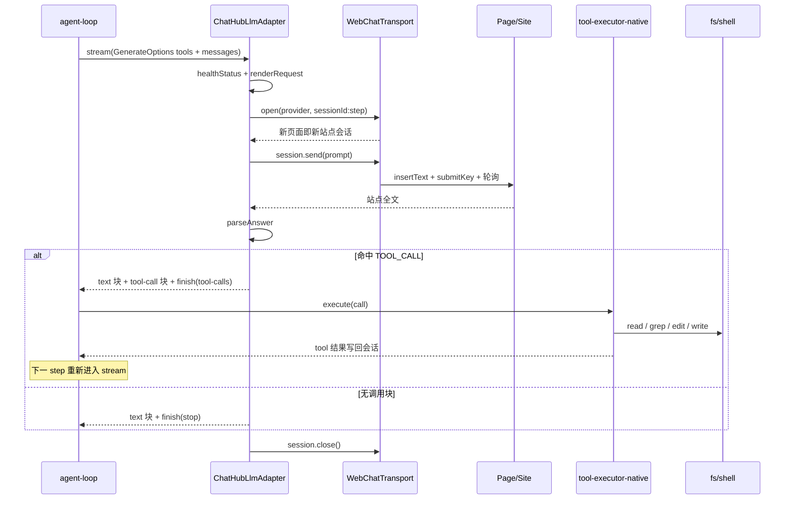

# 设计规范：用网页模型改本地大型项目代码

状态：协议、渲染、预算、适配器与接线已实现（`packages/experimental/llm-chathub`）；真实站点验收与录制回放待做
范围：本文件描述设计与接入点、实现落点、安全边界、请求生命周期、完成判定与验收清单。

## 1. 结论

改大型项目需要「读 → 想 → 改 → 验 → 修」的闭环，其中只有「想」需要模型。现有 harness 已经把另外四步做完了（`fs`/`shell`/`lsp` 工具、`compaction`、`spill`、`session` 事件、`agent-loop`）。所以最简洁有效的改法不是把 chathub 做成编码 agent，而是：

> **写一个 `LlmAdapter`，把站点当成「无 function calling 的纯文本补全器」，让现有 agent loop 继续驱动本地工具。**

即 `GenerateOptions → 一段自包含文本 → 站点 → 严格解析出的工具调用块 → 现有工具执行器`。

### 1.1 三条路线的取舍

| 路线 | 改动面 | 探索能力 | 结论 |
|---|---|---|---|
| A. 文本协议 `LlmAdapter`（本文） | 新增 1 个包 + 1 处 host 暴露 | 完整（继承 loop 的一切） | **采用** |
| B. 独立 `web-patch` 命令：检索→一次提问→应用 diff | 1 个脚本 | 无（只能一次往返） | 用 A 的步数上限配置退化实现，不单独写脚本 |
| C. 让站点伪装原生 function calling / 抓 DOM 当工具 | 不可控 | 站点改版即碎 | 放弃 |

选 A 的核心理由：**需要新写的只有「渲染」和「解析」两个纯函数，其余全部复用**。任何把工具循环搬到浏览器侧的做法，都会重新实现一遍 loop、权限、压缩，并受站点 180 秒与 UI 漂移的支配。

### 1.2 成功标准（可验收）

| # | 标准 | 验收方式 |
|---|---|---|
| 1 | 适配器可被 agent loop 调用：`ctx.llm.registerAdapter` 注册一条路由，`stream()` 产出合法 chunk 序列 | `tests/adapter.spec.ts` 断言 `block-start` → `text-delta` → `block-end` → `finish`；`tests/index.spec.ts` 断言路由注册与卸载 |
| 2 | 每次尝试都是独立的网页会话，重试不污染上一次 | 每次 `stream()` 分配新的页面键 `<site>:<n>`；`tests/adapter.spec.ts` 断言两个键不同、`close()` 总被调用 |
| 3 | 输出经 schema 校验与授权后才执行 | `parseAnswer` 校验唯一 JSON 块、白名单工具名、参数为对象、路径不出工作区；非法时返回 `invalid` 而不执行 |
| 4 | 有步数、重试与时长上限 | 模型侧一步一个调用由协议保证；`repairAttempts` 限制自纠轮数；单轮时长由站点 `turnTimeoutMs` 决定；prompt 超预算直接拒绝 |
| 5 | 失败可解释 | 每个失败都带稳定码（`AUTH` / `TIMEOUT` / `RATE_LIMIT` / `SERVER` / `TRANSPORT` / `MALFORMED_RESPONSE` / `CONTEXT_WINDOW_EXCEEDED`），消息里点明站点、原因或出错块 |
| 6 | 不记录敏感内容 | 每轮只上报长度、工具名、拒绝原因、耗时、丢弃条目；prompt 与回答原文从不进事件、日志或会话记录 |
| 7 | fake transport 可跑，真实站点可验 | `tests/` 全部使用 fake transport（无网络、无 key）；真实站点按 §16 手动验收 |

### 1.3 非目标

| 非目标 | 理由 |
|---|---|
| 不在浏览器侧实现 agent loop | loop 一旦搬进页面，权限、压缩、会话日志都要重写一遍，并受站点 UI 与 180 秒上限支配 |
| 不伪造原生 function calling | 站点协议不携带工具定义，伪造只会让失败模式变得不可解释 |
| 不抓 DOM 造工具接口 | 站点改版即碎，且无法给出稳定的失败码 |
| 不提供任意 shell | 编码需要的检索与编辑由 `read/grep/glob/edit/write` 承担；命令只在 `verifyCommands` 里作为提示文本出现 |
| 首版不支持图片、并行调用与浏览工具 | 站点文本通道无附件入口；站点无并行；harness 侧浏览工具不进白名单 |

## 2. 约束（来自现有代码的事实）

| 约束 | 事实 | 依据 |
|---|---|---|
| 站点无 function calling | `GenerateOptions.tools` 无法传到站点 | `llm/src/types.ts:583` |
| 浏览器 provider 拒收 tool 消息 | `splitRequestMessages` 对 `role: 'tool'` 抛 `unsupported-request` | `chathub/src/providers/web-provider.ts:167` |
| provider 只发最后一条 user 消息，上下文只首轮带 | 不能承载工具结果 | `web-provider.ts:211`、`:419` |
| 站点自己保留会话历史 | 重发全量历史会双重累积 | 同上 |
| 无图片输入 | `capabilities.vision = false` | `web-provider.ts:108` |
| 单轮 180 秒硬超时 | `turnTimeoutMs` 默认 180000 | `chathub-host/cordis.patch.yml` |
| 完成判定是文本稳定 | `pollMs 500 × stablePolls 3` = 1.5 秒静默即完成；「思考中」占位已由 `pending` 正则剥离 | `session.ts:88`、`drivers.ts:16` |
| 页面按 key 复用，新 key 新建并 `goto(driver.url)` | 每轮换 key = 每轮新会话 | `runtime.ts:134`、`transport.ts:59` |
| 豆包反爬不可绕过 | 曾用 stealth/CDP/真实键鼠仍 `from_logout` | `chatDeepDoc/detail_design.md` 15.4.3 |

## 3. 架构

```
agent-loop（现有，不改）
  │ GenerateOptions{messages, tools: ToolSchema[], system}
  ▼
ChatHubLlmAdapter（新增）
  ├─ renderRequest(options) ──► 单条文本 prompt
  ├─ WebChatTransport.open(provider, `${sessionId}:${seq}`) ──► 新页面/新会话
  ├─ session.send({prompt, system:'', messages:[], meta:{origin:'raw-messages'}})
  └─ parseAnswer(text) ──► StreamChunk（text / tool-call / finish）
  │
  ▼
tool-executor-native（现有）→ read/grep/glob/edit/write/bash → 结果作为 tool 消息回到 loop
```

不做的事：不触碰 `agent-loop`、不改 `WebModelProvider`、不新增站点专用 DOM 抓取、不引入第二套会话存储。

### 3.1 参与进程与调用边界

| 层 | 所在进程 | 入口 |
|---|---|---|
| 面板 `ChatHubPanel` | 浏览器渲染进程 | `ctx.remote.chatHub.*` / `ctx.remote.webChat.*` |
| Remote 载波 | 浏览器 ↔ 宿主 | 一元调用走共享 `/api` RPC 通道（Web 载体为 fetch，宿主侧由 `bridge` 承接，默认请求体上限 300 MiB）；Remote 流式与事件走 WebSocket `/api/remote.mux` |
| `ChatHubController` / `WebChatTransportService` | 宿主 Node 进程 | Cordis service，命名空间 `chatHub` / `webChat` |
| `PlaywrightWebChatTransport` / `Runtime` / `Page` | 宿主 Node 进程 | 通过 CDP 驱动独立 Chrome |
| 站点页面 | Chrome 进程 | 真实登录态，DOM 读写 |

客户端每个 Remote 调用都返回 `RemoteResult<T>`，面板侧统一 `expect()` 解包（`mount.ts:52`）：失败分支变成抛出的错误，成功分支直接取值。

### 3.2 一轮对话：逐跳调用（现有实现）

| # | 调用方 → 被调方 | 调用 | 返回 / 失败 |
|---|---|---|---|
| 1 | 面板 → Remote | `ctx.remote.chatHub.send(sessionId, content)` | `RemoteResult<ChatHubTurnResult>` |
| 2 | Remote → 控制器 | `ChatHubController.send(sessionId, content)` | 会话/Provider 未知时抛 `session-not-tracked` / `provider-not-registered` |
| 3 | 控制器 → 存储 | `ensureLoaded()` → `ctx.storageDomain.open(chatHubDomainSpec)` → `ChatHubRepository.from(domain)` → `hydrate()` | 首次调用才真正打开域 |
| 4 | 控制器 → 存储 | `appendMessage(sessionId, userMessage)` | 用户消息先落盘，失败轮次也保留 |
| 5 | 控制器 → 会话 | `setStatus(sessionId,'thinking')` → `putSession(record,'thinking')` | — |
| 6 | 控制器 → 会话 | `buildRequest(record,{messages})` | `ContextCompiler.compile` + `createPrompt` → `ChatRequest{systemPrompt, taskContext}` |
| 7 | 控制器 → Provider | `provider.sendMessage(request)` | `ChatResponse{content,…}`；`provider-not-ready` 当未 `init` |
| 8 | Provider → 传输层 | `transport.open(providerId, sessionKey)` | `WebChatTransportSession` / `{closed:true}` |
| 9 | 传输层 → 运行时 | `runtime.acquire(key, driver)` → `createPage` → `goto(driver.url)` → `page.waitForInput(input, loginWall, loginTimeoutMs, pollMs)` | 未登录返回 `{closed:true,reason:'not-signed-in'}` |
| 10 | Provider → 传输层 | `session.send(payload)`（payload 由 `splitRequestMessages` + `renderWebPrompt` 生成） | `WebChatRawResponse` |
| 11 | 传输层 → 运行时 | `gate.acquireTurn(key, maxQueuedTurns)` → `page.submit(prompt, driver, typeDelayMs)` | 队列满抛 `chathub-busy` |
| 12 | 页面 → 站点 | `mouse.click(box)` → `keyboard.insertText(prompt)` → `sleep(typeDelayMs)` → `keyboard.press(submitKey)` | 选择器失效 → `chathub-ui-drift` |
| 13 | 传输层 → 页面 | 轮询 `answerText(selector)` → `locator.nth(count-1).innerText()`，`answerFrom` 剥离 prompt 回声与 `driver.pending` 占位 | 超时 → `chathub-turn-timeout` |
| 14 | Provider → 控制器 | `normalizeResponse(raw, sessionId, id)` | `finishReason` 缺省 `stop` |
| 15 | 控制器 → 存储 | `appendMessage(assistant)` → `markProviderUsed(providerId, at)` → `putSession(record,'done')` | 失败轮：`setStatus('failed', 'provider: code')`，不写 assistant |
| 16 | 控制器 → 面板 | `ChatHubTurnResult{sessionId,status,assistant?,lastError?}` | 面板乐观渲染的用户消息保留 |

失败分类只暴露稳定 token：`BrowserTransportError` → `WebModelProvider.normalizeError` → `ChatHubError`（`provider-not-ready` / `rate-limited` / `network-error` / `stream-interrupted` / `provider-call-failed`）。



### 3.3 登录 / 重新登录（现有实现）

| # | 调用链 | 说明 |
|---|---|---|
| 1 | `ctx.remote.webChat.login(providerId, signal)` | 面板传新的 `AbortController().signal` |
| 2 | `WebChatTransportService.login` → `requireTarget(providerId)` | 未发货的 provider 抛 `chathub-driver-missing` |
| 3 | `runtime.login(providerId, driver, loginTimeoutMs, signal)` | managed+headless 分支：`dropContext()` → `openContext(headless:false)` → `createPage` → `waitForInput`，finally 再 `dropContext()` |
| 4 | 用户在弹出的 Chrome 内完成站点登录 | 登录态只留在 profile 目录 |
| 5 | `registry.reauthenticate(providerId)` → `provider.close()` + `provider.init()` | `init` 内部 `transport.open` → 新页面 → `applyOpenResult` |
| 6 | 返回 `ProviderHealth` | `ready` 才会被列为可切换目标 |
| 7 | `webChat.reauthenticate(providerId)` | 已登录但会话过期时的等价入口；不弹窗，直接重开 |



### 3.4 模型切换（现有实现）

| # | 调用 | 关键行为 |
|---|---|---|
| 1 | `ctx.remote.chatHub.switch(sessionId, providerId, reason)` | 面板先弹确认，确认后才调用 |
| 2 | `manager.switchProvider(record, to, reason)` | 目标即当前 → `provider-already-active` |
| 3 | `registry.get(to)` → `probeProvider(provider)` | 非 ready → `provider-not-ready` |
| 4 | `checkpoints.generate(record,{provider:from,reason})` | 先写检查点，再让目标看到任务 |
| 5 | `compiler.compile(record, to)` + `createPrompt(context, to)` | 规范上下文与目标 prompt |
| 6 | 更新 `currentProvider` / `providerHistory` / `context` / `checkpoints` / `updatedAt`，`timeline.record({kind:'provider-switch'})` | 切换记录进入会话历史 |
| 7 | 控制器 `setStatus('idle')` → `putSession(record,'idle')` → 返回 `{checkpointId, from, to}` | 切换本身不发送任何消息 |



### 3.5 现有链路的三个接缝（直接影响新 adapter）

| 接缝 | 事实 | 对新设计的要求 |
|---|---|---|
| Provider 是全局单例，页 key 缺省为 providerId | `transport.open(id)` 时 `key = sessionKey ?? providerId`（`transport.ts:59`）；`#session` / `#sessionKey` 是单值字段（`web-provider.ts:259`） | 多个 ChatHub 会话共用同一页面与站点会话。adapter 必须自带 key 策略（`${sessionId}:${step}`），不得依赖缺省 key |
| 切换 provider 不重置交接状态 | `switchSession` 在控制器里**没有调用点**；`#contextPending` 只在 `applyOpenResult` 置 `true` | 目标实例若此前发过消息，交接上下文不会随下一轮下发。adapter 侧自行决定每轮是否携带上下文（设计上每轮全新 key，天然规避） |
| 提交后不回读输入 | `page.submit` 只做 `click` → `insertText` → `press`，不校验输入容器的实际内容 | 长 prompt 被站点截断时静默。adapter 需要新增「读回校验」：提交后比对输入长度，不符直接判 `chathub-ui-drift` |

这三条都只影响「多会话隔离」与「长 prompt 可靠性」，不影响单会话小步改码，因此不作为前置改造，只在 adapter 内兜住。

### 3.6 新增 adapter 链路的调用时序（已实现）

| # | 调用方 → 被调方 | 调用 | 返回 / 失败 |
|---|---|---|---|
| 1 | 插件加载 | `ctx.llm.registerAdapter([provider], adapter)` | `AdapterRegistrationHandle`，可 `replace` 路由 |
| 2 | agent-loop → adapter | `prepareCall(provider, model, signal)` → `resolveModel` | `LlmResolvedModelInfo{context:{contextWindow}}` |
| 3 | agent-loop → adapter | `stream(options: GenerateOptions)` | `AsyncIterable<StreamChunk>` |
| 4 | adapter → provider 健康 | `provider.healthStatus()` | 非 `ready` → 抛 `AUTH_REQUIRED`，不打开页面 |
| 5 | adapter → 传输层 | `transport.open(provider, key)`，`key = <sessionId>:<step>` | `{closed:true}` → `AUTH_REQUIRED` / `PROVIDER_UNAVAILABLE` |
| 6 | adapter → 传输层 | `session.send({providerId, system:'', messages:[], prompt: rendered, meta:{origin:'raw-messages'}})` | 透传失败 token |
| 7 | adapter 内部 | `parseAnswer(text)` → `{text, call?}` | 解析失败 → `invalid`，回灌自纠 |
| 8 | adapter → agent-loop | `block-start` / `text-delta` / `block-end`（text 块）+ 可选 `tool-call` 块 + `finish{kind:'tool-calls'|'stop'}` | chunk 契约见 `types.ts:496` |
| 9 | agent-loop → 工具 | `tool-executor-native` 执行 `read/grep/glob/edit/write` | 失败作为 tool 消息回灌 |
| 10 | adapter → 传输层 | `session.close()`（`finally`） | `gate.release(key)` → 关闭页面 |



### 3.7 两套链路的关系

- 面板链路（§3.2–3.4）只负责「人跟模型聊、切模型」。它与编码无关，也不进 harness 会话日志（消息只落 `chathub` 存储域）。
- adapter 链路（§3.6）只借用同一个 `WebChatTransport` 与同一套站点 driver，**不经过** `ChatHubController`、`SessionManager`、`ContextCompiler`（那是给人工会话做检查点交接的），上下文由 harness 的 `GenerateOptions` 直接提供。
- 两条链路共享同一个 Chrome profile 与 `maxQueuedTurns` 队列，因此同一 provider 上「面板里正在聊天」与「adapter 正在跑编码」会串行排队；需要并行时给 adapter 单独的 profile 目录。

### 3.8 辅助调用必须让开（实测踩坑后的强制约束）

站点只有「一个会话框」这一个入口，任何 `GenerateOptions` 到达 adapter 都会被 `renderRequest` 渲染成整段 prompt 发出去。而 harness 里有一类**不是对话**的请求也走同一份路由：

| 调用方 | `purpose` | 它带的输入 | 站点看到的后果 |
|---|---|---|---|
| `session-title-llm` | `session-title` | 一段 JSON（前几条消息）+ 一句「Generate the session title」 | 站点把它当成本轮任务，回答「理解需求……项目 plugin 实现原理分析」，编码请求根本没被读到 |
| 上下文压缩 | `compaction` | 要压缩的历史 | 浪费一次页面轮次，返回的摘要还被当成对话内容 |

现象就是「发过去的是标题请求，回来的是需求理解」。修法是把辅助请求挡在 adapter 门口，而不是在 prompt 里补救：

```ts
private assertConversational(options: GenerateOptions, site: string): void {
  const purpose = options.purpose
  if (purpose === undefined || this.config.auxiliary === 'allow') return
  throw new LlmError(
    `chathub-llm: ${site} does not serve auxiliary "${purpose}" requests; `
    + "point that caller at an API route, or mount with auxiliary: 'allow'",
    'INVALID_REQUEST',
  )
}
```

- 抛错发生在 `transport.open()` 之前：**不打开页面、不消耗轮次**，站点上不会留下一条莫名其妙的会话。
- `session-title` 的失败是良性的：`session-title` 服务在 `defer` 里 `catch` 后只 `logger.warn`，会话保留首条消息生成的兜底标题（`session-title/src/index.ts:534`、`585`）。
- 想恢复自动标题，就把标题 provider 指到真 API 路由（`session-title-llm` 的 `provider` + `model` 成对配置），而不是给 `auxiliary: 'allow'`。
- 同一约束适用于 `compaction`：网页路由不承担压缩，长会话靠 `maxPromptChars` + `historyTurns` 收敛。

## 4. 代码落点

新增包 `packages/experimental/llm-chathub/`（与 `chathub`、`chathub-host` 同组，因为它的 transport 契约来自这一组）：

```
src/
  index.ts     # Cordis 插件：配置 schema、解析行、注册路由、发轮次事件
  adapter.ts   # ChatHubLlmAdapter extends LlmAdapter
  render.ts    # GenerateOptions -> prompt（纯函数）
  protocol.ts  # 工具调用块的解析与校验（纯函数）
  budget.ts    # 文本夹紧策略（纯函数）
  types.ts     # 配置、传输契约、解析/渲染策略、失败码
tests/         # 每个 src 文件 100% 覆盖（行/分支/函数）
locale/        # 8 份插件元数据（title/description）
cordis.patch.yml
```

包内同时声明 `dsh.bundle.patch`（`listedByDefault: false`），因此它可以作为一个可选层被 `--patch` 应用，而不会进入随包 profile。

唯一需要动的现有包：`packages/experimental/chathub-host` 暴露 transport 句柄（`webChatTransport` service 把 transport 放在私有字段里）。加一个只读方法即可：

```ts
/** 供未经过面板的模型路由复用同一 transport；不开放页面句柄。 */
transportForAdapter(): WebChatTransport {
  return this.transport
}
```

## 5. 接口（实现形）

```ts
export interface ChatHubLlmConfig {
  /** 站点 provider id，如 'deepseek-web'。 */
  readonly site: string
  /** 注册的 LLM 路由，默认 `${site}-chathub`。 */
  readonly route: string
  /** 路由上声明的模型 id，仅作为路由标识。 */
  readonly model: string
  readonly contextWindow: number
  readonly maxPromptChars: number
  readonly maxToolResultChars: number
  readonly maxSystemChars: number
  readonly historyTurns: number
  /** 暴露给模型的工具名白名单，其他名字一律判为非法回答。 */
  readonly allowTools: readonly string[]
  /** 任何参数都不得指向的路径片段，默认 ['.git','node_modules','.env']。 */
  readonly denyPaths: readonly string[]
  /** 提示中声明为完成校验的命令；适配器从不执行它们。 */
  readonly verifyCommands: readonly string[]
  /** 绝对路径参数必须落在其内；缺省时只做穿越与拒绝片段检查。 */
  readonly workspaceRoot?: string
  readonly maxToolCallsPerTurn: number
  readonly repairAttempts: number
  /** 每轮一条观测记录，不含 prompt 与回答原文。 */
  readonly onTurn?: (record: ChatHubTurnObservation) => void
}

export class ChatHubLlmAdapter extends LlmAdapter {
  constructor(source: ChatHubTransportSource, config: ChatHubLlmConfig)
  providerInfo(provider: string): LlmProviderInfo
  listModels(provider: string): Promise<readonly LlmModelInfo[]>
  resolveModel(provider: string, model: string): Promise<LlmResolvedModelInfo>
  stream(options: GenerateOptions): AsyncIterable<StreamChunk>
}

/** 纯函数，全部可单测。 */
export function renderRequest(options: GenerateOptions, policy: ChatHubRenderPolicy): RenderedPrompt
export function parseAnswer(raw: string, policy: ChatHubParsePolicy): ChatHubParsedAnswer
export interface ChatHubParsedAnswer {
  /** 展示给用户的说明文字（已剥离调用块），上限 2000 字符。 */
  readonly text: string
  /** 唯一被接受的调用；多于一个块只取第一个并记一条告警。 */
  readonly call?: ChatHubToolCall
  /** 拒绝原因；存在即表示不得执行任何调用。 */
  readonly invalid?: string
  /** 非致命发现，例如被丢弃的第二个调用块。 */
  readonly warnings: readonly string[]
}
export function clampText(text: string, max: number): string
```

`ChatHubTransportSource` 是宿主层的两方法投影（`transportForAdapter()` 与 `providers()`），因此测试替身只需两个方法，不依赖 Remote 服务类。

`stream` 遵守的 chunk 契约（`llm/src/types.ts:496`）：先 `block-start`，再 `text-delta` / `tool-call-delta`，每块以 `block-end` 收尾，最后 `finish`。结束原因：有调用 → `{kind:'tool-calls'}`；无调用 → `{kind:'stop'}`；站点失败 → 抛错（由 `LlmRuntime.stream` 归一化为 `error`/`aborted`）。

`resolveModel` 返回 `{ provider, id, name, context: { contextWindow } }`（`types.ts:454`）。站点不给 token 用量，适配器**不发** `usage` 块——这是合法的可选字段。

## 6. 输出协议

站点会把 markdown 代码块重排、加复制按钮，`innerText` 可能混入行号或裁掉围栏，因此**不用 ```json 围栏**，改用罕见分隔符：

```
<<<TOOL_CALL
{"name":"read","arguments":{"file_path":"src/main.ts","offset":1,"limit":120}}
TOOL_CALL>>>
```

规则：

1. 每轮**最多一个**调用块；出现多个时取第一个，其余忽略并计一次告警。
2. `name` 必须在 `allowTools` 内，否则视为非法调用（回灌错误，不执行）。
3. `arguments` 必须是 JSON 对象；解析器做括号配平扫描以容忍前后噪声文字。
4. 没有调用块 = 模型认为任务结束，`finish: stop`。
5. 模型不得输出工具结果、不得输出 shell 命令文本作为执行入口——参数只走 JSON，执行入口只有白名单工具。
6. 文本部分（给人看的说明）限制 2000 字符，超出截断。

### 6.1 Prompt 骨架

固定顺序，便于人读、便于快照比对：

```
# ROLE
You operate one step at a time through tools. Emit at most one tool call per reply.

# TOOLS
[{"name":"read","description":"...","parameters":{...}}, ...]   // 白名单子集，压缩描述

# PROTOCOL
To act, reply with exactly one block:
<<<TOOL_CALL
{"name":"<tool>","arguments":{...}}
TOOL_CALL>>>
Never fabricate tool output. When the task is done, reply without a block.

# PROJECT
root: <workspace root>
verify: pnpm run typecheck && pnpm run test -t <filter>

# CONVERSATION
user: <首轮任务>
tool(read) -> <结果，已按预算截断>
assistant: <上一轮说明>

# NOW
<最后一条 user/tool 消息>
```

历史渲染只保留最近 `historyTurns` 轮；更早的轮次压成一行 `[earlier: N steps, files touched: ...]`。压缩由 `budget.ts` 完成，不依赖站点。

## 7. 预算策略

| 项 | 默认 | 理由 |
|---|---|---|
| `maxPromptChars` | 48 000 | 站点输入上限未知，先保守；按实测调 |
| `maxToolResultChars` | 6 000 | 超出保留 head 3k + tail 2k + `[omitted N chars, re-read with offset]` |
| `historyTurns` | 8 | 更早的压成摘要行 |
| `maxToolCallsPerTurn` | 1 | 站点无并行，单调用解析最稳 |
| 单次 `edit` 目标规模 | ≤ 120 行 | 超出易被 180 秒截断 |
| `repairAttempts` | 1 | 第二次仍失败就交给用户 |
| `contextWindow`（声明值） | 32 000 起 | 影响 harness 压缩触发点，宁小勿大 |

裁剪顺序（先砍最不痛的）：更早的 assistant 说明 → 更早的 tool 结果尾部 → 更早的 user 消息 → 拒绝请求（`CONTEXT_WINDOW_EXCEEDED`），不静默截断任务目标。

大仓检索不靠模型猜：主 agent 用 `grep`/`glob` 定位，`read` 按行窗口取片段，模型只做「下一步调哪个工具 / 改哪一行」。这正是现有 loop 的默认行为，不需要额外索引服务。

## 8. 与现有实现的三处冲突及解法（代码事实见 §3.5）

1. **tool 消息被拒** → adapter 不经过 `WebModelProvider`，直接拿 `WebChatTransport.open()` 的 session，自己渲染完整 prompt。`payload.messages` 留空、`system` 留空、`origin: 'raw-messages'`（诚实标注：渲染由 adapter 完成）。代价：放弃 `WebModelProvider` 的失败归一化，adapter 需自己映射（见 §10）。
2. **站点自带历史** → 每轮用唯一 `sessionKey = ${sessionId}:${step}` 打开新页；`runtime.acquire` 对未知 key 会新建页面并 `goto(driver.url)`，天然是全新对话。轮末 `session.close()` 释放页面（`gate.release` → 关闭页）。幂等、可重放，harness 侧重试不会污染站点会话；代价约 1–2 秒/轮的页面启动。
3. **完成判定过早** → 「思考中」类占位已由 `driver.pending` 剥离（`drivers.ts:16`），但长回答生成途中的静默仍会被判为完成。网页路由把 `pollMs` 提到 1000、`stablePolls` 提到 4（4 秒静默才算完），`turnTimeoutMs` 提到 300000；adapter 侧再兜一层：**整轮收完再解析**，不做增量解析（避免半截 JSON）。

## 9. 安全边界

站点输出、站点页面、站点时延都在本进程之外，因此边界按「谁能做什么」写死，而不是按「站点通常怎么做」假设。

### 9.1 授权：执行入口只有白名单工具

| 能力 | 是否给模型 | 机制 |
|---|---|---|
| `read` / `grep` / `glob` / `edit` / `write` | 是（默认白名单） | 参数只走 JSON；调用由 harness 的工具执行器执行，并按会话审批走原有权限链 |
| 任意 shell / `bash` | 否 | 白名单里没有它，适配器也没有执行入口；`verifyCommands` 只是提示文本 |
| `web` / 浏览器 / `cua` 工具 | 否 | 同一原因；首版不把浏览工具放进白名单 |
| 并行调用 | 否 | 协议每次回答只接受一个块，多出的块丢弃并告警 |
| 图片 / 附件上传 | 否 | 文本块被替换成一行占位说明，适配器没有附件通道 |

### 9.2 路径守卫：调用执行前拒绝

`parseAnswer` 在每个字符串参数上按「键名像路径」的规则（`*path*`、`file`、`dir`、`glob`、`pattern`、`cwd`）取出候选值，并对每个候选值做四项检查，任一项失败即整段回答判为非法、不执行任何调用：

| 检查 | 拒绝示例 |
|---|---|
| 含 NUL 字节 | `"src/a\0.ts"` |
| 出现 `..` 片段 | `"../secrets.env"` |
| 命中 `denyPaths` 片段 | `".git/config"`、`"node_modules/x/index.js"` |
| 绝对路径不在 `workspaceRoot` 内 | `"/etc/passwd"`、`"C:////Windows////win.ini"` |

限制要说清楚：这是**词法**守卫，不解析符号链接，也不判断相对路径最终落在哪里——相对路径由真正执行它的工具按会话沙箱判定。守卫的作用是让「模型被诱导去读主机文件」在调用执行前就失败，并与工具自身的沙箱形成两层。

### 9.3 不可信输入：只解析成数据和原因

站点的回答只被解析成三样东西：展示文本、`{白名单工具名, JSON 对象参数}`、拒绝原因。适配器不解析命令、不解析 URL、不把回答当模板求值、不把回答里的路径当 glob 展开。拒绝原因里回显的参数值会被截断到 80 字符，避免恶意回答把日志撑大。

### 9.4 健康前置与幂等

- 每次提问前读 `providers()`，`needs-auth` / `failed` 立刻抛 `AUTH`，不打开页面、不消耗重试预算。
- 每次尝试都用新的页面键（`<site>:<n>`），因此重试永远是全新站点会话，不会把上一次的半截上下文带进来；`finally` 里 `close()` 释放页面。
- 重复执行的语义交给工具本身：`edit` 的 `old_string` 不匹配即失败并作为工具结果回灌，而不是硬写。

## 10. 请求生命周期

一次 `stream()` 就是 agent loop 的一步，内部有明确的阶段与上限：

| # | 阶段 | 动作 | 上限 / 失败 |
|---|---|---|---|
| 1 | 渲染 | `renderRequest` 折叠系统提示、工具 schema、历史、当前消息；超预算先丢最旧条目，仍超则抛 `ChatHubPromptOverflowError` | `maxPromptChars`；失败码 `CONTEXT_WINDOW_EXCEEDED`（loop 走压缩，不重试） |
| 2 | 健康检查 | 读 `providers()` 找本站点健康 | 未注册 → `INVALID_REQUEST`；`needs-auth`/`failed` → `AUTH` |
| 3 | 开页 | `transport.open(site, <site>:<n>)`，新键即新会话 | 返回 `undefined` → `AUTH`；返回 `{closed:true}` → `AUTH` |
| 4 | 提交 | 页面把整段 prompt 作为一次文本插入并提交 | 站点 `actionTimeoutMs`；选择器失效 → `chathub-ui-drift` |
| 5 | 等待完成 | 轮询回答容器，剥离「思考中」占位，静默 `stablePolls` 次即完成 | 站点 `turnTimeoutMs` → `chathub-turn-timeout` |
| 6 | 解析 | `parseAnswer` 产出文本 + 至多一个调用，或拒绝原因 | 非法 → 进入自纠轮 |
| 7 | 自纠（可选） | 在新页面里重发同一 prompt 并追加 `# CORRECTION` | `repairAttempts` 次；用尽 → `MALFORMED_RESPONSE` |
| 8 | 收尾 | `close()` 释放页面；发一条 `chathub-llm/turn` 观测 | 取消：`AbortSignal` 在两次提问间检查，抛 `ABORTED` |
| 9 | 产出 | 文本块 + 可选工具调用块 + `finish{tool-calls|stop}` | — |

**完成判定**分三层，任何一层都不靠「看起来像结束了」：

1. **单轮完成**是传输层的事实：回答容器连续 `stablePolls` 次读数不变，且不匹配站点的思考占位。
2. **单步完成**由协议决定：回答里没有调用块 → `finish: stop`；有一个合法块 → `finish: tool-calls`，loop 去执行工具。
3. **任务完成**由 loop 与用户判断：适配器不猜任务是否做完，也不发「请继续」以外的提示；任务真的结束表现为模型不再请求调用，而校验（`verifyCommands`）是否通过属于 harness 侧的可见结果。

## 11. 失败映射

| 站点 token / 情形 | `LlmError.code` | loop 行为 |
|---|---|---|
| `chathub-signed-out`、站点仍在等登录 | `AUTH` | 终止，提示先登录（不重试） |
| `chathub-turn-timeout` | `TIMEOUT` | 换新页面重试 |
| `chathub-busy` | `RATE_LIMIT` | 退避后重试 |
| `chathub-ui-drift` | `SERVER` | 终止，提示站点 driver 需要更新 |
| `chathub-browser-unavailable`、`chathub-profile-locked` | `SERVER` | 终止 |
| `chathub-network`、无法识别的传输失败 | `TRANSPORT` | 重试 |
| 回答非法且自纠预算用尽 | `MALFORMED_RESPONSE` | 终止，原因里点出出错块 |
| 无历史可丢仍超预算 | `CONTEXT_WINDOW_EXCEEDED` | 走压缩，不重试同一段文本 |
| 带 `purpose` 的辅助请求（标题、压缩） | `INVALID_REQUEST` | 不打开页面；标题服务降级为兜底标题 |
| 调用方取消 | `ABORTED` | 立即结束 |

`llm-retry` 按 `retryableCodes` 判定（`llm-retry/src/index.ts:212`）：`TRANSPORT`、`RATE_LIMIT`、`TIMEOUT` 可重试，`AUTH`、`SERVER`、`MALFORMED_RESPONSE`、`CONTEXT_WINDOW_EXCEEDED` 不可重试。

## 12. 可观测性

每步记一条 `chathub-llm/turn` 事件（`ctx.emit`，声明在 `src/index.ts` 的 `Events` 里）：`sessionId`、`pageKey`、`attempt`、`promptChars`、`answerChars`、`toolName`、`invalid`、`ms`、`droppedEntries`。用于调预算、判断是站点变慢还是 driver 漂移，以及量化自纠比例。事件里没有 prompt 与回答原文（可能含源码），也没有工具参数。

## 13. 测试与门禁

| 层 | 手段 |
|---|---|
| `render`/`protocol`/`budget` | 纯函数单测，`packages/*/*/src` 每文件 100% 行/分支/函数（CI 覆盖率门禁） |
| `adapter` | fake transport + 断言完整 chunk 序列（含非法块、超时、签名过期） |
| 组合入口 | `pnpm dsh web --dump-config --dump-config-schema` 断言新行解析为 `schema` |
| 回归 | 录制一次真实站点交互为 `snapshots/` 回放，`pnpm run test:snapshot` 无 key 可跑 |
| 真实站点 | 手动脚本（`deepseek-web`、`chatgpt-web`、`gemini-web`），豆包不纳入 |

局部验证命令：`pnpm exec vitest run packages/experimental/llm-chathub/tests --coverage --coverage.include='packages/experimental/llm-chathub/src/**'`，再 `pnpm run typecheck`、`pnpm run lint`、`pnpm run build:check`。

## 14. 里程碑

| PR | 内容 | 可验证产物 |
|---|---|---|
| 1 ✅ | `protocol` + `render` + `budget` 纯函数与单测 | 覆盖率 100%，无网络依赖 |
| 2 ✅ | `adapter` + `chathub-host.transportForAdapter()` | fake transport 下完整 chunk 序列断言 |
| 3 ✅ | Cordis 接线（`cordis.patch.yml` 新行）、配置 schema、双语 README、locale、配置目录 | `--dump-config-schema` 与配置目录显示新路由，`verify-*` 文档门禁全绿 |
| 4 ⬜ | 真实站点验证 + 录制回放 + 一个真实仓库的小改实测报告 | 报告给出每轮耗时、prompt 字节数、成功/自纠次数 |

## 15. 已知限制

- 无图片/截图输入（站点文本通道）；无网页浏览工具（站点自身有网，但 harness 侧 `web`/`browser-use` 工具不进白名单）。
- 不支持并行工具调用，同一浏览器 profile 串行（`maxQueuedTurns` 默认 2）。
- 单轮上限受站点与时延约束，重构级改动必须拆成多轮小步。
- 豆包站点不可用（反爬）；deepseek / chatgpt / gemini / qianwen 四个站点已发货，但 gemini、chatgpt 需要代理（`DSH_CHATHUB_PROXY`）。
- 站点不返回 token 用量，`token-meter` 只能估算。
- 站点改版会打断链路，失败码 `chathub-ui-drift` 需要人工更新 driver。
- **答案容器是「卡片」不是「正文」**：通义（qianwen）一张 `chat-answers-card-wrap` 里同时装思考卡、工作流卡和正文，直接读卡片会把三段文字粘在一起（实测返回 `<div>…message-card…thinking-content…qk-markdown…` 全量 HTML）。driver 因此多一个 `answerBody`：先定位最后一张卡片，再在卡片内取最后一个正文节点（`.qk-markdown`）。卡片内没有正文字节点时回退成整卡读取，旧版 `answerItem` 也还能用。
- 辅助调用（`session-title`、`compaction`）默认被拒（§3.8）；网页路由不承担它们，标题与压缩要另配 API 路由。

## 16. 参数默认表（可直接抄进 schema）

```ts
export const DEFAULT_CHATHUB_LLM_CONFIG = {
  model: 'web-model',
  contextWindow: 32_000,
  maxPromptChars: 48_000,
  maxToolResultChars: 6_000,
  maxSystemChars: 4_000,
  historyTurns: 8,
  allowTools: ['read', 'grep', 'glob', 'edit', 'write'] as const,
  denyPaths: ['.git', 'node_modules', '.env'] as const,
  verifyCommands: ['pnpm run typecheck'] as const,
  maxToolCallsPerTurn: 1,
  repairAttempts: 1,
  auxiliary: 'refuse',
} as const
```

站点侧同时把 `pollMs` 设为 1000、`stablePolls` 设为 4、`turnTimeoutMs` 设为 300_000、`typeDelayMs` 设为 300（长 prompt 需要 React 状态落定再按 Enter）。

## 17. 验收清单（可执行）

单元与门禁（每次改动跑一遍，不需要网络与 key）：

| 命令 | 期望 |
|---|---|
| `pnpm exec vitest run packages/experimental/llm-chathub/tests --coverage --coverage.include='packages/experimental/llm-chathub/src/**'` | 全绿，每个 src 文件 100% |
| `pnpm run typecheck` | 5 个 project 全过 |
| `pnpm run lint` | 0 error |
| `pnpm run build:artifacts` | 8 个产物全过 |
| `pnpm run verify-cordis-catalog`、`verify-config-catalog`、`verify-doc-graphs` | 生成物最新 |
| `pnpm run verify-translation-pairing`、`verify-md-wrap`、`verify-package-readme-model-experience` | 文档双语与结构合规 |

真实站点手动验收（一次即可，需要已登录 profile）：

1. `pnpm dsh web --patch packages/experimental/chathub-host/cordis.patch.yml --patch packages/experimental/llm-chathub/cordis.patch.yml` 启动；面板 `providers` 里把目标站点登录成 `ready`。
2. 会话里选新路由（`deepseek-web-chathub`），提一个只读任务（「读 package.json 并说出包名」），确认：模型先请求 `read`，工具结果回灌后给出正确包名。
3. 提一个单文件改写任务（「把某常量从 A 改成 B 并跑 typecheck」），确认：`edit` 被调用一次、`bash` 从未出现、`typecheck` 结果来自 harness 而非站点。
4. 断开站点登录后再提一条消息，确认失败码是 `AUTH` 且没有重试风暴。
5. 观察 `chathub-llm/turn` 事件的 `promptChars` / `answerChars` / `ms`，据此调整 `maxPromptChars`、站点 `pollMs` 与 `stablePolls`。

验收记录写进该 PR 的描述：每轮耗时中位数、prompt 平均字符数、自纠次数、失败码分布。
