# DeepSeek Harness — Design

A design overview of the DeepSeek Harness (`dsh`), an open-source agent harness built by [DeepSeek AI](https://deepseek.com) on an everything-is-a-plugin architecture.

This document is a navigational map: it states the design goals, the composition and runtime model, the plugin-loading and call paths, the durable-data contracts, and the repository shape, with sequence diagrams (时序图), swimlane diagrams (泳道图), and class diagrams (类图) for the flows and object models that cross package boundaries. Each subject links to its owning document. The canonical behavior map is [docs/architecture.md](docs/architecture.md); per-subsystem type references are in [docs/subsystems/](docs/subsystems/README.md); the vocabulary is in [docs/glossary.md](docs/glossary.md). A Chinese version of this document is [design.zh.md](design.zh.md).

Repository version: `0.2.1-rc.2`. License: MIT. Status: developer preview, compatibility-breaking changes expected ([README.md](README.md), [SAFETY.md](SAFETY.md)).

<a id="the-code-directory"></a>
## The code directory

The whole repository is one pnpm workspace (`pnpm-workspace.yaml`). Its top level separates the vendored foundations, the capability packages, the product assemblies, and the runtimes that are not TypeScript.

```text
vendor/      vendored Cordis and its foundation libraries (rescoped, private; local divergences are logged in vendor/README.md)
packages/    342 workspaces named @deepseek-ai/dsh-<pkg>, one directory per capability family
  core/        the product API spine: agent, agent-loop, session, system-prompt, tools, scope
  llm/         model adapters, streaming vocabulary, token meter, retry
  session/     persistence, projections, format generations, title, working directory
  ...          the full group map is packages/README.md#package-groups
apps/        product assemblies: cli (owns the `dsh` bin), web, desktop, desktop-host, plugin-market-generator
native/      @deepseek-ai/node-addon-system, the native addon loader built from source here
python/      the Python SDK, its runtime deploy root, and the published wheel
docs/        architecture, subsystems, cookbooks, generated catalogs, guides, upgrade guides
snapshots/   keyless recorded-session replay fixtures, grouped by surface (session, web, sdk, acp)
scripts/     repository gates, generators, and release tooling
website/     the VitePress projection of docs/
benchmarks/  performance-gate scenarios
patches/     pnpm patch files for pinned upstream dependencies
```

Where to start reading:

- **Behavior first.** [docs/architecture.md](docs/architecture.md) is the runtime map; every flow described below links to the one subsystem document that owns it.
- **Then one package.** A package's contract is its `README.md` plus the JSDoc on its `src/index.ts` exports, and its group README lists its siblings.
- **Then the loop.** `packages/core/agent-loop/src/index.ts` is the entry point every capability attaches to; the spine table in [§5](#5-runtime-topology) indexes the `ctx` keys it drives.
- **Read generated files as output, never as source.** `docs/tool-catalog.md`, `docs/config-catalog.md`, `docs/module-graph.md`, and `docs/persistence-catalog.md` are derived from source and freshness-gated.

## Table of Contents

- [The code directory](#the-code-directory)
- [1. Problem and goals](#1-problem-and-goals)
- [2. Design principles](#2-design-principles)
- [3. Composition model: profiles, bundles, patches](#3-composition-model-profiles-bundles-patches)
- [4. Plugin loading and lifecycle](#4-plugin-loading-and-lifecycle)
- [5. Runtime topology](#5-runtime-topology)
- [6. Interface calls: services, scopes, and remote calls](#6-interface-calls-services-scopes-and-remote-calls)
- [7. Turn, step, and the agent loop](#7-turn-step-and-the-agent-loop)
- [8. Flow orchestration](#8-flow-orchestration)
- [9. Event mechanism](#9-event-mechanism)
- [10. Session log and durability](#10-session-log-and-durability)
- [11. Memory management](#11-memory-management)
- [12. Context management](#12-context-management)
- [13. Tools](#13-tools)
- [14. Model-facing surface](#14-model-facing-surface)
- [15. Clients, transports, and SDKs](#15-clients-transports-and-sdks)
- [16. Repository layout](#16-repository-layout)
- [17. Engineering conventions and quality gates](#17-engineering-conventions-and-quality-gates)
- [18. Extending the harness](#18-extending-the-harness)
- [19. Tradeoffs and known limitations](#19-tradeoffs-and-known-limitations)

-----

<a id="1-problem-and-goals"></a>
## 1. Problem and goals

The harness runs an agent loop against a model, gives the model tools, and keeps a durable record of everything the model saw and did. It is not a fixed application: every part — the model adapter, the tool registry, the session log, the agent loop, the sandbox, the UI — is a plugin that a deployment can replace from configuration.

Design goals:

- **Everything is replaceable.** Any capability has a swappable provider behind a stable Service Definition, so one provider swap (filesystem, subprocess, model, sandbox, subagent) moves the whole product without forking consumers.
- **Composition, not configuration flags.** A running harness is an ordered stack of plugin layers; a deployment changes behavior by patching the layer list, not by branching inside a plugin.
- **Durability is the source of truth.** The session log is the authoritative record; model history, UI, telemetry, fork, and resume all derive from it.
- **Registrations are effects.** Every contribution goes through a Cordis effect and unwinds when the contributing plugin unloads, so hot reload and teardown are uniform.
- **One product, several carriers.** Web, Desktop, headless CLI, automation (ACP), and SDK clients run the same profile-composed core.

Explicit non-goals: stable public APIs (pre-stable by policy), a single canonical front end, and support for launching Node applications outside the `dsh` profile launcher ([rule](docs/architecture.md#application-launch)).

<a id="2-design-principles"></a>
## 2. Design principles

- **Cordis is the substrate.** Plugins contribute services, typed events, and reversible effects to a shared context; there is no privileged core to patch ([docs/cordis-primer.md](docs/cordis-primer.md), [docs/architecture.md](docs/architecture.md#cordis)).
- **Model-visible ⟺ logged.** Anything that reaches a model request must be reconstructable from the session log; a new model-visible input requires a session event ([docs/subsystems/session.md](docs/subsystems/session.md)).
- **Capability seam over direct dependency.** Extension plugins depend on Service Definitions, never concrete providers ([packages/README.md](packages/README.md#dependencies)).
- **Explicit over implicit at package boundaries.** Defaulting is an explicit resolve step in the owning implementation, not a hidden fallback inside a run path.
- **Fail loud on misconfiguration.** A missing referent is an error at load or at the earliest resolvable point, never a silent skip.
- **Evidence over speculation.** Abstractions, options, defaults, and compatibility paths need a current owner and a production consumer.
- **Source plane and artifact plane stay separate.** Static gates and tests resolve workspace imports to `src`; gates that consume built `lib/` declare that dependency ([docs/development.md](docs/development.md#typescript-project-layout)).

<a id="3-composition-model-profiles-bundles-patches"></a>
## 3. Composition model: profiles, bundles, patches

A running `dsh` is a plugin tree composed at boot from ordered layers.

```text
empty entry list
  + profile's ordered bundles          (dsh-base, then the app bundle)
  + profile cordis.patch.yml
  + user home patch
  + --patch overlays
  = the live plugin tree
```

- A **profile** is a named composition stored in the Harness home. Shipped templates: `web`, `headless`, `sdk`, `sdk-minimal`, `acp`.
- A **bundle** is a distribution format for Cordis config rows and the code behind them, declared in `package.json` under `dsh.bundle`. [`dsh-base`](packages/bundle/base/README.md) is the shared first layer (model adapters, tools, persistence, sandbox and approval policy, settings, credentials, telemetry); app bundles add the carrier.
- A **patch** targets a row by id and replaces its whole config, or inserts new rows. A `preset` patch applies the same operations inside an agent declaration's `config.plugins` with the same precedence.

Supported Node applications launch only through named profiles; a profile composition is a profile plus ordered patch files, never another executable ([docs/architecture.md#application-launch](docs/architecture.md#application-launch), [app-boot](packages/boot/app-boot/README.md#profiles)). Layer errors fail startup, while an unreadable or incompatible bundle is skipped and reported in the profile's `skippedBundles`.

<a id="4-plugin-loading-and-lifecycle"></a>
## 4. Plugin loading and lifecycle

**插件加载.** Boot is a Cordis Loader run over the composed entry list, not a hand-written import list. `apps/cli` calls the shared boot library, which loads environment layers, resolves the profile directory, composes bundle patches and profile patches into Loader rows, mounts each row as a fiber, and returns the running context — or identifies the failed plugin and its cause. `--dump-config` prints the composed rows without booting.

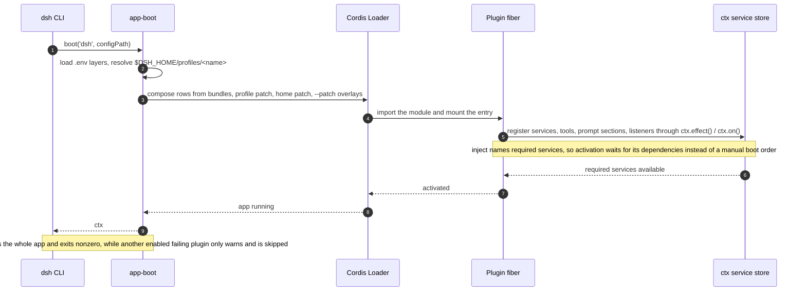

Three rules govern what a plugin may look like and when it runs ([packages/AGENTS.md](packages/AGENTS.md), [docs/cordis-primer.md](docs/cordis-primer.md)):

- **Two export forms, never mixed.** A service package default-exports its `Service` subclass; a function plugin named-exports `name` / `inject` / `Config` / `apply` and has no default export. Mixing the forms makes the Loader discard the function plugin's namespace, so its declarations silently disappear.
- **Dependencies are declared, not sequenced.** `inject` expresses required services; a plugin activates when they exist, so load order is a consequence of the dependency graph. An optional service is read with `ctx.get(name)` rather than the `ctx.<name>` property proxy, whose behavior is topology-sensitive.
- **Registrations are reversible effects.** Tools, prompt sections, adapters, providers, and listeners are installed through `ctx.effect()` or `ctx.on()`; unload and hot reload unwind them in the intended order.

Hot reload (HMR) is YAML-controlled per profile: `dsh-base` enables config-only `dsh-hmr`, headless and SDK compositions disable it, and `sdk-minimal` omits it. Profile reconciliation reports which Loader entries stayed inactive and which changed modules can only take effect after a restart ([docs/subsystems/boot.md](docs/subsystems/boot.md#profile-reconciliation)). Runtime self-modification is a separate, explicit path: `plugin-manager` installs and toggles bundles by editing profile files, and the [extensions](docs/subsystems/extensions.md) family mounts model-written plugins behind approval ([docs/subsystems/boot.md](docs/subsystems/boot.md)).

The Cordis object model behind that sequence:

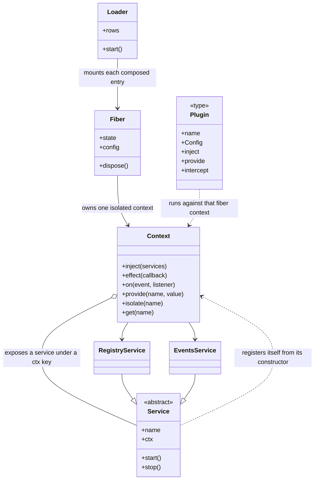

Every subsystem in this document is one of those two plugin forms: a `Service` subclass for the spine (`ctx.sessions`, `ctx.tools`, `ctx.systemPrompt`, `ctx.agents`, `ctx.agentLoop`), or a function plugin that only installs effects (a tool provider, a context contribution, a listener).

<a id="5-runtime-topology"></a>
## 5. Runtime topology

The core packages form the product API spine.

| Package | Owns | `ctx` key |
|---|---|---|
| [`core/session`](docs/subsystems/session.md) | The append-only `SessionEvent` log and in-memory store | `ctx.sessions` |
| [`core/system-prompt`](docs/subsystems/system-prompt.md) | Prompt-section and tool-schema assembly | `ctx.systemPrompt` |
| [`core/tools`](docs/subsystems/tools.md) | The scoped tool registry and guarded execution pipeline | `ctx.tools` |
| [`core/agent`](docs/subsystems/core.md) | The `Agent` interface, live registry, and `agent/*` events | `ctx.agents` |
| [`core/agent-loop`](docs/subsystems/core.md) | The default driver implementing that interface | `ctx.agentLoop` |
| [`core/scope`](docs/subsystems/scope.md) | The per-agent scoped-registration primitive | library, no key |
| [`llm/llm`](docs/subsystems/llm-streaming.md) | Message and stream vocabulary plus the adapter seam | `ctx.llm` |

Around that spine sit the capability families, one group per concern: execution (`shell`, `subprocess`, `terminal`, `sandbox`, `ssh`, `fs`, `lsp`), model surface (`context`, `skill`, `compaction`, `attachment`, `spill`, `todo`, `plan`, `goal`, `schedule`), access (`web`, `mcp`, `computer-use`, `browser-use`), orchestration (`subagent`, `workflow`, `jobs`, `preset`, `guard`, `extensions`), durability (`session`, `session-query`, `storage`, `settings`, `credentials`, `workspace`), and delivery (`host`, `client`, `sdk`, `acp`, `interaction`, `api`). The authoritative group map is [packages/README.md](packages/README.md#package-groups).

The dependency rule that keeps this topology swappable: extension plugins depend on Service Definitions, composition bundles may depend on spine plugins, and `dsh-agent-loop` stays replaceable behind the `dsh-agent` interface ([packages/README.md](packages/README.md#dependencies)).

<a id="6-interface-calls-services-scopes-and-remote-calls"></a>
## 6. Interface calls: services, scopes, and remote calls

**接口调用.** The harness has three call paths, and choosing the right one is the same decision as choosing an extension point.

**In-process service calls.** A Consumer declares its dependency through `inject` and calls a method on `ctx.<key>`. The Service Definition owns the interface and the `ctx` key; providers implement it; consumers never import a provider package. Policy and interception ride events rather than wrapper calls, so a capability can be observed without being reimplemented.

**Scoped calls.** A registration is global or scoped; a scoped one is owned by exactly one scope key, and the harness convention is that a live agent is the key of its own scope (`agent.ctx`). Events about one agent's activity dispatch with that agent's carrier and reach global listeners plus that agent's own; events about a registry itself stay unfiltered. A per-agent restriction filters the global tool set for that scope, and a scoped registration shadows its same-named global twin ([docs/glossary.md#agent-scope](docs/glossary.md#agent-scope), [docs/subsystems/scope.md](docs/subsystems/scope.md)).

**Remote calls.** The browser half cannot call Host services directly, so it goes through Typert: Host packages annotate callable methods with Remote decorators, generation emits strict descriptors and codecs, and the Client mounts the generated face as `ctx.remote.<namespace>`, with session-scoped methods under `agentCtx.remote.<namespace>`. Feature packages depend on that generated face, never on the Gateway implementation ([docs/subsystems/typert.md](docs/subsystems/typert.md), [docs/api-gateway.md](docs/api-gateway.md)).

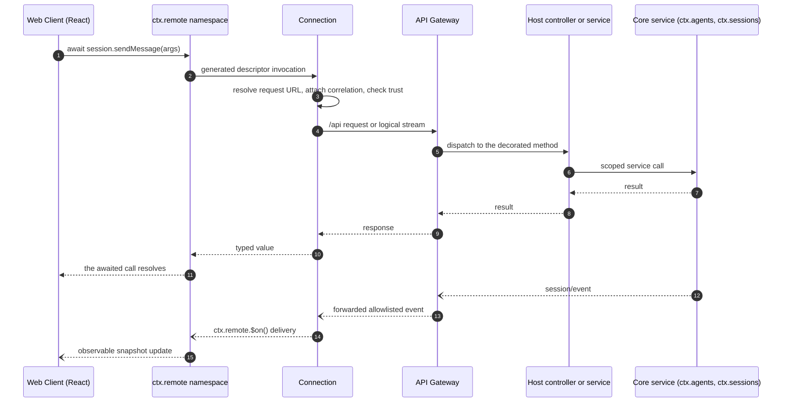

Which layer plays which role:

| Layer | Lane | Responsibility |
|---|---|---|
| Web Client | Browser | UI plugins render from Client models; no transport state in component stores |
| `ctx.remote` | Browser | Typed, generated method face over the wire types |
| Connection | Browser | URL resolution, correlation, `/api` carrier, trust checks, generation tracking |
| API Gateway | Host | Remote dispatch, cancellation, logical streams, selected event forwarding |
| Host controllers and services | Host | Authoritative mutation and stream production |
| Core services and providers | Core | Domain state, persistence, execution |

The internal `$events` logical stream opens each Connection generation with a `ready` frame, which is why a baseline read always follows a generation change ([docs/subsystems/web-client.md](docs/subsystems/web-client.md#remote-communication)).

<a id="7-turn-step-and-the-agent-loop"></a>
## 7. Turn, step, and the agent loop

Two nouns define the loop: a **step** is one model request plus the tools it calls; a **turn** is zero or more steps, opening before its first input is claimed and closing once nothing is owed ([docs/glossary.md#loop-hierarchy](docs/glossary.md#loop-hierarchy)).

```text
turn/start
  claim next-step input plus one queued message
  assemble prompt sections + tool schemas
  -> agent/pre-step; project runtime context at fallback
                                     reject | enter(messages, startsRequestSeries?)
     reject, or a first enter rewritten empty -> close the turn with no step
     step/start
     agent/request -> prepareCall (cancellation commits neither system nor users)
     reconcile system/message using the prepared call capability
     append entered messages as user/message; reconcile retained runtime context
     log request/header and request/context as needed
     derive and freeze model history from the log
     stream the bound prepared call -> llm/stream -> agent/assistant-stream start
       agent/assistant-stream chunk*
       assistant/message | assistant/attempt -> agent/assistant-stream end
     tool/call* -> tools/pre-execute -> tools/execute -> tools/post-execute -> tool/result*
     step/end
     tools owe another request, or next-step input arrived -> claim -> next step
  -> agent/turn-stopping
turn/end
```

The same flow as lanes, showing which component owns each stage:

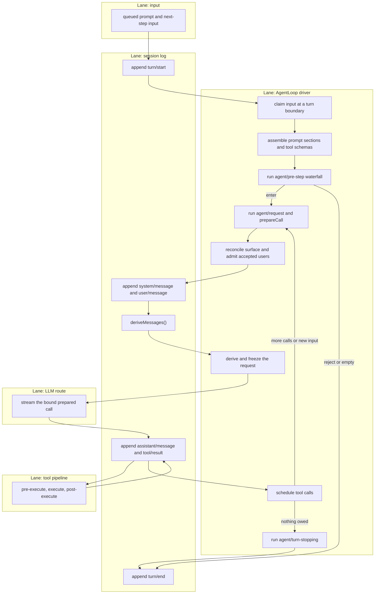

Extension points on this path are typed events rather than loop edits: `agent/pre-step` decides accepted input, `agent/request` resolves the route before anything is committed, `llm/stream` wraps streaming, the three `tools/*` events intercept execution, and `agent/turn-stopping` ends the turn. The loop is the production acquisition point for session write handles: with a persistence backend mounted it creates or opens the handle before publishing the agent, and it closes that handle after committing its closing events ([packages/core/agent-loop/README.md](packages/core/agent-loop/README.md)). Full detail: [docs/architecture.md#turn-flow](docs/architecture.md#turn-flow), [docs/agent-lifecycle.md](docs/agent-lifecycle.md), [docs/tool-execution-pipeline.md](docs/tool-execution-pipeline.md).

The agent objects the loop is built from:

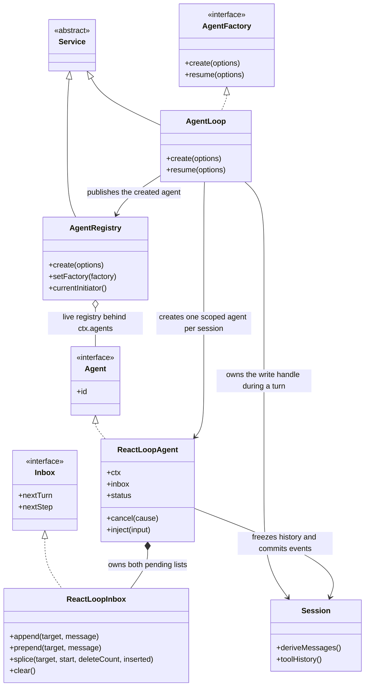

`ctx.agentLoop` is the composition's single `AgentFactory`; `ctx.agents` is the live registry clients and orchestrators read. Replacing the driver means providing another `AgentFactory`, which is why the loop can stay generic about orchestration.

<a id="8-flow-orchestration"></a>
## 8. Flow orchestration

**流程编排.** Orchestration never changes the loop; it composes the loop with entry points, wrappers, and policies that are themselves plugins. Three mechanisms do all of it:

- **Turn entry.** Input arrives from a human message, a queued message, an injected context notice, or an external rule. A turn opens when input is claimed, so every orchestrator ultimately works by producing or waking input.
- **Turn wrapping.** `agent/pre-step` may rewrite or reject the claimed input, `agent/request` may change the route, and `agent/turn-stopping` may stop the turn; `tools/*` wraps execution. A policy that owns a decision returns without `next()`; an observing listener must delegate.
- **Session and agent creation.** A forked session, a delegated subagent, or a webhook-started Workspace session is a new agent with its own scope, inbox, and log; `parentSession` and delegation depth travel as lineage data and never change visibility.

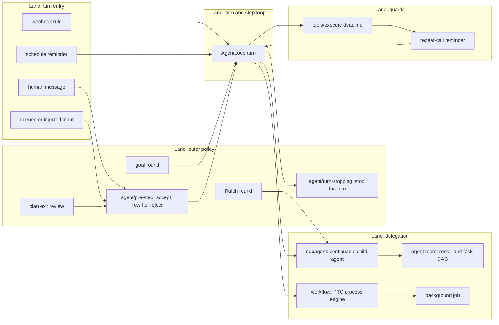

The orchestration families and where each attaches:

| Mechanism | Attaches by | Documented in |
|---|---|---|
| Goal round | registering `ctx.goals`; continuation admits one goal-sourced turn | [docs/subsystems/goal.md](docs/subsystems/goal.md) |
| Schedule | host-owned reminder records delivered as ordinary conversation | [docs/subsystems/schedule.md](docs/subsystems/schedule.md) |
| Plan mode | the log-only `plan/mode` state plus the `exit_plan_mode` review arc | [docs/subsystems/plan.md](docs/subsystems/plan.md) |
| Subagent | the named-provider registry on `ctx.subagents` | [docs/subsystems/subagent.md](docs/subsystems/subagent.md) |
| Agent teams | opt-in `ctx.agentTeams` with a durable roster and shared task state | [docs/subsystems/agent-team.md](docs/subsystems/agent-team.md) |
| Workflow | the `workflow` tool plus a PTC process engine | [docs/subsystems/workflow.md](docs/subsystems/workflow.md) |
| Background job | the `ctx.jobs` runtime plus `job_*` tools | [docs/subsystems/jobs.md](docs/subsystems/jobs.md) |
| Webhook | a trusted rule on `ctx.webhookRuntime` starting a Workspace session | [docs/subsystems/webhook.md](docs/subsystems/webhook.md) |
| Guards | `tools/execute` around-dispatch plus advisory reminders | [packages/guard/README.md](packages/guard/README.md) |

Per-session capability composition is a separate axis: an agent **preset** composes one session's tools, sections, and services from a preset `cordis.yml`, with the same patch precedence as the profile layers ([packages/preset/README.md](packages/preset/README.md)).

The orchestrators as objects, with the loop at the centre:

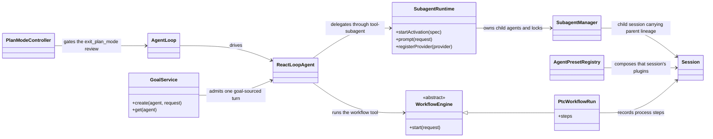

None of these classes is inside the loop. Each one either produces input, wraps a decision through an event, or creates another agent — which is what keeps orchestration additive.

<a id="9-event-mechanism"></a>
## 9. Event mechanism

**事件机制.** Events are the extension points, and the first decision in most changes is which domain the fact belongs to.

- **Session events** are durable facts appended to the log and broadcast through `session/event`. Use one when the fact must survive a reload.
- **Agent events** (`agent/*`) carry a live `Agent`: inbox, step, status, request, validation, continuation. Use one to observe or intercept work in flight.
- **Capability events** attach policy and adapters to a seam (`fs/*`, `tools/*`, `telemetry/*`) without importing the loop.

Dispatch mode is part of each event's public contract, declared through TypeScript declaration merging and tagged with `@mode` so the generated catalog can check declarations against dispatch sites:

| Mode | Awaited? | Dispatch order | Returns a value? |
|---|---|---|---|
| `emit` | No | listeners observe in registration order | No |
| `waterfall` | No | listeners observe in registration order | Yes |
| `parallel` | Yes | all listeners observe in parallel | No |
| `serial` | Yes | listeners observe in registration order | Yes |
| `bail` | No | listeners observe until one bails | Yes |

`waterfall` is around-middleware: a listener receives `(...args, next)`, calls `next()` to delegate the possibly wrapped result, and returns without `next()` to short-circuit. Cooperative listeners mutate a shared decision object and delegate; a listener that owns a single-decision event short-circuits on purpose. `agent/pre-step`, `agent/request`, `llm/stream`, and the three `tools/*` events are waterfalls; `agent/turn-stopping` is serial and has no `next()` ([docs/cordis-primer.md](docs/cordis-primer.md#cordis-waterfall-semantics)).

Which listeners see an event depends on the dispatch carrier, not on the domain:

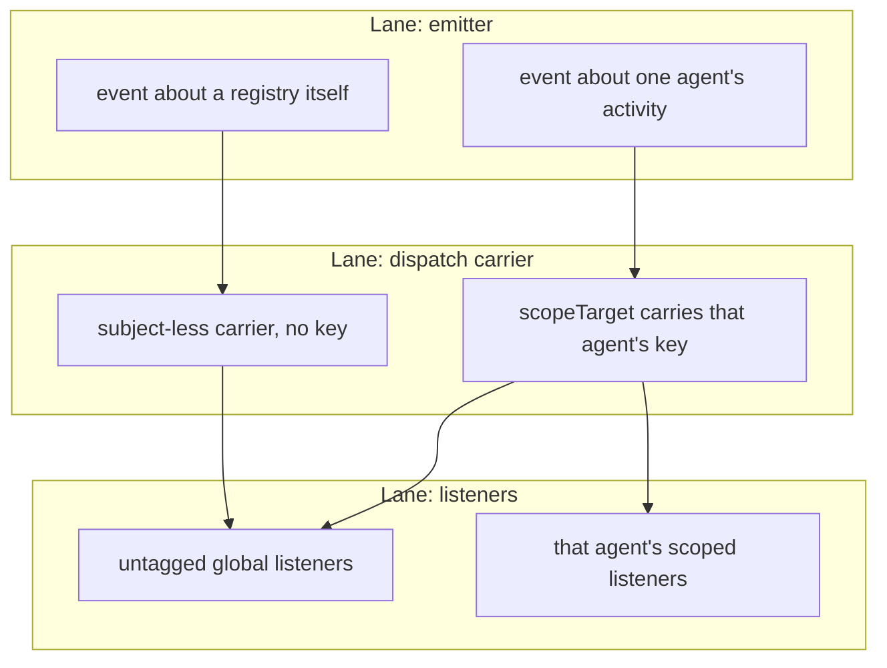

Durability is a property of the event type, not of the domain: `turn/*`, `step/*`, `system/message`, `user/message`, `assistant/message`, `assistant/attempt`, and `tool/*` are durable session events; `agent/*` and capability events are live. `SessionEventMap` members are required-on-read unless the envelope carries `ignorable: true`, so an older reader refuses an unknown fact rather than misinterpreting it ([docs/subsystems/session.md](docs/subsystems/session.md)). The producer/consumer inventory is [docs/event-producer-consumer.md](docs/event-producer-consumer.md).

The event machinery as objects:

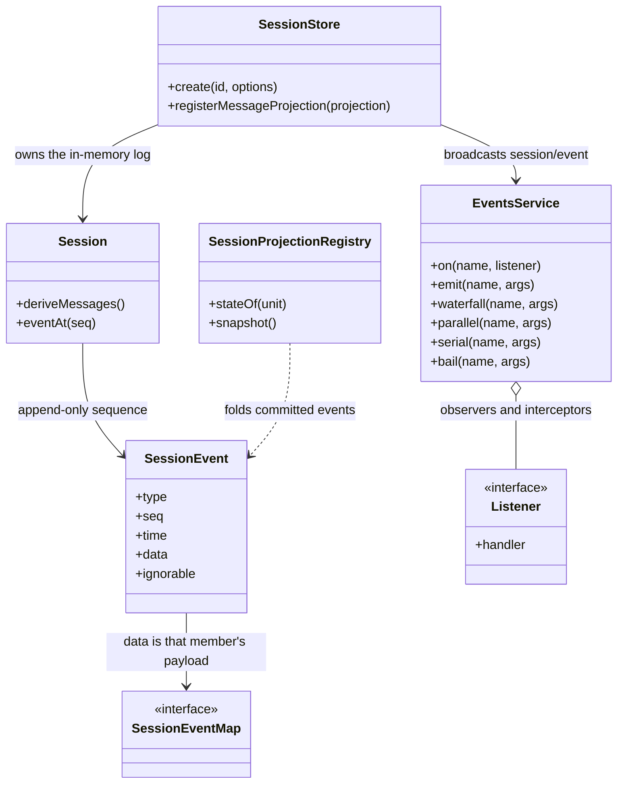

`EventsService` is domain-neutral: the durable session events, the live `agent/*` events, and the capability events all ride the same five dispatch modes, and only `SessionEventMap` decides which of them survive a reload.

<a id="10-session-log-and-durability"></a>
## 10. Session log and durability

The session log is an append-only, versioned sequence of `SessionEvent`s and the single source of the context the model sees. `deriveMessages()` projects model history from it; each `assistant/message` embeds the compact timed stream that produced its content, while `assistant/attempt` retains settled failed, retried, cancelled, or stream-errored attempts without adding model history ([docs/subsystems/session.md](docs/subsystems/session.md)).

Durability contracts:

- **Storage seam.** `SessionPersistence` (`create`/`open`/`stat`/`list`/`export`) is implemented by the JSONL provider, which owns physical framing, compression, generation selection, and exclusive publication ([docs/subsystems/persistence.md](docs/subsystems/persistence.md)).
- **Versioned generations.** JSONL v0 uses `session.jsonl[.zstd]`; v1 and later use `session.vN.jsonl[.zstd]`. Committed generations are never renamed, replaced, or deleted. A write open publishes a version-named successor beside the unchanged source through one adjacent `vN -> vN+1` migration step ([docs/session-format-status.md](docs/session-format-status.md)).
- **Projection seam.** `dsh-session-projection` owns `ctx.sessionProjections`: registered units fold committed events incrementally and consumers read one typed state via `stateOf()`, with `snapshot()` for batched client views ([docs/subsystems/session-projection.md](docs/subsystems/session-projection.md)).
- **Plugin-owned message projections.** A plugin that changes existing message content registers a pure projection; detached readers supply the same definitions explicitly.

<a id="11-memory-management"></a>
## 11. Memory management

**Memory 管理.** The harness has no separate memory service; memory is the session log plus the mechanisms that shape what is read from it, and each mechanism has its own owner. Four layers cover the whole picture.

- **Durable memory — the session log.** Every fact worth remembering is an event in the log: user and assistant messages, tool calls and results, compaction records, attachments, working-directory changes, goals, todos. The log is written as versioned JSONL generations beside a write handle the loop owns, so restart, replay, fork, resume, and export all read the same record ([docs/subsystems/persistence.md](docs/subsystems/persistence.md)).
- **Working memory — derived history.** A request's history is `deriveMessages()` over the log, filtered by surface operations and message projections, then frozen for that request. Working memory is therefore computed, never a mutable cache the loop owns.
- **Payload memory — attachments and spill.** Large content lives outside the transcript: images get durable identity in a content-addressed store and are referenced from messages, and oversized tool results are spilled to storage and replaced by a locator with retrieval guidance. Both keep the log readable while preserving the full original ([packages/attachment/README.md](packages/attachment/README.md), [packages/spill/README.md](packages/spill/README.md)).
- **Condensation — compaction.** The `ctx.compaction` seam reduces history when token pressure builds: automatic summarization of older history, on-demand `/compact`, trimming of oversized tool outputs, and image offload when a route can no longer accept images. Compaction is one optional capability, not part of the loop spine, and it records `compaction/start`, `compaction/summary`, and `compaction/end` as log-only events bracketed by a log-recorded lock, with the summary applied through a single surface replacement ([docs/subsystems/compaction.md](docs/subsystems/compaction.md)).

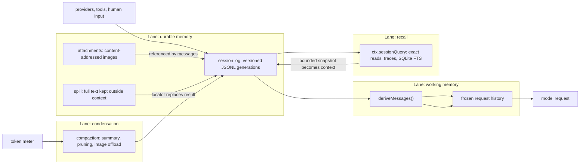

Retrieval is deliberately independent of condensation: `ctx.sessionQuery` serves exact event reads, filtered lists, relationship traces, and SQLite FTS5 full-text search over lives and durable history, so looking something up does not require keeping it in context ([packages/session-query/README.md](packages/session-query/README.md)).

The memory objects, one owner per layer:

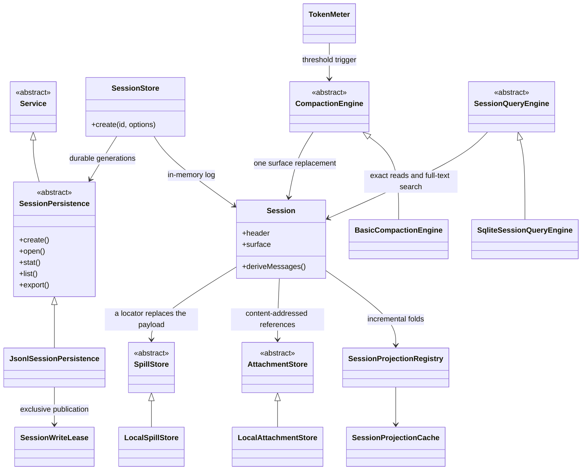

Each abstract class is a Service Definition with swappable providers, so the memory layer changes by registering a different provider rather than by editing the loop.

<a id="12-context-management"></a>
## 12. Context management

**上下文管理.** Context is what a request carries besides the model's own output, and the harness separates it into three layers with different durability, so a plugin can change one without disturbing the others.

- **System prompt (stable).** Prompt sections registered on `ctx.systemPrompt` are assembled cooperatively each request — sections sort by order and name, tool providers contribute schemas, variables interpolate, and at most one `complete` section may win. The rendered text is committed as a `system/message` surface node rather than a request field, so the prompt reaches the model as derived history and a capable route can append an update after cached history instead of rewriting it ([docs/subsystems/system-prompt.md](docs/subsystems/system-prompt.md)).
- **Durable context (logged).** Injected instructions and references — workspace `AGENTS.md` guidance, a referenced session snapshot, a `@file` mention — enter history as user-role messages, so they persist, replay, and compact like any other conversation content. This is what makes "model-visible ⟺ logged" hold for context ([packages/context/README.md](packages/context/README.md)).
- **Runtime context (per attempt).** Facts such as the current time or the agent's tmux location are refreshed for each attempt, included in model history by default, and separately configurable per persona scope; required context remains even when optional snapshots are suppressed. They are recorded under the durable `runtime-context` form so a resumed request still reconstructs what the model saw ([docs/config-catalog.md](docs/config-catalog.md)).

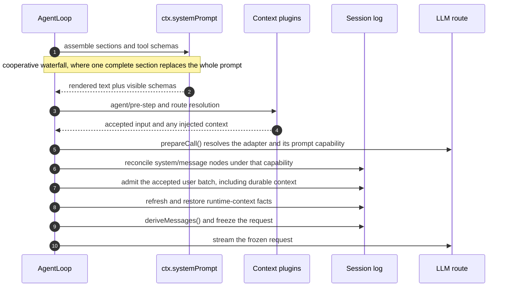

Token pressure is handled where the context is assembled, not inside the providers: the token meter measures the request, and compaction acts on the log when measurement crosses the configured threshold. Because the prompt is a surface node, an unchanged prompt produces no event, and consolidation happens only when the prepared route cannot append updates ([packages/core/agent-loop/README.md](packages/core/agent-loop/README.md)).

The context objects, one per durability layer:

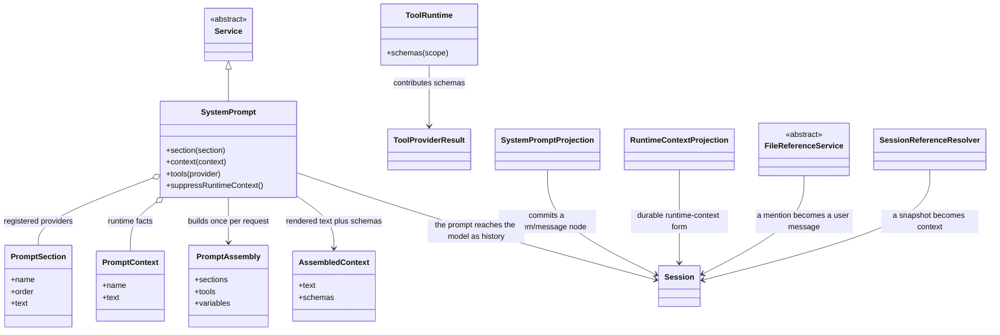

The three durability layers are visible here: `PromptSection` and `PromptContext` are per-request inputs, `AssembledContext` is the frozen rendering, and everything that must survive a reload lands in the log as a `system/message`, a `user/message`, or a `runtime-context` record.

<a id="13-tools"></a>
## 13. Tools

Tools are the model-facing capability consumers. Each registers a `ToolDefinition` on `ctx.tools` with a schema built from a typed DSL; its schema joins prompt assembly, and it may contribute a UI presentation contract for clients ([docs/subsystems/tools.md](docs/subsystems/tools.md), [docs/tool-catalog.md](docs/tool-catalog.md)).

Execution runs through a guarded pipeline (`tools/pre-execute` → monotonic guards → `tools/execute` → `tools/post-execute` → `tools/result`) so that policy, approval, sandboxing, deadlines, result rewriting, and UI rendering attach without touching the loop. Enforcement lives in the operation that makes the decision: schema omission, prompt filtering, or listener order are not enforcement when another caller can bypass them. A definition-owned `projectContent` installs prepared content before post-execute, `finalizeContent` enforces the last content-only invariant, and `tools/result` notifies the frozen authoritative outcome after the registry normalizes any pipeline failure into an error result ([docs/tool-execution-pipeline.md](docs/tool-execution-pipeline.md)).

Tool calls are scheduled within a step: exclusive calls form ordering barriers and parallel-safe calls use a bounded rolling pool, so a call family that mutates shared state can declare itself exclusive while read-only calls overlap ([packages/core/agent-loop/README.md](packages/core/agent-loop/README.md#what-a-step-does)).

<a id="14-model-facing-surface"></a>
## 14. Model-facing surface

What a model sees is assembled per request from independently contributed parts:

- **Prompt sections** registered on `ctx.systemPrompt`, assembled cooperatively and logged as `system/message` history.
- **Tool schemas** from the scoped tool registry, where per-agent restrictions filter the global set and scoped registrations shadow same-named globals.
- **Request context** from `context` plugins and `agent.inject()` calls that land in the next admitted request.
- **Skills**: a discovery-priority provider registry exposing a catalog plus a model-facing loader ([docs/subsystems/skills.md](docs/subsystems/skills.md)).
- **Attachments, spills, and compaction decisions**, each with its own durable identity and events.

The contract for all of them is written from the model's perspective: prompts, schemas, results, and diagnostics carry task-relevant concepts only, never UI, transport, or implementation vocabulary, and stable model-visible text is pinned verbatim while dynamic behavior is covered by snapshots or end-to-end tests ([packages/AGENTS.md](packages/AGENTS.md)).

<a id="15-clients-transports-and-sdks"></a>
## 15. Clients, transports, and SDKs

The core is carrier-neutral; each carrier mounts the same profile-composed plugins.

- **Web.** `apps/cli` serves a Vite-built React shell (`apps/web`) from `packages/client/*` UI plugins over the Host/Remote wire described in [§6](#6-interface-calls-services-scopes-and-remote-calls). Client UI is composed by typed Slots and Conversation node definitions; product copy is locale-owned ([docs/subsystems/web-client.md](docs/subsystems/web-client.md), [docs/subsystems/conversation.md](docs/subsystems/conversation.md)).
- **Desktop.** The Electron app ships its dsh runtime in signed resources, starts the private Desktop Host, and loads the packaged Web application in the same document ([docs/architecture.md#desktop-application](docs/architecture.md#desktop-application)).
- **Headless and SDK.** `headless` runs one task with no server; `sdk` exposes a JSON-RPC protocol with a TypeScript client/server ([docs/subsystems/typert.md](docs/subsystems/typert.md)). The Python SDK packages the CLI runtime wheel and launches `dsh --profile sdk` ([python/README.md](python/README.md)).
- **Automation.** `acp` serves the automation-only Agent Client Protocol ([packages/acp/README.md](packages/acp/README.md)).
- **Remote BFF.** `packages/api` assembles the Typert RPC gateway used by remote deployments ([docs/api-gateway.md](docs/api-gateway.md)).

<a id="16-repository-layout"></a>
## 16. Repository layout

```text
vendor/      vendored Cordis (rescoped, private)
packages/    342 workspaces, @deepseek-ai/dsh-<pkg>, grouped by capability family
apps/        cli, web, desktop, desktop-host, plugin-market-generator
native/      @deepseek-ai/node-addon-system source
python/      Python SDK and runtime
docs/        architecture, subsystems, cookbooks, guides, generated catalogs
snapshots/   keyless recorded-session replay fixtures
website/     VitePress documentation projection
scripts/     gates, generators, release tooling
```

Every package is ESM (`"type": "module"`), lives in exactly one group, and is listed in that group's README. Package-level rules — export form, service access, test placement, README contract — are in [packages/AGENTS.md](packages/AGENTS.md).

<a id="17-engineering-conventions-and-quality-gates"></a>
## 17. Engineering conventions and quality gates

The repository treats invariants as executable gates rather than review conventions ([scripts/](scripts/), [docs/development.md](docs/development.md)).

- **Types.** `strict: true` repo-wide; opaque cross-boundary ids are branded; no new `as unknown` casts.
- **Tests.** Unit tests colocated per package; `test:coverage` (not `test`) is the CI coverage gate with per-file 100% on `packages/*/*/src`; product-visible plugins need a real-composition test that boots `cordis.yml` through the Loader.
- **Snapshots.** Every non-trivial model- or product-user-visible change updates a keyless recorded-session snapshot that replays through shipped profiles.
- **Docs.** Markdown is one physical line per paragraph, links resolve, pasted type declarations drift-check against source, and standing docs have word budgets.
- **Generated references.** Tool, config, persistence, CLI, Cordis, and module-graph catalogs are generated from source and freshness-gated in CI.
- **Persistence discipline.** Every externally perceptible breaking change is recorded immediately in an upgrade guide; persistence-type changes need an acknowledgement.

<a id="18-extending-the-harness"></a>
## 18. Extending the harness

New behavior attaches to a documented extension point; changing the loop itself updates the architecture map.

| Goal | Mechanism |
|---|---|
| Add a model provider | register its adapter on `ctx.llm` |
| Add a model-facing capability | register on `ctx.tools`; its schema joins prompt assembly |
| Give one session a different capability set | compose an agent preset |
| Add shell, terminal, or filesystem execution | register a `ctx.shell`, `ctx.terminals`, or `ctx.fs` backend |
| Add a human command | register on `ctx.commands` |
| Intercept a request, tool, or turn | use the matching `agent/*` or `tools/*` event |
| Add model-facing context | call `agent.inject()` |
| Add UI or editor integration | drive `ctx.agents`, expose Host methods as Remotes, and render from `session/event` |
| Add durable session state | extend `SessionEventMap`; render and replay from the log |
| Store sessions in a new backend | implement `SessionPersistence` over the shared handle scaffolding |
| Start a session from an external system | register a trusted rule on `ctx.webhookRuntime` |

Step-by-step guides: [docs/cookbook/extension-cookbook.md](docs/cookbook/extension-cookbook.md) (packages, tools, LLM adapters, settings cards).

<a id="19-tradeoffs-and-known-limitations"></a>
## 19. Tradeoffs and known limitations

- **Pre-stable APIs.** Public APIs change with every consumer updated together; the format is versioned and migrated rather than frozen.
- **Composition depth.** Plugin composition is powerful but demands a profile-plus-patch mental model; `dsh --profile web --dump-config` exists to make the resolved tree inspectable.
- **Call-path indirection.** Remote calls route through generated descriptors and a gateway, which buys type safety and swappability at the cost of an extra hop to read through.
- **Gate weight.** Per-file 100% coverage, generated-catalog freshness, and bilingual documentation pairing raise the cost of small changes; the repository mitigates it by requiring only the checks that cover the outgoing diff before push.
- **Experimental surface.** `packages/experimental/*` capabilities carry no product-support commitment ([packages/experimental/README.md#status](packages/experimental/README.md#status)).
- **Platform matrix.** Fixtures replay on macOS and Linux; Windows-specific behavior is diagnosed through a separate gate rather than assumed equivalent.
