# DeepSeek Harness — 设计文档

DeepSeek Harness（`dsh`）的设计概览，它是 [DeepSeek AI](https://deepseek.com) 开源的 agent harness，采用「一切皆插件」的架构。

本文是一张导航图：它说明设计目标、组装与运行时模型、插件加载与调用路径、持久化数据契约以及仓库形态，并为跨包边界的关键流程与对象模型配了时序图、泳道图与类图。每个主题都链接到其归属文档。权威的行为地图是 [docs/architecture.zh.md](docs/architecture.zh.md)；各子系统的类型参考在 [docs/subsystems/README.zh.md](docs/subsystems/README.zh.md)；术语表在 [docs/glossary.zh.md](docs/glossary.zh.md)。本文的英文版本是 [design.md](design.md)。

仓库版本：`0.2.1-rc.2`。许可证：MIT。状态：开发者预览版，预期会有破坏兼容性的变更（[README.zh.md](README.zh.md)、[SAFETY.zh.md](SAFETY.zh.md)）。

<a id="the-code-directory"></a>
## 代码目录

整个仓库是一个 pnpm workspace（`pnpm-workspace.yaml`）。顶层把「内置基础库、能力包、产品组装、非 TypeScript 运行时」分开。

```text
vendor/      源码内置的 Cordis 与其基础库（已改作用域且 private；本地差异记录在 vendor/README.md）
packages/    342 个 workspace，命名为 @deepseek-ai/dsh-<pkg>，每个目录对应一个能力族
  core/        产品 API 脊柱：agent、agent-loop、session、system-prompt、tools、scope
  llm/         模型适配器、流式词汇、token 计量、重试
  session/     持久化、投影、格式世代、标题、工作目录
  ...          完整分组地图见 packages/README.zh.md#package-groups
apps/        产品组装：cli（提供 `dsh` 可执行入口）、web、desktop、desktop-host、plugin-market-generator
native/      @deepseek-ai/node-addon-system，在此从源码构建原生 addon 加载器
python/      Python SDK、其运行时部署根与发布的 wheel
docs/        架构、子系统、cookbook、生成目录、指南与升级指南
snapshots/   无密钥的录制会话回放固定装置，按面分组（session、web、sdk、acp）
scripts/     仓库闸门、生成器与发布工具
website/     docs/ 的 VitePress 投影站点
benchmarks/  性能闸门场景
patches/     针对固定版本上游依赖的 pnpm patch 文件
```

阅读路径：

- **先看行为。** [docs/architecture.zh.md](docs/architecture.zh.md) 是运行时地图；下文每条流程都链接到拥有它的那一个子系统文档。
- **再看单个包。** 一个包的契约是它的 `README.zh.md` 加上 `src/index.ts` 导出上的 JSDoc，其所属分组 README 列出同族包。
- **然后看 loop。** `packages/core/agent-loop/src/index.ts` 是所有能力接入的入口；[§5](#5-runtime-topology) 的脊柱表索引了它驱动的 `ctx` key。
- **生成文件只当产物读，不要当源码改。** `docs/tool-catalog.zh.md`、`docs/config-catalog.zh.md`、`docs/module-graph.zh.md`、`docs/persistence-catalog.zh.md` 均由源码派生并受新鲜度闸门约束。

## 目录

- [代码目录](#the-code-directory)
- [1. 问题与目标](#1-problem-and-goals)
- [2. 设计原则](#2-design-principles)
- [3. 组装模型：profile、bundle、patch](#3-composition-model-profiles-bundles-patches)
- [4. 插件加载与生命周期](#4-plugin-loading-and-lifecycle)
- [5. 运行时拓扑](#5-runtime-topology)
- [6. 接口调用：服务、作用域与远程调用](#6-interface-calls-services-scopes-and-remote-calls)
- [7. 轮次、步骤与 agent loop](#7-turn-step-and-the-agent-loop)
- [8. 流程编排](#8-flow-orchestration)
- [9. 事件机制](#9-event-mechanism)
- [10. 会话日志与持久化](#10-session-log-and-durability)
- [11. Memory 管理](#11-memory-management)
- [12. 上下文管理](#12-context-management)
- [13. 工具](#13-tools)
- [14. 模型可见面](#14-model-facing-surface)
- [15. 客户端、传输与 SDK](#15-clients-transports-and-sdks)
- [16. 仓库结构](#16-repository-layout)
- [17. 工程约定与质量闸门](#17-engineering-conventions-and-quality-gates)
- [18. 扩展方式](#18-extending-the-harness)
- [19. 权衡与已知限制](#19-tradeoffs-and-known-limitations)

-----

<a id="1-problem-and-goals"></a>
## 1. 问题与目标

harness 针对模型运行一个 agent loop，给模型提供工具，并持久记录模型看到和做过的一切。它不是一个固定的应用：模型适配器、工具注册表、会话日志、agent loop、沙箱、UI 的每一部分都是插件，部署方可以通过配置替换。

设计目标：

- **一切皆可替换。** 每种能力都有一个稳定服务定义（Service Definition）背后的可替换提供方，因此一次提供方替换（文件系统、子进程、模型、沙箱、子 agent）就能带动整个产品迁移，无需 fork 消费方。
- **靠组装而非配置开关。** 运行中的 harness 是插件的有序分层；部署通过修补层列表来改变行为，而不是在插件内部分支。
- **持久化是唯一事实来源。** 会话日志是权威记录，模型历史、UI、遥测、fork、resume 都从它派生。
- **注册即副作用。** 每一项贡献都经由 Cordis effect，并在贡献它的插件卸载时回退，因此热重载与 teardown 的行为一致。
- **一个产品，多种载体。** Web、Desktop、headless CLI、自动化（ACP）与 SDK 客户端运行同一套由 profile 组装的核。

明确的非目标：稳定的公共 API（按策略保持 pre-stable）、唯一的标准前端，以及支持绕过 `dsh` profile 启动器去启动 Node 应用（[规则](docs/architecture.zh.md#应用启动)）。

<a id="2-design-principles"></a>
## 2. 设计原则

- **Cordis 是底座。** 插件向共享上下文贡献服务、类型化事件和可逆副作用，没有需要打补丁的特权内核（[docs/cordis-primer.zh.md](docs/cordis-primer.zh.md)、[docs/architecture.zh.md](docs/architecture.zh.md#cordis)）。
- **模型可见 ⟺ 已记录。** 任何抵达模型请求的内容都必须能从会话日志重建，新的模型可见输入需要一个会话事件（[docs/subsystems/session.zh.md](docs/subsystems/session.zh.md)）。
- **能力 seam 优先于直接依赖。** 扩展插件依赖服务定义，绝不依赖具体提供方（[packages/README.zh.md](packages/README.zh.md#dependencies)）。
- **包边界上显式优于隐式。** 默认值由拥有该行为的实现显式解析，而不是隐藏在运行路径里的兜底。
- **配置错误要响亮失败。** 缺失的引用对象在加载时或最早可解析的位置报错，绝不静默跳过。
- **以证据代替猜测。** 抽象、选项、默认值与兼容路径都需要当前的所有者和生产消费方。
- **源码面与产物面分离。** 静态闸门与测试把工作区导入解析到 `src`；消费已构建 `lib/` 的闸门需声明该依赖（[docs/development.zh.md](docs/development.zh.md#typescript-project-layout)）。

<a id="3-composition-model-profiles-bundles-patches"></a>
## 3. 组装模型：profile、bundle、patch

运行中的 `dsh` 是在启动时按有序分层组装出来的插件树。

```text
empty entry list
  + profile's ordered bundles          (dsh-base, then the app bundle)
  + profile cordis.patch.yml
  + user home patch
  + --patch overlays
  = the live plugin tree
```

- **profile** 是存放在 Harness home 中的具名组装。随发行提供的模板有：`web`、`headless`、`sdk`、`sdk-minimal`、`acp`。
- **bundle** 是 Cordis 配置行及其背后代码的分发格式，通过 `package.json` 中的 `dsh.bundle` 声明。[`dsh-base`](packages/bundle/base/README.zh.md) 是共享的第一层（模型适配器、工具、持久化、沙箱与审批策略、设置、凭据、遥测），应用 bundle 在其上添加载体。
- **patch** 按 id 定位某一行并整体替换其 config，或插入新行。`preset` patch 在某个 agent 声明的 `config.plugins` 内做同样的操作，并遵循相同的层优先级。

支持的 Node 应用只能通过具名 profile 启动，profile 组装等于「一个 profile 加有序 patch 文件」，绝不是另一个可执行文件（[docs/architecture.zh.md#application-launch](docs/architecture.zh.md#应用启动)、[app-boot](packages/boot/app-boot/README.zh.md#profiles)）。分层错误会导致启动失败，而不可读或不兼容的 bundle 会被跳过并记录在该 profile 的 `skippedBundles` 中。

<a id="4-plugin-loading-and-lifecycle"></a>
## 4. 插件加载与生命周期

**插件加载。** 启动是在组装好的 entry 列表上跑一次 Cordis Loader，而不是手写的 import 列表。`apps/cli` 调用共享启动库，由它加载环境层、解析 profile 目录、把 bundle patch 与 profile patch 组装成 Loader 行、把每一行挂载为一个 fiber，并返回运行中的 context —— 或者给出失败的插件及其原因。`--dump-config` 只打印组装后的行，不启动。

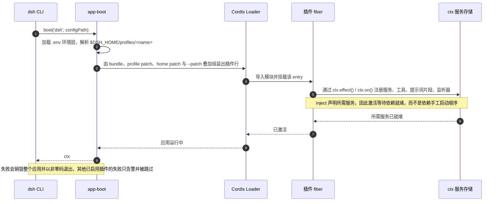

三条规则决定插件长什么样、何时运行（[packages/AGENTS.md](packages/AGENTS.md)、[docs/cordis-primer.zh.md](docs/cordis-primer.zh.md)）：

- **两种导出形式，绝不混用。** 服务包默认导出其 `Service` 子类，函数式插件具名导出 `name` / `inject` / `Config` / `apply` 且没有默认导出。混用会让 Loader 丢弃函数式插件的命名空间，其声明会静默消失。
- **依赖靠声明，而非排序。** `inject` 表达所需服务，依赖就绪时插件才激活，因此加载顺序是依赖图的推论。可选服务用 `ctx.get(name)` 读取，而不用行为与拓扑相关的 `ctx.<name>` 属性代理。
- **注册即可逆副作用。** 工具、提示词片段、适配器、提供方与监听器都通过 `ctx.effect()` 或 `ctx.on()` 安装，卸载与热重载会按预期顺序回退它们。

热重载（HMR）由各 profile 的 YAML 控制：`dsh-base` 启用仅配置的 `dsh-hmr`，headless 与 SDK 组装禁用它，`sdk-minimal` 则完全不包含它。profile 对账会报告哪些 Loader entry 保持未激活、哪些被改动过的模块只能在重启后生效（[docs/subsystems/boot.zh.md](docs/subsystems/boot.zh.md#profile-reconciliation)）。运行期自我修改是一条独立且显式的路径：`plugin-manager` 通过编辑 profile 文件来安装与开关 bundle，[extensions](docs/subsystems/extensions.zh.md) 家族在审批之后挂载由模型编写的插件（[docs/subsystems/boot.zh.md](docs/subsystems/boot.zh.md)）。

上面这段时序背后的 Cordis 对象模型：

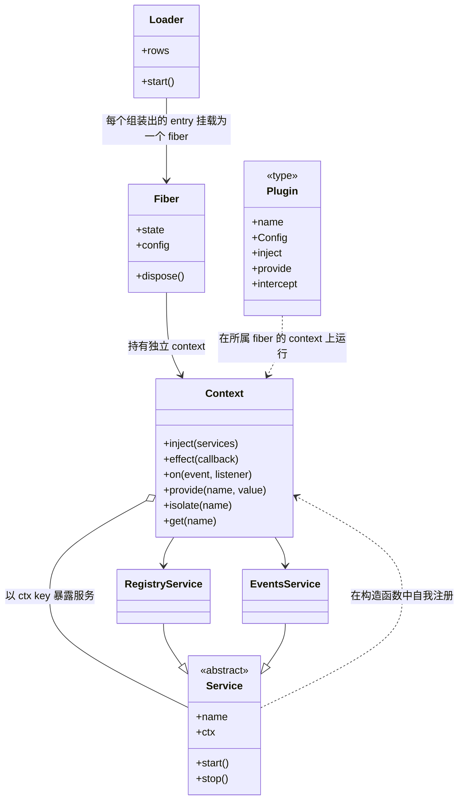

本文中的每个子系统都属于这两种插件形态之一：脊柱是 `Service` 子类（`ctx.sessions`、`ctx.tools`、`ctx.systemPrompt`、`ctx.agents`、`ctx.agentLoop`），其余是只安装副作用的函数插件（工具提供方、上下文贡献、监听器）。

<a id="5-runtime-topology"></a>
## 5. 运行时拓扑

核心包构成产品 API 的脊柱。

| 包 | 职责 | `ctx` 键 |
|---|---|---|
| [`core/session`](docs/subsystems/session.zh.md) | 仅追加的 `SessionEvent` 日志和内存存储 | `ctx.sessions` |
| [`core/system-prompt`](docs/subsystems/system-prompt.zh.md) | 提示词片段与工具 schema 的组装 | `ctx.systemPrompt` |
| [`core/tools`](docs/subsystems/tools.zh.md) | 作用域化的工具注册表和带把关的执行流水线 | `ctx.tools` |
| [`core/agent`](docs/subsystems/core.zh.md) | `Agent` 接口、活跃 agent 注册表和 `agent/*` 事件 | `ctx.agents` |
| [`core/agent-loop`](docs/subsystems/core.zh.md) | 实现该接口的默认驱动器 | `ctx.agentLoop` |
| [`core/scope`](docs/subsystems/scope.zh.md) | 按 agent 划分作用域的注册原语 | 库，无 ctx 键 |
| [`llm/llm`](docs/subsystems/llm-streaming.zh.md) | 消息与流式词汇表，以及适配器 seam | `ctx.llm` |

脊柱周围是按关注点分组的各能力家族：执行（`shell`、`subprocess`、`terminal`、`sandbox`、`ssh`、`fs`、`lsp`）、模型接口（`context`、`skill`、`compaction`、`attachment`、`spill`、`todo`、`plan`、`goal`、`schedule`）、访问（`web`、`mcp`、`computer-use`、`browser-use`）、编排（`subagent`、`workflow`、`jobs`、`preset`、`guard`、`extensions`）、持久化（`session`、`session-query`、`storage`、`settings`、`credentials`、`workspace`）与交付（`host`、`client`、`sdk`、`acp`、`interaction`、`api`）。权威的分组地图是 [packages/README.zh.md](packages/README.zh.md#package-groups)。

维持这套拓扑可替换的依赖规则是：扩展插件依赖服务定义，组装 bundle 可以依赖脊柱插件，而 `dsh-agent-loop` 在 `dsh-agent` 接口之后保持可替换（[packages/README.zh.md](packages/README.zh.md#dependencies)）。

<a id="6-interface-calls-services-scopes-and-remote-calls"></a>
## 6. 接口调用：服务、作用域与远程调用

**接口调用。** harness 有三条调用路径，选择哪一条与选择扩展点是同一个决定。

**进程内服务调用。** 消费方用 `inject` 声明依赖，然后调用 `ctx.<key>` 上的方法。服务定义拥有接口与 `ctx` 键，提供方实现它，消费方从不导入提供方包。策略与拦截走事件而非包装调用，因此可以在不重新实现能力的前提下去观察它。

**作用域化调用。** 注册要么是全局的，要么是作用域化的，作用域化注册恰好由一个 scope key 拥有，harness 的约定是「一个活跃 agent 就是它自己作用域的键」（`agent.ctx`）。关于某个 agent 活动的事件以该 agent 的载体派发，抵达全局监听器与该 agent 自己的监听器，而关于注册表本身的事件保持不过滤。按 agent 的限制会为该作用域过滤全局工具集，作用域内注册会遮蔽同名的全局注册（[docs/glossary.zh.md#agent-scope](docs/glossary.zh.md#agent-scope)、[docs/subsystems/scope.zh.md](docs/subsystems/scope.zh.md)）。

**远程调用。** 浏览器侧无法直接调用 Host 服务，因此经过 Typert：Host 包用 Remote 装饰器标注可调用方法，生成器产出严格描述符与编解码器，客户端把生成的面挂载为 `ctx.remote.<namespace>`，会话级方法挂在 `agentCtx.remote.<namespace>` 下。功能包依赖这个生成的面，绝不依赖 Gateway 实现（[docs/subsystems/typert.zh.md](docs/subsystems/typert.zh.md)、[docs/api-gateway.zh.md](docs/api-gateway.zh.md)）。

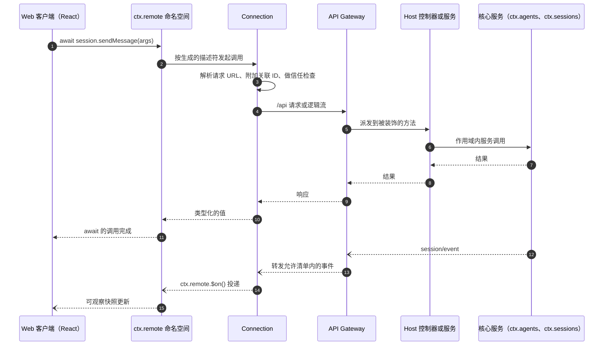

各层承担的角色：

| 层 | 泳道 | 职责 |
|---|---|---|
| Web 客户端 | 浏览器 | UI 插件从客户端模型渲染，组件 store 不复制传输状态 |
| `ctx.remote` | 浏览器 | 覆盖线上类型的、生成的类型化方法面 |
| Connection | 浏览器 | URL 解析、关联、`/api` 载体、信任检查、连接代次跟踪 |
| API Gateway | Host | Remote 派发、取消、逻辑流、选定事件转发 |
| Host 控制器与服务 | Host | 权威的变更与流产出 |
| 核心服务与提供方 | 核 | 领域状态、持久化、执行 |

内部的 `$events` 逻辑流会以 `ready` 帧开启每个 Connection 代次，因此基线读取总是发生在代次变更之后（[docs/subsystems/web-client.zh.md](docs/subsystems/web-client.zh.md#remote-通信)）。

<a id="7-turn-step-and-the-agent-loop"></a>
## 7. 轮次、步骤与 agent loop

两个名词定义了循环：一个**步骤**是一次模型请求加上它调用的工具；一个**轮次**包含零个或多个步骤，在领取首条输入之前打开，并在不再欠下任何工作时关闭（[docs/glossary.zh.md#loop-hierarchy](docs/glossary.zh.md#循环层级)）。

```text
turn/start
  claim next-step input plus one queued message
  assemble prompt sections + tool schemas
  -> agent/pre-step; project runtime context at fallback
                                     reject | enter(messages, startsRequestSeries?)
     reject, or a first enter rewritten empty -> close the turn with no step
     step/start
     agent/request -> prepareCall (cancellation commits neither system nor users)
     reconcile system/message using the prepared call capability
     append entered messages as user/message; reconcile retained runtime context
     log request/header and request/context as needed
     derive and freeze model history from the log
     stream the bound prepared call -> llm/stream -> agent/assistant-stream start
       agent/assistant-stream chunk*
       assistant/message | assistant/attempt -> agent/assistant-stream end
     tool/call* -> tools/pre-execute -> tools/execute -> tools/post-execute -> tool/result*
     step/end
     tools owe another request, or next-step input arrived -> claim -> next step
  -> agent/turn-stopping
turn/end
```

同一流程的泳道视图，标出每个阶段由哪个组件负责：

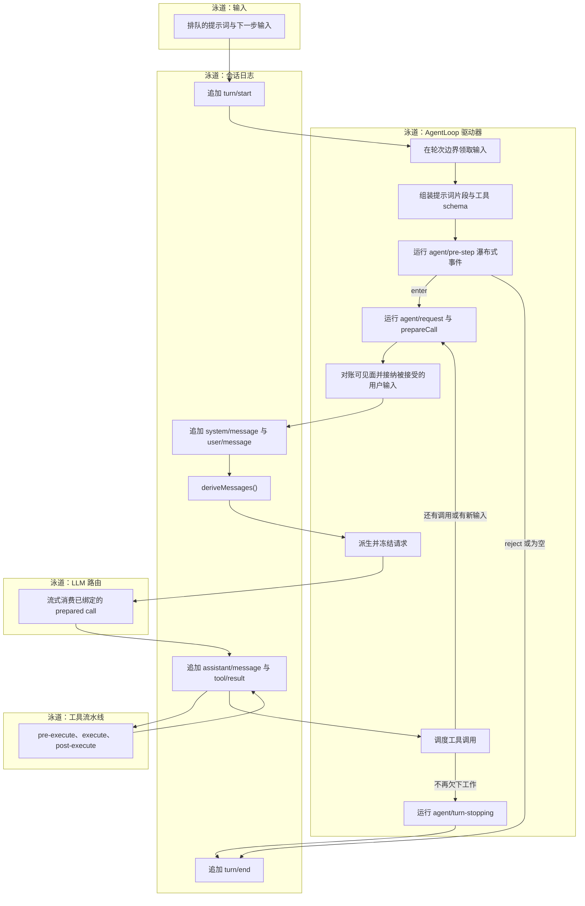

这条路径上的扩展点是类型化事件而不是循环改动：`agent/pre-step` 决定接受的输入，`agent/request` 在任何内容提交之前解析路由，`llm/stream` 包装流式过程，三个 `tools/*` 事件拦截执行，`agent/turn-stopping` 结束轮次。loop 也是会话写句柄的生产性获取点：挂载了持久化后端时，它在发布 agent 之前创建或打开句柄，并在提交收尾事件之后关闭它（[packages/core/agent-loop/README.zh.md](packages/core/agent-loop/README.zh.md)）。完整细节见 [docs/architecture.zh.md#turn-flow](docs/architecture.zh.md#turn-flow)、[docs/agent-lifecycle.zh.md](docs/agent-lifecycle.zh.md)、[docs/tool-execution-pipeline.zh.md](docs/tool-execution-pipeline.zh.md)。

loop 所依赖的 agent 对象：

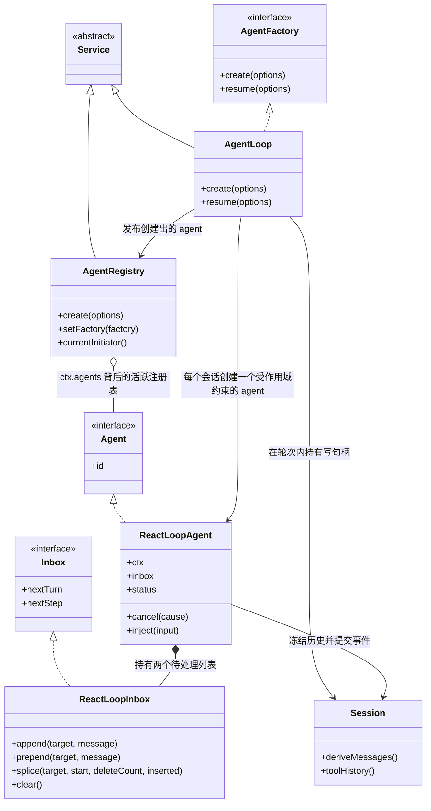

`ctx.agentLoop` 是组装中唯一的 `AgentFactory`，`ctx.agents` 是客户端与编排器读取的活跃注册表。替换驱动器就是提供另一个 `AgentFactory`，这也是 loop 能对编排保持通用的原因。

<a id="8-flow-orchestration"></a>
## 8. 流程编排

**流程编排。** 编排从不改动循环，它用入口、包装器与策略来组合循环，而这三者本身都是插件。所有编排都由三种机制完成：

- **轮次入口。** 输入来自人类消息、排队消息、注入的上下文通知或外部规则。轮次在输入被领取时打开，因此每个编排器最终都在「产出或唤醒输入」。
- **轮次包装。** `agent/pre-step` 可以改写或拒绝被领取的输入，`agent/request` 可以更换路由，`agent/turn-stopping` 可以停止轮次，`tools/*` 包装执行。拥有决策权的策略返回时不调用 `next()`，只做观察的监听器必须委托。
- **会话与 agent 创建。** fork 出的会话、委派的子 agent、由 webhook 启动的 Workspace 会话都是一个带自身作用域、inbox 与日志的新 agent；`parentSession` 与委派深度作为 lineage 数据传播，永不改变可见性。

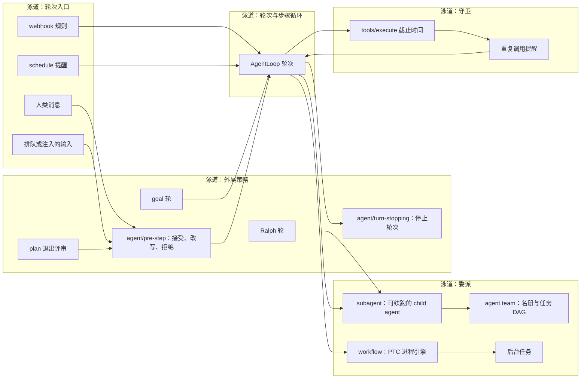

各编排家族及其接入方式：

| 机制 | 接入方式 | 文档 |
|---|---|---|
| goal 轮 | 注册 `ctx.goals`，续跑时接纳一个由 goal 发起的轮次 | [docs/subsystems/goal.zh.md](docs/subsystems/goal.zh.md) |
| schedule | 由 Host 拥有的提醒记录，作为普通对话投递 | [docs/subsystems/schedule.zh.md](docs/subsystems/schedule.zh.md) |
| plan 模式 | 仅日志的 `plan/mode` 状态加上 `exit_plan_mode` 评审流程 | [docs/subsystems/plan.zh.md](docs/subsystems/plan.zh.md) |
| subagent | `ctx.subagents` 上的具名提供方注册表 | [docs/subsystems/subagent.zh.md](docs/subsystems/subagent.zh.md) |
| agent team | 可选启用的 `ctx.agentTeams`，带持久名册与共享任务状态 | [docs/subsystems/agent-team.zh.md](docs/subsystems/agent-team.zh.md) |
| workflow | `workflow` 工具加上 PTC 进程引擎 | [docs/subsystems/workflow.zh.md](docs/subsystems/workflow.zh.md) |
| 后台任务 | `ctx.jobs` 运行时加上 `job_*` 工具 | [docs/subsystems/jobs.zh.md](docs/subsystems/jobs.zh.md) |
| webhook | 在 `ctx.webhookRuntime` 上注册可信规则，启动一个 Workspace 会话 | [docs/subsystems/webhook.zh.md](docs/subsystems/webhook.zh.md) |
| 守卫 | `tools/execute` 环绕派发加上提示性提醒 | [packages/guard/README.zh.md](packages/guard/README.zh.md) |

按会话组合能力是另一个维度：agent **preset** 从 preset `cordis.yml` 组装某个会话的工具、片段与服务，并遵循与 profile 分层相同的 patch 优先级（[packages/preset/README.zh.md](packages/preset/README.zh.md)）。

以对象表示的编排家族，loop 位于中心：

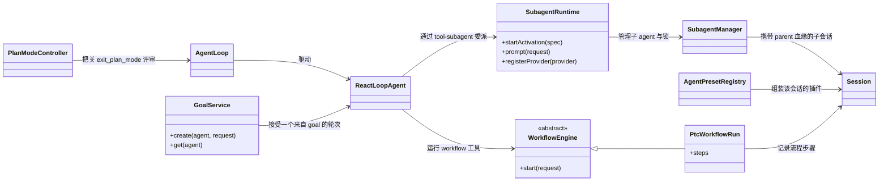

这些类没有一个在 loop 内部。每一个要么产生输入，要么通过事件包装决策，要么创建另一个 agent——这正是编排可以叠加而不侵入的原因。

<a id="9-event-mechanism"></a>
## 9. 事件机制

**事件机制。** 事件就是扩展点，而大多数改动的第一个决定是「这个事实属于哪个事件域」。

- **会话事件**是追加到日志并通过 `session/event` 广播的持久事实。当某个事实必须在重新加载后仍然存在时，使用它。
- **Agent 事件**（`agent/*`）携带活跃 `Agent`：inbox、步骤、状态、请求、验证、续跑。要观察或拦截进行中的工作时，使用它。
- **能力事件**无需导入循环即可向某个 seam（`fs/*`、`tools/*`、`telemetry/*`）附加策略和适配器。

派发模式是每个事件公共契约的一部分，通过 TypeScript 声明合并表达，并带有 `@mode` 标注，使生成的目录能校验声明与派发点是否一致：

| 模式 | 是否等待 | 派发顺序 | 有返回值 |
|---|---|---|---|
| `emit` | 否 | 监听器按注册顺序观察 | 否 |
| `waterfall` | 否 | 监听器按注册顺序观察 | 是 |
| `parallel` | 是 | 所有监听器并行观察 | 否 |
| `serial` | 是 | 监听器按注册顺序观察 | 是 |
| `bail` | 否 | 监听器按注册顺序观察，直到有人 bail | 是 |

`waterfall` 是环绕式中间件：监听器接收 `(...args, next)`，调用 `next()` 委托可能被包装的结果，不调用 `next()` 直接返回即短路。协作式监听器改写共享的决策对象后委托，而拥有单一决策事件的监听器则会主动短路。`agent/pre-step`、`agent/request`、`llm/stream` 与三个 `tools/*` 事件是瀑布式事件，`agent/turn-stopping` 是 serial 事件且没有 `next()`（[docs/cordis-primer.zh.md](docs/cordis-primer.zh.md#cordis-waterfall-semantics)）。

哪些监听器能看到某个事件取决于派发载体，而不是事件域：

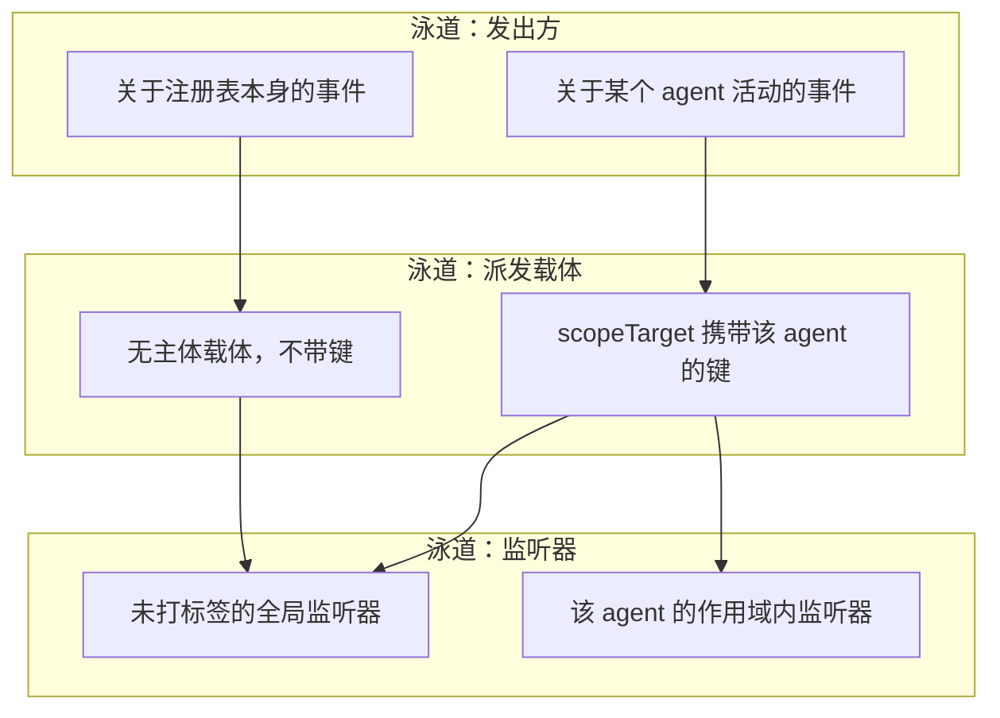

持久性是事件类型的属性，而不是事件域的属性：`turn/*`、`step/*`、`system/message`、`user/message`、`assistant/message`、`assistant/attempt` 与 `tool/*` 是持久会话事件，`agent/*` 与能力事件是实时的。`SessionEventMap` 的成员默认按「读取即必需」处理，除非信封带有 `ignorable: true`，因此较旧的读取方会拒绝未知事实，而不是误解它（[docs/subsystems/session.zh.md](docs/subsystems/session.zh.md)）。生产方与消费方清单见 [docs/event-producer-consumer.zh.md](docs/event-producer-consumer.zh.md)。

以对象表示的事件机制：

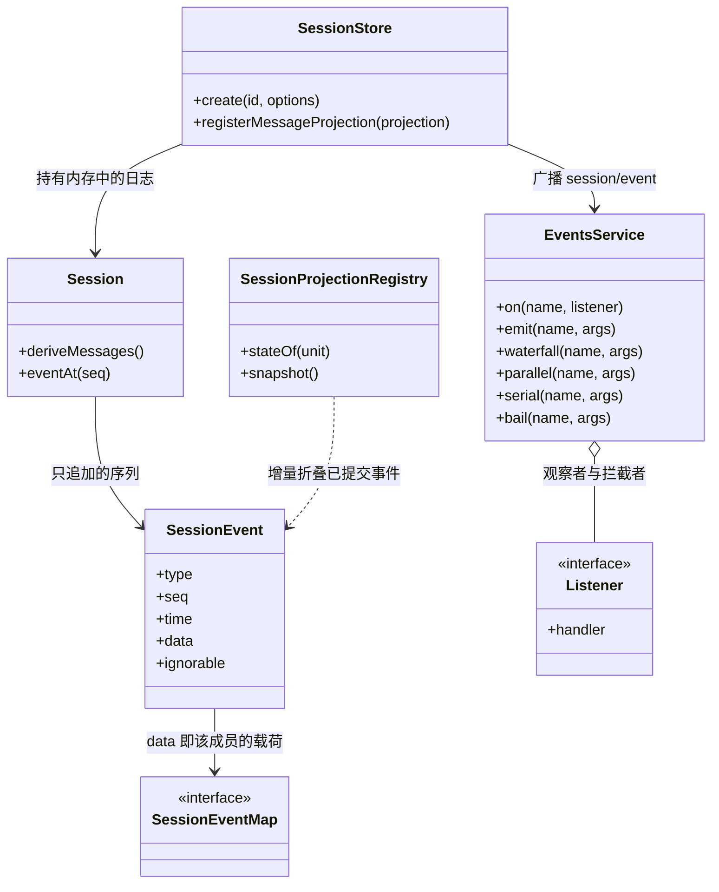

`EventsService` 与事件域无关：持久会话事件、实时 `agent/*` 事件与能力事件共用同五种分发模式，只有 `SessionEventMap` 决定其中哪些能跨重启存活。

<a id="10-session-log-and-durability"></a>
## 10. 会话日志与持久化

会话日志是 `SessionEvent` 的仅追加、带版本的序列，也是模型所见上下文的唯一来源。`deriveMessages()` 从中派生出模型历史；每个 `assistant/message` 内嵌产生其内容的紧凑计时流，而 `assistant/attempt` 保留已定局但失败、重试、取消或流式出错的尝试，且不加入模型历史（[docs/subsystems/session.zh.md](docs/subsystems/session.zh.md)）。

持久化契约：

- **存储 seam。** `SessionPersistence`（`create`/`open`/`stat`/`list`/`export`）由 JSONL 提供方实现，它拥有物理分帧、压缩、代次选择与排他发布（[docs/subsystems/persistence.zh.md](docs/subsystems/persistence.zh.md)）。
- **带版本的代次。** JSONL v0 使用 `session.jsonl[.zstd]`，v1 及以后使用 `session.vN.jsonl[.zstd]`。已提交的代次永不重命名、替换或删除。写打开会在未改动的源文件旁发布一个以版本命名的后继文件，通过一次相邻的 `vN -> vN+1` 迁移步骤完成（[docs/session-format-status.zh.md](docs/session-format-status.zh.md)）。
- **投影 seam。** `dsh-session-projection` 拥有 `ctx.sessionProjections`：注册的单元增量折叠已提交事件，消费方通过 `stateOf()` 读取一份类型化状态，客户端批量视图使用 `snapshot()`（[docs/subsystems/session-projection.zh.md](docs/subsystems/session-projection.zh.md)）。
- **插件自有的消息投影。** 修改既有消息内容的插件注册一个纯投影，脱离宿主读取的读者需要显式提供同样的定义。

<a id="11-memory-management"></a>
## 11. Memory 管理

**Memory 管理。** harness 没有单独的 memory 服务：memory 就是会话日志，加上塑造「从中读出什么」的各套机制，每套机制都有自己的所有者。四个层次可以覆盖全貌。

- **持久记忆 —— 会话日志。** 任何值得记住的事实都是日志中的一个事件：用户与助手消息、工具调用与结果、压缩记录、附件、工作目录变更、goal、todo。日志以带版本的 JSONL 代次写入，配合由 loop 拥有的写句柄，因此重启、replay、fork、resume 与导出读到的都是同一份记录（[docs/subsystems/persistence.zh.md](docs/subsystems/persistence.zh.md)）。
- **工作记忆 —— 派生历史。** 请求的历史是在日志上跑 `deriveMessages()`，再经可见面操作与消息投影过滤，然后为该请求冻结。因此工作记忆是计算出来的，而不是 loop 持有的可变缓存。
- **载荷记忆 —— 附件与 spill。** 大体积内容放在对话记录之外：图片在内容寻址存储中获得持久身份并被消息引用，过大的工具结果被 spill 到存储并替换为一个带检索指引的定位符。两者都让日志保持可读，同时保留完整原文（[packages/attachment/README.zh.md](packages/attachment/README.zh.md)、[packages/spill/README.zh.md](packages/spill/README.zh.md)）。
- **压缩 —— compaction。** `ctx.compaction` seam 在 token 压力上升时缩减历史：自动摘要较早的历史、按需 `/compact`、裁剪过大的工具输出，以及当路由不再接受图片时的图片卸载。compaction 是一项可选能力而非 loop 脊柱的一部分，它把 `compaction/start`、`compaction/summary`、`compaction/end` 记录为仅日志事件，并由一条记录在日志中的锁包围，摘要本身通过一次可见面替换生效（[docs/subsystems/compaction.zh.md](docs/subsystems/compaction.zh.md)）。

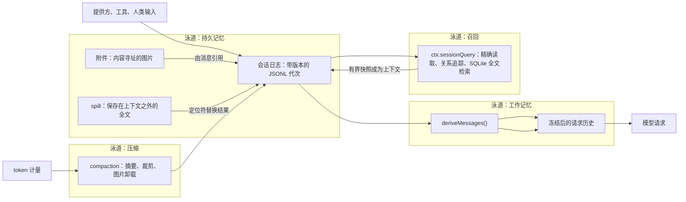

<a id="memory-storage-format"></a>
### 存储格式

四层记忆里只有持久记忆与载荷记忆会落到磁盘；工作记忆由日志派生，压缩以事件记录在同一个日志中，检索索引是可重建的派生产物。

**会话日志（JSONL）。** 每个会话一个目录，路径由持久化根、可读项目目录键与会话 id 组成：

```text
<root>/
  --<normalized-cwd>--/           # 可读项目目录；无 cwd 时为 _no-cwd/
    <escaped-session-id>/         # 会话自有目录，id 经 ~XXXX 单射转义
      session.vN.jsonl.zstd       # 当前代际，默认带校验和的 Zstandard 帧
      session.vN.jsonl            # compression: 'none' 时的原始 UTF-8 行
      session.lock                # 写者咨询锁，释放时保留
```

首行是 header 记录，与事件日志分开存储，不进入 `SessionEventMap`：

```json
{"type":"session","version":4,"id":"...","createdAt":1750000000000,"cwd":"/abs/path","isSeeded":false,"delegationDepth":0}
```

可选字段为 `parentSession`、`origin: "subagent"` 与 `agentPreset`；`isSeeded` 的继承切点由最后一个带标记的 `session/end-seed` 事件推导，不写成 header 的数字字段。

其后每行一个事件：

```json
{"type":"user/message","seq":12,"time":1750000000123,"data":{...},"surfaceOp":"append"}
```

`type`、`seq`、`time`、`data` 是所有事件的共有字段；未知事件只有在带有 `ignorable: true` 时才可被较旧的读取方跳过。产生模型消息的事件（`system/message`、`developer/message`、`user/message`、`assistant/message`、`tool/result`）额外携带 `surfaceOp`（`'append'` 或 `{op: 'replace', startSeq, endSeq}`），除 `assistant/message` 外的可见事件还可携带 `sourceEventSeqs` 引用更早的来源事件；连续至少三个序号在磁盘上压缩为 `[start, end]` 区间对，读取时展开回精确数组。

物理编码默认把 header 帧与每个 append 批次各编成一个独立、带校验和的 Zstandard 帧并顺序拼接；`compression: 'none'` 保留相同行结构而不压缩。`append` 解析时只承诺批次已受理，`flush` 才是持久性屏障。撕裂的尾部只贡献其中完整解码的记录，写句柄在第一次新 append 前截掉并重写；代际文件名与内部 `version` 一致，已提交代际永不重命名、替换或删除，迁移在未改动的源文件旁发布 `vN+1` 后继。压缩把 `compaction/start`、`compaction/summary` 与 `compaction/end` 记录为同一个日志中的事件，摘要通过一次可见面替换生效。

**附件对象。** 图片与通用文件都按内容寻址存放，`sha256` 是唯一身份：

```text
<DSH_HOME>/attachments/v1/
  objects/<sha256-prefix>/<sha256>            # 规范化的图片对象
  file-objects/<digest-prefix>/<digest>       # 原始文件字节
  files/<digest-prefix>/<digest>/<name>       # 每条引用一个只读硬链接
  tmp/                                        # 写入暂存区
```

图片先暂存到 `v1/tmp` 并 `fsync`，再以原子且排他的硬链接发布；相同字节只存一份，展示名与 `originalDimensions` 只保留在引用中，不参与对象校验。

**spill 文件。** 超出上下文的工具结果写到会话级私有文件：

```text
<root>/session-<hash>/<random>-<safe-name>
```

`session-<hash>` 是会话 id 的短哈希，`<random>` 是不可预测前缀，`<safe-name>` 把不可信建议名转义为单个安全路径段；文件以 `0600` 排他创建，返回的定位符就是该路径。

**检索索引。** SQLite 全文索引是独立、可丢弃的派生数据库，不与会话日志共用路径：应用 id 为 `0x44534851`，schema 版本为 8，表 `search_state`、`persisted_sessions` 与 FTS5 虚拟表 `persisted_docs`（`unicode61` tokenizer）保存持久历史；连接本地 TEMP 表 `live_sessions` 与 `live_docs` 遮蔽同一会话的实时状态。schema 版本不匹配时整库就地重置，绝不触碰其他数据库。

工作记忆没有磁盘格式：`deriveMessages()` 每次从日志重算，并只在一次请求期间冻结。

检索被有意设计成与压缩相互独立：`ctx.sessionQuery` 提供精确事件读取、过滤列表、关系追踪与基于 SQLite FTS5 的全文检索，覆盖活跃与持久历史，因此「查一下」不需要把内容留在上下文里（[packages/session-query/README.zh.md](packages/session-query/README.zh.md)）。

Memory 相关对象，每层一个归属者：

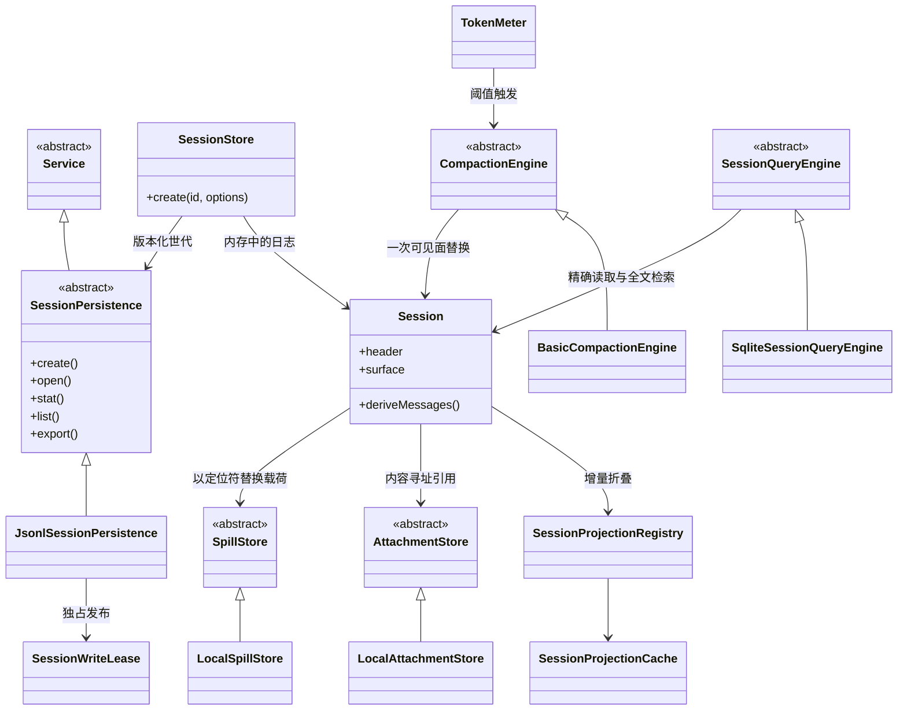

每个抽象类都是一个可替换提供方的 Service Definition，因此改变 memory 层是注册另一个提供方，而不是修改 loop。

<a id="12-context-management"></a>
## 12. 上下文管理

**上下文管理。** 上下文是「一次请求除了模型自身输出之外携带的内容」，harness 把它分成三个持久性不同的层次，使插件可以改变其中一层而不扰动其他层。

- **系统提示词（稳定）。** 注册在 `ctx.systemPrompt` 上的提示词片段每次请求都被协作式组装 —— 片段按 order 与名称排序，工具提供方贡献 schema，变量会插值，最多只有一个 `complete` 片段可以胜出。渲染后的文本作为 `system/message` 可见面节点提交，而不是请求字段，因此提示词以派生历史的形式抵达模型，具备相应能力的路由可以把更新追加在缓存历史之后，而不是重写它（[docs/subsystems/system-prompt.zh.md](docs/subsystems/system-prompt.zh.md)）。
- **持久上下文（已记录）。** 注入的指令与引用 —— 工作区 `AGENTS.md` 指引、被引用的会话快照、`@file` 提及 —— 以用户角色消息进入历史，因此它们像其他对话内容一样持久、可 replay、可被压缩。这正是「模型可见 ⟺ 已记录」对上下文成立的原因（[packages/context/README.zh.md](packages/context/README.zh.md)）。
- **运行时上下文（按尝试）。** 例如当前时间或 agent 的 tmux 位置这类事实，会为每次尝试刷新，默认纳入模型历史，并且可以按 persona 作用域单独配置；即使可选快照被抑制，必需上下文仍然保留。它们以持久的 `runtime-context` 形式记录，因此 resume 后的请求仍能重建模型当时看到的内容（[docs/config-catalog.zh.md](docs/config-catalog.zh.md)）。

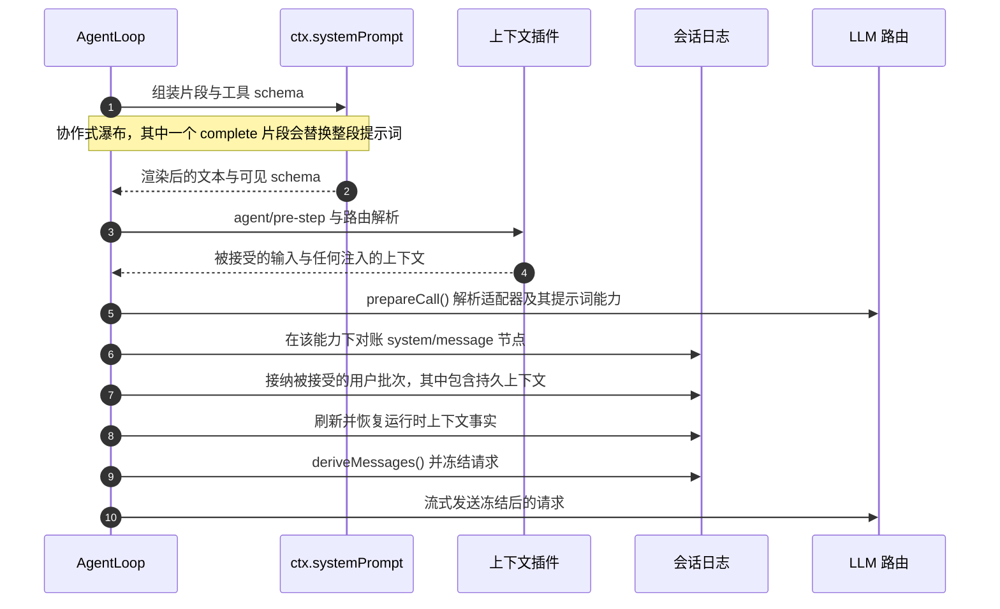

token 压力在「组装上下文的地方」处理，而不是在提供方内部：token 计量器测量请求，当测量越过配置阈值时，compaction 在日志上动作。因为提示词是一个可见面节点，未变动的提示词不产生事件，只有在 prepared call 的路由无法追加更新时才会做归并（[packages/core/agent-loop/README.zh.md](packages/core/agent-loop/README.zh.md)）。

上下文相关对象，每层持久性一个：

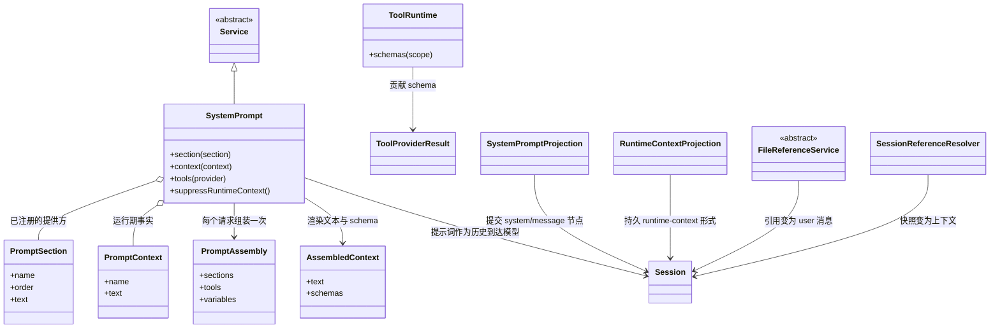

这里能看出三层持久性：`PromptSection` 与 `PromptContext` 是每请求输入，`AssembledContext` 是冻结后的渲染结果，而任何必须跨重启存活的内容都会以 `system/message`、`user/message` 或 `runtime-context` 记录落到日志里。

<a id="13-tools"></a>
## 13. 工具

工具是面向模型的消费方。每个工具在 `ctx.tools` 上注册一个 `ToolDefinition`，其 schema 由类型化 DSL 构建；该 schema 参与提示词组装，工具还可以为客户端贡献一份 UI 呈现契约（[docs/subsystems/tools.zh.md](docs/subsystems/tools.zh.md)、[docs/tool-catalog.zh.md](docs/tool-catalog.zh.md)）。

执行经过带把关的流水线（`tools/pre-execute` → 单调守卫 → `tools/execute` → `tools/post-execute` → `tools/result`），让策略、审批、沙箱、截止时间、结果改写与 UI 渲染无需触碰循环即可接入。强制发生在做出该决策的操作内部：schema 省略、提示词过滤或监听器顺序，在其他调用方可以绕过时都不构成强制。定义自有的 `projectContent` 在 post-execute 之前安装准备好的内容，`finalizeContent` 施加最后一道仅内容不变式，而 `tools/result` 在注册表把任何流水线失败归一化为错误结果之后，通知冻结的权威结果（[docs/tool-execution-pipeline.zh.md](docs/tool-execution-pipeline.zh.md)）。

工具调用在步骤内被调度：独占调用构成顺序屏障，并行安全的调用使用有界滚动池，因此会修改共享状态的调用族可以声明自己为独占，而只读调用可以重叠（[packages/core/agent-loop/README.zh.md](packages/core/agent-loop/README.zh.md#一个步骤做什么)）。

<a id="14-model-facing-surface"></a>
## 14. 模型可见面

模型所见的内容由彼此独立的贡献方按请求组装而成：

- 注册在 `ctx.systemPrompt` 上的**提示词片段**，被协作式组装并记录为 `system/message` 历史。
- 来自作用域化工具注册表的**工具 schema**，按 agent 的限制会过滤全局集合，作用域内注册会遮蔽同名全局注册。
- 来自 `context` 插件与 `agent.inject()` 调用的**请求上下文**，落入下一个被接纳的请求。
- **技能**：按发现优先级排列的提供方注册表，暴露一份目录和一个面向模型的加载器（[docs/subsystems/skills.zh.md](docs/subsystems/skills.zh.md)）。
- **附件、spill 与压缩决策**，各自拥有持久身份与事件。

它们的契约都从模型的视角书写：提示词、schema、结果与诊断只包含任务相关概念，绝不包含 UI、传输或实现词汇；稳定的模型可见文本逐字固定，动态行为由快照或端到端测试覆盖（[packages/AGENTS.md](packages/AGENTS.md)）。

<a id="15-clients-transports-and-sdks"></a>
## 15. 客户端、传输与 SDK

核心与载体无关，每个载体挂载的是同一套由 profile 组装的插件。

- **Web。** `apps/cli` 通过 [§6](#6-interface-calls-services-scopes-and-remote-calls) 描述的 Host/Remote 线路，提供由 `packages/client/*` UI 插件组成的 Vite 构建 React 外壳（`apps/web`）。客户端 UI 由类型化 Slot 与 Conversation 节点定义组合，产品文案归 locale 所有（[docs/subsystems/web-client.zh.md](docs/subsystems/web-client.zh.md)、[docs/subsystems/conversation.zh.md](docs/subsystems/conversation.zh.md)）。
- **Desktop。** Electron 应用把自身的 dsh 运行时打包进已签名资源，启动私有的 Desktop Host，并在同一个 document 中加载打包好的 Web 应用（[docs/architecture.zh.md#desktop-application](docs/architecture.zh.md#桌面应用)）。
- **Headless 与 SDK。** `headless` 不带服务器运行一个任务，`sdk` 暴露带 TypeScript 客户端/服务端的 JSON-RPC 协议（[docs/subsystems/typert.zh.md](docs/subsystems/typert.zh.md)）。Python SDK 打包 CLI 运行时 wheel 并启动 `dsh --profile sdk`（[python/README.zh.md](python/README.zh.md)）。
- **自动化。** `acp` 提供仅用于自动化的 Agent Client Protocol 服务（[packages/acp/README.zh.md](packages/acp/README.zh.md)）。
- **远程 BFF。** `packages/api` 组装远程部署使用的 Typert RPC 网关（[docs/api-gateway.zh.md](docs/api-gateway.zh.md)）。

<a id="16-repository-layout"></a>
## 16. 仓库结构

```text
vendor/      vendored Cordis (rescoped, private)
packages/    342 workspaces, @deepseek-ai/dsh-<pkg>, grouped by capability family
apps/        cli, web, desktop, desktop-host, plugin-market-generator
native/      @deepseek-ai/node-addon-system source
python/      Python SDK and runtime
docs/        architecture, subsystems, cookbooks, guides, generated catalogs
snapshots/   keyless recorded-session replay fixtures
website/     VitePress documentation projection
scripts/     gates, generators, release tooling
```

每个包都是 ESM（`"type": "module"`），恰好属于一个分组，并列入该分组的 README。包级规则 —— 导出形式、服务访问、测试位置、README 契约 —— 见 [packages/AGENTS.md](packages/AGENTS.md)。

<a id="17-engineering-conventions-and-quality-gates"></a>
## 17. 工程约定与质量闸门

仓库把不变式当作可执行的闸门，而不是评审约定（[scripts/](scripts/)、[docs/development.zh.md](docs/development.zh.md)）。

- **类型。** 全仓库 `strict: true`；跨边界的不透明 id 使用 branded 类型；不新增 `as unknown` 断言。
- **测试。** 单元测试按包就近放置；CI 覆盖率闸门是 `test:coverage`（而不是 `test`），要求 `packages/*/*/src` 逐文件 100%；产品可见的插件需要能通过 Loader 启动 `cordis.yml` 的真实组装测试。
- **快照。** 每一项非平凡的、模型或产品用户可见的改动，都要更新一个无密钥的录制会话快照，它通过随发行的 profile 回放。
- **文档。** Markdown 每个段落占一个物理行，链接必须可解析，粘贴的类型声明与源码做漂移校验，常青文档有字数预算。
- **生成式参考。** 工具、配置、持久化、CLI、Cordis 与模块图目录都从源码生成，并在 CI 中做新鲜度校验。
- **持久化纪律。** 每一项外部可感知的破坏性变更都立即记入升级指南，持久化类型变更需要一条确认记录。

<a id="18-extending-the-harness"></a>
## 18. 扩展方式

新行为接入既有的扩展点；改动循环本身则要同步更新架构地图。

| 目标 | 机制 |
|---|---|
| 新增模型提供方 | 在 `ctx.llm` 上注册其适配器 |
| 新增面向模型的能力 | 在 `ctx.tools` 上注册，其 schema 参与提示词组装 |
| 让某个会话拥有不同的能力集 | 组装一个 agent preset |
| 新增 shell、终端或文件系统执行 | 注册 `ctx.shell`、`ctx.terminals` 或 `ctx.fs` 后端 |
| 新增人类命令 | 在 `ctx.commands` 上注册 |
| 拦截请求、工具或轮次 | 使用对应的 `agent/*` 或 `tools/*` 事件 |
| 新增面向模型的上下文 | 调用 `agent.inject()` |
| 新增 UI 或编辑器集成 | 驱动 `ctx.agents`，把 Host 方法暴露为 Remote，并从 `session/event` 渲染 |
| 新增持久会话状态 | 扩展 `SessionEventMap`，从日志渲染与回放 |
| 用新后端存储会话 | 在共享句柄脚手架之上实现 `SessionPersistence` |
| 从外部系统启动会话 | 在 `ctx.webhookRuntime` 上注册可信规则 |

逐步操作指南见 [docs/cookbook/extension-cookbook.zh.md](docs/cookbook/extension-cookbook.zh.md)（包、工具、LLM 适配器、设置卡片）。

<a id="19-tradeoffs-and-known-limitations"></a>
## 19. 权衡与已知限制

- **pre-stable 的 API。** 公共 API 变更时要求所有消费方同步更新；格式通过版本化与迁移演进，而不是冻结。
- **组装深度。** 插件组装能力很强，但要求读者掌握「profile 加 patch」的心智模型；`dsh --profile web --dump-config` 就是为让解析后的树可检查而存在的。
- **调用路径的间接性。** 远程调用经过生成的描述符与网关，换来类型安全与可替换性，代价是多一跳的阅读成本。
- **闸门负担。** 逐文件 100% 覆盖率、生成目录新鲜度与双语文档配对会抬高小改动的成本；仓库通过「推送前只跑覆盖本次改动的最小检查集」来缓解。
- **实验性接口。** `packages/experimental/*` 中的能力不承诺产品级支持（[packages/experimental/README.zh.md#status](packages/experimental/README.zh.md#status)）。
- **平台矩阵。** fixture 在 macOS 与 Linux 上回放；Windows 特有行为通过独立闸门诊断，而不是默认等价。
